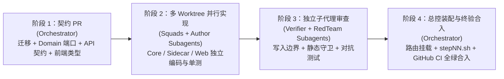

# xBlueNode / AxPoint 分步、多团队、多分支与多 Subagent 协同宪章

本文档规定 `xBlueNode / AxPoint` Monorepo 在推进分步实施方案（见 [plans/README.md](../plans/README.md)）时的**多团队分工、三级代理（Orchestrator / Squad Lead / Subagent）拓扑、多 Git Worktree 分支隔离、并发测试环境隔离与合并审查纪律**，与根目录 [IRON_RULES.md](../IRON_RULES.md) 及 [QUALITY_GATES_AND_VERIFICATION.md](./QUALITY_GATES_AND_VERIFICATION.md) 配套强制执行。

---

## 1. 三级协同拓扑与独占写入边界

研发组织采用 **「L1 架构总控 × L2 五大领域分队 × L3 职责隔离子代理」** 三级协同结构。规模较小时可合并分队，但**公共入口独占原则**与**编写/审查分离原则**不可豁免。

### 1.1 L1 与 L2 分队职责及文件所有权锁表

此表由 `scripts/check-write-scope.sh` 自动强制核验：

| 角色标识（`--role`） | 角色/分队名称 | 独占写入路径白名单 | 负责领域（Step 00～22） |
| :--- | :--- | :--- | :--- |
| `orchestrator` | **L1 架构总控与契约官** | `IRON_RULES.md`、`AGENTS.md`、`GEMINI.md`、`CLAUDE.md`、`.agents/`、`README.md`、`.github/`、`docs/`、`plans/`、`deploy/migrations/`、`deploy/docker*`、`deploy/k8s/`、`axpoint-core/Cargo.toml`、`axpoint-core/Cargo.lock`、`axpoint-core/{rust-toolchain,clippy}.toml`、`axpoint-core/crates/axpoint-domain/src/{lib.rs,ports.rs,enums.rs}`、`axpoint-core/crates/axpoint-db/src/lib.rs`、`axpoint-core/crates/axpoint-server/src/{main.rs,state.rs,routes/mod.rs}`、`xbluenode-web/src/{App.tsx,modules/meta.ts,modules/registry.ts,lib/api/enums.ts}`、`scripts/{naming-guard.sh,lint-guard.py,web-guard.py,python-guard.py,hallucination-guard.py,docs-and-plans-guard.py,check-write-scope.sh,check_routes.py,check_traceability.py}`、`scripts/gate/{lib.sh,all.sh}` | 各 Step 的契约 PR、迁移编号分配、全局装配挂载、门禁定义与最终合入审查 |
| `squad-data` | **L2 数据与出品分队** | `axpoint-parser/`、`axpoint-core/crates/axpoint-domain/src/{axhub.rs,export.rs}`、`deploy/collectors/`、`scripts/seed/01-*`、`scripts/seed/02-*`、`scripts/seed/12-*` | 双轨解析（AxParser）、连接器与数据湖（AxHub）、全格式出品与服务端图表、Python PII 识别 |
| `squad-analytics-guard` | **L2 分析、无幻觉问数与安全分队** | `axpoint-core/crates/{axpoint-analytics,axpoint-security}/`、`axpoint-core/crates/axpoint-domain/src/{analytics.rs,guard.rs,algo/}`、`axpoint-core/crates/axpoint-db/src/{hub_repo.rs,graph_repo.rs,analytics_repo.rs,rules_repo.rs,guard_repo.rs}`、`axpoint-core/crates/axpoint-server/src/routes/{axhub.rs,analytics.rs,documents.rs,axguard.rs}`、`tests/cassettes/` | 图存储、DuckDB OLAP、语义层、本体接地防幻觉问数（Step 04/16）、引用核验、AxGuard 全栈安全治理 |
| `squad-domain-agent` | **L2 建模、编排、智能体与推演分队** | `axpoint-core/crates/{axpoint-llm,axpoint-flow,axpoint-agent}/`、`axpoint-core/crates/axpoint-domain/src/{agent.rs,flow.rs,graph.rs,ops.rs,rules.rs,topology.rs,view.rs,expr/,rollup/,sim/,studio/}`、`axpoint-core/crates/axpoint-db/src/{studio_repo.rs,flow_repo.rs,agent_repo.rs,sim_repo.rs,view_repo.rs,ops_repo.rs}`、`axpoint-core/crates/axpoint-server/src/routes/{xblue.rs,xblue_graphql.rs,axflow.rs,axagent.rs,published.rs,mcp.rs,axsim.rs,xblueview.rs,axops.rs}`、`templates/packs/`、`scripts/ops/` | 多模型受限解码（Step 15）、xBlueStudio 建模与血缘/规格书（Step 05/06/18）、AxBuilder 构建态 MCP（Step 17）、AxFlow、AxAgent 与 IM 双向连接（Step 09/21）、AxSim 预检与推演（Step 10/20）、xBlueView 服务端与 AxOps |
| `squad-web` | **L2 前端工作台与交互分队** | `xbluenode-web/src/{pages/,components/,lib/api/,i18n/,styles/,lib/theme.ts,lib/sse.ts,lib/permissions.ts,lib/utils.ts}`（不含 `App.tsx`、`modules/meta.ts`、`modules/registry.ts`、`lib/api/enums.ts` 四个总控入口）、`xbluenode-web/package.json`、`xbluenode-web/package-lock.json` | 全部模块的 `100vh` 工作台界面、组件原语、双语微文案、可视化画布与交互体验（Step 00～22 前端） |
| `squad-qa` | **L2 门禁、评测与端到端验收分队** | `xbluenode-web/e2e/`、`scripts/gate/step*.sh`、`scripts/seed/`、`scripts/bench/`、`scripts/demo/`、`tests/` | Playwright 冒烟与全旅程 E2E、分步门禁补充断言、性能基准与无幻觉红队回归集 |

### 1.2 L3 分队内多 Subagent 职责分离规范

任何分队主代理在执行复杂 Step 时，按以下四类专业子代理拆分任务，**严禁由编码子代理自行充当最终验收官**：

1. **`Research Subagent`（只读上下文调研员）**：仅授予文件读取与代码检索权限。负责梳理上游 `axpoint-domain` 端口签名、现有数据库表结构、关联 API 契约与测试夹具，输出精确到文件行号的影响面报告。
2. **`Author Subagent`（受限写入实现员）**：仅授予本分队且属于当前子任务的最小文件子集写入权。若编码过程中发现 `axpoint-domain/src/ports.rs` 缺少方法或需修改公共路由表，**必须立即停止越界修改并上报分队主控**，由 L1 总控补发契约修订。
3. **`Verifier Subagent`（独立门禁与质量审查员）**：在新会话上下文中启动，不共享 `Author` 的主观假设。负责运行 `check-write-scope.sh`、全套静态守卫、编译器/Clippy/Mypy/Build 检查与对应单测，逐项核对 [API_CONTRACT.md](./API_CONTRACT.md) 字段一致性。
4. **`RedTeam Subagent`（安全与反幻觉对抗测试员）**：针对涉及 SQL、连接器、权限脱敏或大模型调用的改动，专门构造越权租户读取、PII 泄露、虚构列名/虚构指标/篡改总结数值/越界引用角标等对抗输入，验证拦截率 100%。

---

## 2. 多分支与多 Git Worktree 物理隔离规约

严禁多个团队或多个并行 Agent 在同一克隆目录中反复 `git checkout` 切换分支（会导致 Rust `target/` 增量编译缓存失效、`node_modules` 锁冲突及未提交更改相互污染）。

### 2.1 分支命名与生命周期
- 受保护主干：`main`（禁止直接 `push`，仅接收通过 GitHub Actions 全量检查的 PR）。
- 契约分支：`feat/contract-step<NN>-<slug>`（由 `orchestrator` 创建并先行合入）。
- 实现分支：`feat/<squad>-step<NN>-<topic>` 或缺陷修复分支 `fix/<module>-<topic>`。
- 生命周期：每个分支聚焦单一 Step 的单一分队交付，PR 合入 `main` 后立即删除远程分支、本地分支与对应 `git worktree`。

### 2.2 Worktree 标准目录布局

```bash
# 主仓库目录仅由 L1 总控驻留，始终保持与 origin/main 同步
cd /path/to/xBlueNode
git fetch --all --prune && git pull --ff-only

# 为并行分队创建独立物理工作树（置于主目录同级）
git worktree add ../wt-data-step17      -b feat/data-step17-template-sync      main
git worktree add ../wt-analytics-step16 -b feat/analytics-step16-grounded-ask  main
git worktree add ../wt-domain-step15    -b feat/domain-step15-guided-decoding  main
git worktree add ../wt-web-step18       -b feat/web-step18-studio-copilot      main
```

若配置了共享 `SCCACHE` 或 `CCACHE_DIR` + `CCACHE_BASEDIR`（参照 [.github/workflows/ci.yml](../.github/workflows/ci.yml)），多个 Worktree 可安全复用 C/C++（`libduckdb`）编译缓存，大幅缩短首次编译耗时。

### 2.3 同机并发测试的数据库与端口隔离协议

当多个分队在同一台开发机或远程测试主机（如共享集成服务器）并发执行测试时，必须按 Worktree 隔离数据库与监听端口，禁止争抢默认的 `xbluenode` 库、`8001` 端口与 `9995` 端口：

| Worktree 槽位 | PostgreSQL 库名 | Sidecar 端口 (`PARSER_BASE_URL`) | Core 端口 (`AXPOINT_BIND_ADDR`) | Metrics 端口 (`AXPOINT_METRICS_ADDR`) |
| :--- | :--- | :--- | :--- | :--- |
| 主门禁槽（串行终验 `all.sh`） | `xbluenode` | `127.0.0.1:8001` | `127.0.0.1:9995` | `127.0.0.1:9464` |
| 并发槽 #1 (`WT_SLOT=1`) | `xbluenode_wt1` | `127.0.0.1:18001` | `127.0.0.1:19995` | `127.0.0.1:19464` |
| 并发槽 #2 (`WT_SLOT=2`) | `xbluenode_wt2` | `127.0.0.1:28001` | `127.0.0.1:29995` | `127.0.0.1:29464` |
| 并发槽 #3 (`WT_SLOT=3`) | `xbluenode_wt3` | `127.0.0.1:38001` | `127.0.0.1:39995` | `127.0.0.1:39464` |
| 并发槽 #4 (`WT_SLOT=4`) | `xbluenode_wt4` | `127.0.0.1:48001` | `127.0.0.1:49995` | `127.0.0.1:49464` |

最终合入前的 `scripts/gate/stepNN.sh` 与 `scripts/gate/all.sh` 统一在干净的主门禁槽上顺序执行（切换前执行 `bash scripts/dev-down.sh` 释放进程）。

---

## 3. 分步推进的四阶段标准闭环（SOP）

无论是推进 `plans/v2-ux-and-grounded-ai/` 中的 Step 15～22，还是未来新增演进阶段，每个依赖层（Layer）严格执行四步闭环：



1. **阶段 1 — 契约先行合入（Contract PR）**：
   - `orchestrator` 按目标 Step 方案合入：`deploy/migrations/NNNN_*.sql`、`axpoint-domain` 类型与端口、`docs/API_CONTRACT.md`、`docs/standards/{A1,A2,A4,A6,A7}` 增量、`axpoint-parser/schemas.py`、`xbluenode-web/src/lib/api/<module>.ts` 接口类型及 `scripts/gate/stepNN.sh`。
   - 同一依赖层含多个并行 Step 时，各契约 PR 按迁移编号从小到大依次合入 `main`。
2. **阶段 2 — 多分支无阻塞并行实现（Parallel Implementation PRs）**：
   - 各分队基于最新 `origin/main` 拉出各自 Worktree。后端面向 `axpoint-domain` Trait 编写实现与单测；前端基于已合入的 `lib/api/<module>.ts` 类型与本地夹具并行构建组件与交互，前后端零等待。
   - 后端执行者在各自 `src/routes/<module>.rs` 内导出 `pub fn router(...) -> Router<AppState>`，不在实现分支内直接改动 `main.rs` 或 `routes/mod.rs`，在 PR 说明中附上挂载声明。
3. **阶段 3 — 独立审查与远程测试机联调（Independent Verification）**：
   - 启动 `Verifier Subagent` 运行 `bash scripts/check-write-scope.sh <role> origin/main...HEAD` 及 G1 + G2 全套检查。
   - 如本机缺少完整数据库或浏览器环境，通过 `rsync` 或 Git 分支同步至共享测试主机的独立工作目录运行完整数据库迁移、Rust 集成测试与门禁脚本。
4. **阶段 4 — 装配挂载、GitHub CI 终验与清理（Integration & Merge）**：
   - `orchestrator` 完成 `AppState` / `routes/mod.rs` / `registry.ts` 装配（如新增顶层模块），跑通 `stepNN.sh` 与 `all.sh` 回归，推送 PR 等待 GitHub Actions 全作业（`naming-guard`、`rust-core`、`python-parser`、`web-frontend`）全绿后合入 `main`。
   - 某阶段全部 Step 验收完毕后，将该阶段方案目录整体移入 `plans/completed/` 封存归档。

---

## 4. 标准多代理派发提示词模板

### 4.1 派发 L1 总控执行「契约 PR」

```markdown
角色：xBlueNode / AxPoint 架构总控（orchestrator）。
必读：`IRON_RULES.md`、`AGENTS.md`、`docs/MULTI_AGENT_TEAM_WORKFLOW.md`、`docs/standards/A1-CONVENTIONS-ENUMS-ROUTES.md` 以及目标方案文件 `{PLAN_STEP_FILE}`。

任务：仅交付 Step {STEP_ID} 的契约 PR（分支 `feat/contract-step{STEP_ID}-{SLUG}`），不写具体业务实现：
1. 创建幂等迁移 `deploy/migrations/{MIGRATION_FILE}`（带 `tenant_id` 的新表末尾调用 `ax_enable_tenant_rls`），同步登记 `docs/standards/A2-DATABASE-MIGRATIONS-INDEX.md`。
2. 在 `axpoint-domain` 定义本 Step 的纯领域 DTO、错误码与端口 Trait（返回 `impl Future + Send`），同步更新 `docs/standards/A1-CONVENTIONS-ENUMS-ROUTES.md`（如有新增枚举/权限）。
3. 更新 `docs/API_CONTRACT.md`、`axpoint-parser/schemas.py`（如涉及 Sidecar）与 `xbluenode-web/src/lib/api/{MODULE}.ts` 强类型签名。
4. 按方案验收小节落地 `scripts/gate/step{STEP_ID}.sh`。
5. 运行 G1 全部静态守卫与 G2 编译检查全绿后提交，并输出后续可并行派发给各 Squad 的任务拆分单与 `ALLOWED_PATHS`。
```

### 4.2 派发 L3 实现子代理（Author Subagent）

```markdown
角色：`{SQUAD_ROLE}` 旗下的实现子代理（Author Subagent），工作目录 `{WORKTREE_PATH}`，分支 `{BRANCH_NAME}`。
必读：`AGENTS.md`、目标栈子目录 `AGENTS.md`、`{PLAN_STEP_FILE}`、`docs/API_CONTRACT.md`。

授权写入范围：仅限 `{ALLOWED_PATHS}`。严禁触碰任何总控独占公共入口文件与他队目录；若发现上游端口或 DTO 缺失，立即停止并报告所需签名。

质量与防幻觉红线：
- 100% 使用自主命名词表；
- Rust 零豁免（禁用 `unsafe`、`#[allow]`、`unwrap`、`expect`、`as` 转换、切片下标、`let _ =`）；
- Python 强制 `from __future__ import annotations`、`mypy --strict`、SQL 参数化 + 标识符白名单；
- Web 强制 TS Strict 零 `any`、复用 `primitives.tsx`、双语 `tx()` 与极简微文案；
- 涉及 AI 调用必须接入 PII 出域过滤、确定性编译/Schema 受限解码与后置接地核验。

完成标准：贴出 `bash scripts/check-write-scope.sh {SQUAD_ROLE} origin/main...HEAD`、G1 静态守卫与本栈 G2 编译及单测全绿的真实终端输出。
```

### 4.3 派发 L3 独立审查子代理（Verifier Subagent）

```markdown
角色：独立验收审查子代理（Verifier Subagent），只读审查分支 `{BRANCH_NAME}`（基准 `origin/main`）。
必读：`IRON_RULES.md`、`docs/QUALITY_GATES_AND_VERIFICATION.md`、`{PLAN_STEP_FILE}`。

逐项核验并给出带文件行号证据的 `PASS / BLOCK` 报告：
1. 越界核验：`bash scripts/check-write-scope.sh {SQUAD_ROLE} origin/main...{BRANCH_NAME}` 通过。
2. 静态守卫：`naming-guard.sh`（若配置密钥词表）、`lint-guard.py`、`web-guard.py`、`python-guard.py`、`hallucination-guard.py`、`docs-and-plans-guard.py`、`check_routes.py`、`check_traceability.py` 全部返回 `0`。
3. 契约与安全对齐：请求/响应结构、状态码、错误码与 `docs/API_CONTRACT.md` 完全一致；租户 RLS 隔离、三道 PII 脱敏与无幻觉后置核验无遗漏。
4. 运行验证：对应栈单测、文档测试与 `scripts/gate/step{STEP_ID}.sh`（如已装配集成）全绿，且 `git status` 无任何构建缓存或临时文件残留。
```
