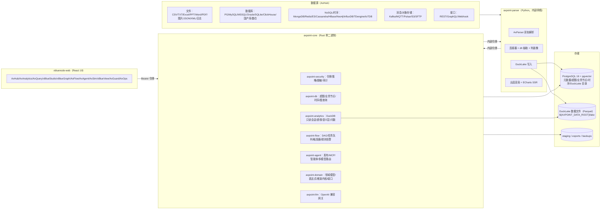
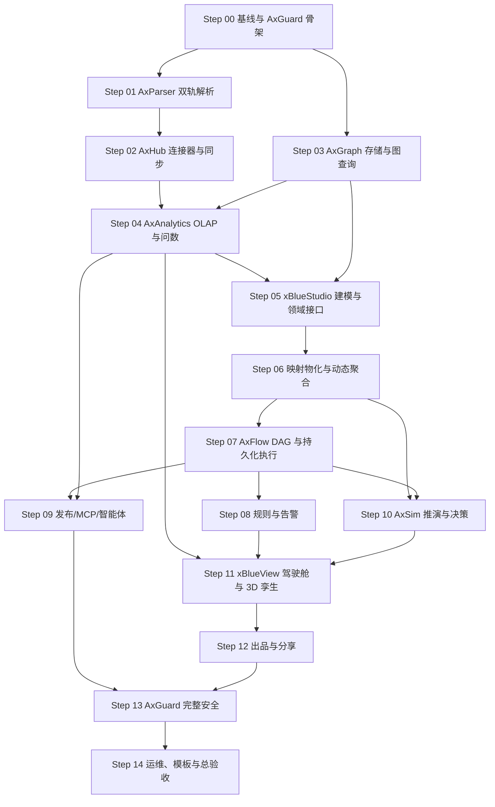

# xBlueNode / AxPoint 工程落地总蓝图（总索引）

本文件是 `docs/blueprint/` 的**唯一入口**。它给出平台定位、目标架构、仓库基线、目标目录、全部文件与步骤索引、依赖拓扑和统一执行协议。任何人从本文件出发，按步骤表逐个执行 Step 文件中的“文件变更清单 → 代码与 DDL → 命令 → 验收标准”，即可在当前仓库上完成整个平台的构建或重构。

---

## 1. 平台定位

**xBlueNode / AxPoint** 是一个企业级“全源数据 → 业务对象模型 → 分析与推演 → 应用与出品”的一体化平台：

1. **全源接入**：CSV / TSV / TXT / Excel（xlsx、xlsm、xls、xlsb、ods）/ PPT（pptx、ppt）/ Word（docx、doc）/ PDF / 图片 / JSON / JSONL / XML / 日志，关系库（含国产库与数仓）、NoSQL、时序库、消息队列、对象存储 / SFTP、REST / GraphQL / Webhook。
2. **双轨解析与数据湖**：文本轨进入超图知识库（五路召回 + RRF），表格轨进入 DuckLake 数据湖（快照、追加、按主键合并、时间回溯）。
3. **业务对象建模与领域接口**：在 xBlueStudio 画布上定义对象、关系、属性、派生公式、聚合规则、数据映射，支持部门级多子图隔离建模与跨子图对齐合并；AI 从数据、文档或需求描述生成草案，人工确认发布后留存版本，并自动暴露强类型领域对象 REST 与动态 GraphQL 查询接口。
4. **分析、制表与问数**：DuckDB OLAP 透视制表、指标语义层、受控 SQL、自然语言问数、图查询与图算法、时序窗口聚合。
5. **编排与自动化**：DAG 流程、持久化任务队列、定时 / 事件 / Webhook 触发、人工审批、对象级“条件 → 动作”规则、告警中心与通知渠道。
6. **应用化**：领域对象、流程与已保存查询一键发布为 REST API、Skill、MCP 工具，测试 / 正式环境分开发布；可配置智能体、多轮工作台、MCP Client、多模型路由。
7. **因果推演**：按业务范围克隆沙盘、写时复制覆盖层、SCC + 阻尼迭代传导、检查点与回放、多方案对比、推演问数、审批后下发生产。
8. **孪生可视、交互回写与出品**：AI 一句话生成孪生页面、拖拽驾驶舱、实时刷新、下钻、地理地图 / 2D 平面图 / 3D 空间数字孪生场景（glTF/GLB）、页面级实体动作与表单回写组件、告警组件，Excel / CSV / PDF / Word / PPT / Markdown 出品与安全分享。
9. **安全治理**：本地口令 + OIDC、短期令牌与个人访问令牌、Cedar ABAC + PostgreSQL 行级安全、查询 / LLM / 出品三道脱敏、跨部门授权共享、全链路审计。
10. **轻量交付**：PostgreSQL + 单二进制 Core + Sidecar 三个必选容器；备份恢复、保留策略、行业模板包、演示数据一键装载。

命名体系、路由前缀、页面键、公共枚举见 [A1](./A1-CONVENTIONS-ENUMS-ROUTES.md)。

---

## 2. 目标架构



---

## 3. 仓库基线（执行 Step 00 之前的真实状态）

| 区域 | 已有内容 |
| :--- | :--- |
| Rust Workspace | `axpoint-core/crates/{axpoint-domain, axpoint-llm, axpoint-db, axpoint-server}`；`ports.rs` 定义 `TopologyRepository`、`HypergraphQueryPort`、`AiPort`（方法返回 `impl Future + Send`） |
| Core 路由 | `GET /api/health`、`GET /api/stats`、`GET /api/graph/topology`、`POST /api/documents/ingest`、`POST /api/documents/upload`、`POST /api/chat/query`、`GET|POST /api/xblue/schema`、`GET|POST /api/xblue/nodes`、`GET|POST /api/axflow/flows`、`POST /api/axflow/flows/{id}/run`、`GET|POST /api/axsim/sandboxes`、`POST /api/axsim/sandboxes/{id}/simulate`；租户来自 `?tenant_id=` |
| 数据库 | `deploy/migrations/0001_init_core.sql`：`hg_docs`、`hg_paras`、`hg_entities`、`hg_edges`、`hg_embeddings`、`xb_node_types`、`xb_edge_types`、`xb_nodes`、`xb_links`、`ax_flows`、`ax_sandboxes`；由 compose 的 `docker-entrypoint-initdb.d` 在首次建库时执行 |
| Sidecar | `axpoint-parser`：`GET /health`、`POST /parse`（Docling / pypdf / 纯文本），包 `parsers/`、`connectors/`、`exporters/` 为空壳 |
| 前端 | `xbluenode-web`：7 个页面（Dashboard、AxIngest、AxQuery、XBlueGraph、XBlueStudio、AxFlow、AxSim），`useState` 切换页签，API 客户端 `lib/api/{client,rag,xblue}.ts` |
| 部署 | `deploy/docker-compose.yml` 只有 `postgres`；`deploy/.env.example` |
| CI | `.github/workflows/ci.yml`：按路径触发 Rust（fmt / clippy / test）、Python（pytest）、Web（build），`naming-guard` 执行 `scripts/naming-guard.sh`（禁用词来自仓库变量 `vars.NAMING_DENYLIST`） |

---

## 4. 目标目录结构

```text
xBlueNode/
├── IRON_RULES.md
├── README.md
├── .github/workflows/ci.yml
├── scripts/
│   ├── naming-guard.sh              # 命名守卫（禁用词来自环境变量）
│   ├── dev-up.sh                    # 启动 PG、设置角色口令、执行迁移、写 .env.test（Step 00）
│   ├── dev-down.sh
│   ├── start-services.sh            # 本地启动 / 重启 Sidecar 与 Core，PID 写入 .gate/pids（Step 00）
│   ├── seed-demo.sh                 # 通过公开 API 装载演示数据，写 .gate/ids.env（Step 00 起逐步扩展）
│   ├── seed/                        # 各 Step 的种子脚本（见 A5 §3）
│   ├── ops/                         # backup.sh、restore-drill.sh、retention-audit.sh（Step 14）
│   ├── demo/                        # 演示场景说明（Step 14）
│   ├── bench/                       # 基准环境脚本（Step 04、10、11、13）
│   ├── check_routes.py              # 路由实现与 A4 比对（Step 14）
│   ├── check_traceability.py        # A7 断言名与门禁脚本比对（Step 14）
│   └── gate/                        # lib.sh + step00.sh … step14.sh + all.sh
├── deploy/
│   ├── docker-compose.yml           # postgres + axpoint-core + axpoint-parser（+ 可选 reverse-proxy）
│   ├── docker-compose.test.yml      # 集成测试辅助服务（redpanda、mosquitto、minio …）
│   ├── .env.example
│   ├── docker/{axpoint-core.Dockerfile, axpoint-parser.Dockerfile, Caddyfile}
│   └── migrations/                  # sqlx 格式 NNNN_<module>.sql，见 A2
├── templates/packs/                 # 行业模板包（Step 14）
├── axpoint-core/
│   ├── Cargo.toml
│   └── crates/
│       ├── axpoint-domain/          # 领域模型、enums、expr、sim、rollup 纯算法、ports
│       ├── axpoint-llm/             # OpenAI 兼容网关、多模型路由
│       ├── axpoint-db/              # PgStore：超图、业务节点、时序、图查询、各 Repository
│       ├── axpoint-security/        # AuthPrincipal、令牌、Cedar、脱敏、审计
│       ├── axpoint-analytics/       # DuckDB 会话、sql_guard、pivot、semantic、nl2sql
│       ├── axpoint-flow/            # DAG、任务队列 Worker、调度器、算子、规则告警
│       ├── axpoint-agent/           # 发布端点、MCP Server/Client、智能体运行时
│       └── axpoint-server/          # Axum 装配、routes/*、telemetry、SPA 托管
├── axpoint-parser/
│   ├── main.py  schemas.py  security.py  settings.py
│   ├── parsers/   connectors/   lake/   exporters/   charts/
│   └── tests/{fixtures, snapshots, test_*.py}
├── xbluenode-web/
│   ├── e2e/                         # Playwright 冒烟
│   └── src/{pages, components/<module>, lib/api, modules/registry.ts}
└── docs/
    ├── API_CONTRACT.md              # 已实现接口契约（随每个 Step 的契约 PR 扩展）
    ├── TEAM_MULTI_AGENT_MANUAL.md
    └── blueprint/                   # 本蓝图
```

---

## 5. 蓝图文件索引

| 文件 | 内容 |
| :--- | :--- |
| [00-MASTER-INDEX.md](./00-MASTER-INDEX.md) | 总索引（本文件） |
| [01-STEP00-FOUNDATION-AND-GUARD-SKELETON.md](./01-STEP00-FOUNDATION-AND-GUARD-SKELETON.md) | Step 00：迁移执行器、测试基础设施、容器化、AxGuard 骨架、行级安全、任务队列、事件外发表、前端路由、可观测性、门禁框架 |
| [02-STEP01-AXPARSER-FILE-PARSING.md](./02-STEP01-AXPARSER-FILE-PARSING.md) | Step 01：Sidecar 安全基线 + 11 个格式子步骤的双轨解析 |
| [03-STEP02-AXHUB-CONNECTORS-AND-SYNC.md](./03-STEP02-AXHUB-CONNECTORS-AND-SYNC.md) | Step 02：连接器框架、凭证密钥环、DuckLake 同步语义、文件入湖、Webhook、消息流、资产目录 |
| [04-STEP03-AXGRAPH-STORAGE-AND-GRAPH-QUERY.md](./04-STEP03-AXGRAPH-STORAGE-AND-GRAPH-QUERY.md) | Step 03：业务节点存储扩展、时序与窗口聚合、对象向量、地理字段、实体归一化、图查询与图算法 |
| [05-STEP04-AXANALYTICS-OLAP-AND-NL2SQL.md](./05-STEP04-AXANALYTICS-OLAP-AND-NL2SQL.md) | Step 04：DuckDB 安全会话、透视制表、指标语义层、智能问数、AI 数据处理、意图路由 |
| [06-STEP05-06-XBLUESTUDIO-MODELING-AND-ROLLUP.md](./06-STEP05-06-XBLUESTUDIO-MODELING-AND-ROLLUP.md) | Step 05：建模画布、多子图隔离与合并、AI 草案、模型版本、动态领域 GraphQL / 对象 API；Step 06：表达式引擎、映射物化、派生与动态聚合、知识-节点同步 |
| [07-STEP07-08-AXFLOW-ORCHESTRATION-RULES-ALERTS.md](./07-STEP07-08-AXFLOW-ORCHESTRATION-RULES-ALERTS.md) | Step 07：DAG 引擎、持久化执行、流程版本；Step 08：规则引擎、告警中心、通知渠道 |
| [08-STEP09-AXAGENT-PUBLISHING-MCP-AGENTS.md](./08-STEP09-AXAGENT-PUBLISHING-MCP-AGENTS.md) | Step 09：测试/正式发布（流程/查询/领域对象）、查询即应用、MCP Server/Client、多模型路由、智能体与多轮工作台 |
| [09-STEP10-AXSIM-SIMULATION-AND-DECISION.md](./09-STEP10-AXSIM-SIMULATION-AND-DECISION.md) | Step 10：范围克隆沙盘、写时复制、传导算法、检查点回放、方案对比、推演问数、决策下发 |
| [10-STEP11-12-XBLUEVIEW-TWIN-DASHBOARD-EXPORT.md](./10-STEP11-12-XBLUEVIEW-TWIN-DASHBOARD-EXPORT.md) | Step 11：孪生驾驶舱、AI 生成大屏、页面动作回写、图浏览器、实时刷新、下钻、地图 / 2D / 3D 孪生场景；Step 12：出品引擎、服务端图表、安全分享 |
| [11-STEP13-AXGUARD-SECURITY-GOVERNANCE.md](./11-STEP13-AXGUARD-SECURITY-GOVERNANCE.md) | Step 13：本地 + OIDC 认证、令牌有效期与轮换、Cedar ABAC、行级与列级策略、PII 识别、跨部门授权、审计 |
| [12-STEP14-OPERATIONS-TEMPLATES-ACCEPTANCE.md](./12-STEP14-OPERATIONS-TEMPLATES-ACCEPTANCE.md) | Step 14：生产部署、高可用、备份恢复、保留策略、模板包、演示场景、交付追踪、全链路总验收 |
| [A1-CONVENTIONS-ENUMS-ROUTES.md](./A1-CONVENTIONS-ENUMS-ROUTES.md) | 命名词表、路由前缀、页面注册表、公共枚举、错误码、身份约定、环境变量 |
| [A2-DATABASE-MIGRATIONS-INDEX.md](./A2-DATABASE-MIGRATIONS-INDEX.md) | 迁移清单 0001～0014、表 → 迁移 → Step 索引、行级安全清单 |
| [A3-CONNECTOR-SPEC-CARDS.md](./A3-CONNECTOR-SPEC-CARDS.md) | 每类数据源的连接器规格卡（驱动、配置、探查、类型映射、增量、测试） |
| [A4-API-CONTRACT-INDEX.md](./A4-API-CONTRACT-INDEX.md) | Core 与 Sidecar 全量接口索引（方法、路径、权限、鉴权方式、所属 Step） |
| [A5-TEST-FIXTURES-AND-GATES.md](./A5-TEST-FIXTURES-AND-GATES.md) | 测试样本规格与生成器、门禁脚本框架、评测集、基准环境、前端冒烟 |
| [A6-DEPENDENCY-BASELINE.md](./A6-DEPENDENCY-BASELINE.md) | 依赖基线表与许可证红线 |
| [A7-REQUIREMENTS-TRACEABILITY.md](./A7-REQUIREMENTS-TRACEABILITY.md) | 需求追踪矩阵：全部能力项与数据源 → Step → 验收用例 |

---

## 6. 步骤总表

| Step | 名称 | 文件 | 迁移 | 涉及 Crate / 包 | 前置 |
| :--- | :--- | :--- | :--- | :--- | :--- |
| **00** | 基线与 AxGuard 骨架 | 01 | `0002_platform_foundation.sql` | `axpoint-security`（创建）、`axpoint-server`、`axpoint-db`、`axpoint-domain`、web、deploy、scripts | 无 |
| **01** | AxParser 双轨解析（01.1～01.11） | 02 | 无 | `axpoint-parser` | 00 |
| **02** | AxHub 连接器、同步与资产目录（02.1～02.9） | 03 | `0003_data_fabric.sql` | `axpoint-parser/connectors`、`axpoint-parser/lake`、`axpoint-db`、`axpoint-server`、web | 01 |
| **03** | AxGraph 存储扩展与图查询 | 04 | `0004_axgraph_timeseries.sql` | `axpoint-db`、`axpoint-domain`、`axpoint-llm`、web | 00 |
| **04** | AxAnalytics OLAP 与智能问数 | 05 | `0005_analytics_semantic.sql` | `axpoint-analytics`（创建）、`axpoint-server`、web | 02、03 |
| **05** | xBlueStudio 建模、多子图、AI 草案与领域接口 | 06 | `0006_xbluestudio_modeling.sql` | `axpoint-domain`、`axpoint-db`、`axpoint-llm`、`axpoint-server`、web | 03、04 |
| **06** | 映射物化、派生与动态聚合、知识同步 | 06 | 无（使用 0004 / 0006） | `axpoint-domain`、`axpoint-db`、`axpoint-server` | 05 |
| **07** | AxFlow DAG 与持久化执行 | 07 | `0007_axflow_orchestration.sql` | `axpoint-flow`（创建）、`axpoint-server`、web | 06 |
| **08** | 规则引擎、告警中心、通知渠道 | 07 | `0008_rules_alerts.sql` | `axpoint-flow`、web | 07 |
| **09** | 发布、MCP、智能体与多轮工作台 | 08 | `0009_publishing_agents.sql` | `axpoint-agent`（创建）、`axpoint-llm`、web | 07、04 |
| **10** | AxSim 推演与决策 | 09 | `0010_axsim_scenarios.sql` | `axpoint-domain::sim`、`axpoint-db`、`axpoint-server`、web | 06、07 |
| **11** | xBlueView 孪生驾驶舱、AI 大屏与 3D 场景 | 10 | `0011_xblueview_dashboards.sql` | `axpoint-server`、web | 04、08、10 |
| **12** | 全格式出品与安全分享 | 10 | `0012_export_and_share.sql` | `axpoint-parser/exporters`、`axpoint-parser/charts`、`axpoint-server`、web | 11 |
| **13** | AxGuard 完整安全治理 | 11 | `0013_axguard_policies.sql` | `axpoint-security`、`axpoint-analytics`、`axpoint-llm`、web | 12、09 |
| **14** | 运维、模板、演示与总验收 | 12 | `0014_ops_templates_delivery.sql` | `axpoint-server`、scripts、deploy、web | 13 |

迁移文件必须按编号顺序执行（`sqlx migrate run` 自动保证）；每个 Step 只追加自己的迁移，不改动任何已合入的迁移。同一依赖层内并行实施多个 Step 时，各 Step 的迁移文件随各自的契约 PR **按编号从小到大依次合入**（契约 PR 体量小、可快速合入），实现 PR 再并行推进，保证任何环境中迁移的应用顺序与编号一致。

---

## 7. 依赖拓扑



可并行的依赖层（同一层内的 Step 无相互依赖，可由不同成员同时实施）：

| 依赖层 | Step |
| :--- | :--- |
| L0 | 00 |
| L1 | 01、03 |
| L2 | 02 |
| L3 | 04 |
| L4 | 05 |
| L5 | 06 |
| L6 | 07 |
| L7 | 08、09、10 |
| L8 | 11 |
| L9 | 12 |
| L10 | 13 |
| L11 | 14 |

---

## 8. 执行协议（每个 Step 相同）

1. **阅读**：本文件、[IRON_RULES.md](../../IRON_RULES.md)、[A1](./A1-CONVENTIONS-ENUMS-ROUTES.md)、目标 Step 文件、[A2](./A2-DATABASE-MIGRATIONS-INDEX.md) 中该 Step 的迁移条目。
2. **契约 PR**：按 Step 文件“契约清单”提交迁移文件、`axpoint-domain` 类型与端口、`docs/API_CONTRACT.md` 条目、`axpoint-parser/schemas.py` 模型、`xbluenode-web/src/lib/api/<module>.ts` 类型、`A6` 中该 Step 的依赖。契约 PR 自身必须通过全局门禁。
3. **实现 PR**：按“文件变更清单”逐个落地；Rust、Python、Web 可并行，各自以契约中的类型为准，未完成的对端用模块内 Mock 夹具联调。
4. **门禁**：执行该 Step 的 `scripts/gate/stepNN.sh`，输出最后一行必须是 `GATE stepNN PASS`；同时执行全局门禁（§9）。
5. **回归**：`scripts/gate/all.sh` 依次执行 `step00.sh` 到当前 Step，全部 `PASS` 才允许合入 `main`。

门禁脚本统一约定（详见 [A5](./A5-TEST-FIXTURES-AND-GATES.md) §2）：

- 读取 `.env.test`（由 `scripts/dev-up.sh` 生成）与 `.gate/ids.env`（由 `scripts/seed-demo.sh` 生成），门禁命令中不出现任何需要手工替换的占位符。
- 使用 `scripts/gate/lib.sh` 中的 `api`（带 `Authorization: Bearer $AXPOINT_DEV_TOKEN` 的 curl）、`expect_eq`、`expect_code`、`expect_json`、`sql_owner`、`sql_app` 断言函数；任一断言失败立即以非零码退出并打印 `GATE stepNN FAIL: <断言名>`。
- 性能类断言只在 `scripts/bench/` 规定的基准环境（4 vCPU / 8 GB / NVMe SSD）执行，CI 只验证正确性。

---

## 9. 全局门禁命令

```bash
# 命名守卫（NAMING_DENYLIST 来自环境变量或本地 .env）
bash scripts/naming-guard.sh

# Rust（PATH 已含 axpoint-parser/.venv/bin，或由 uv run 执行 Python 检查）
cd axpoint-core && cargo fmt --all -- --check \
  && cargo clippy --workspace --all-targets -- -D warnings \
  && cargo test --workspace && cd ..

# Python
cd axpoint-parser && uv run ruff check . && uv run mypy --strict . && uv run pytest -v tests && cd ..

# Web
cd xbluenode-web && npm ci && npm run build && npx playwright test e2e/smoke.spec.ts && cd ..

# 数据库：无待执行迁移
! sqlx migrate info --source deploy/migrations --database-url "$MIGRATION_DATABASE_URL" | grep -q pending
```

---

## 10. 需求追踪

全部能力项（59 项）与全部数据源类别（26 类）到 Step 与验收用例的映射见 [A7](./A7-REQUIREMENTS-TRACEABILITY.md)。每个能力项都有唯一负责的 Step 与至少一条可执行的验收断言。
