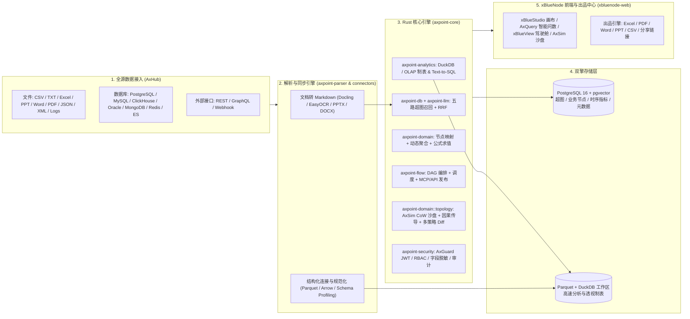
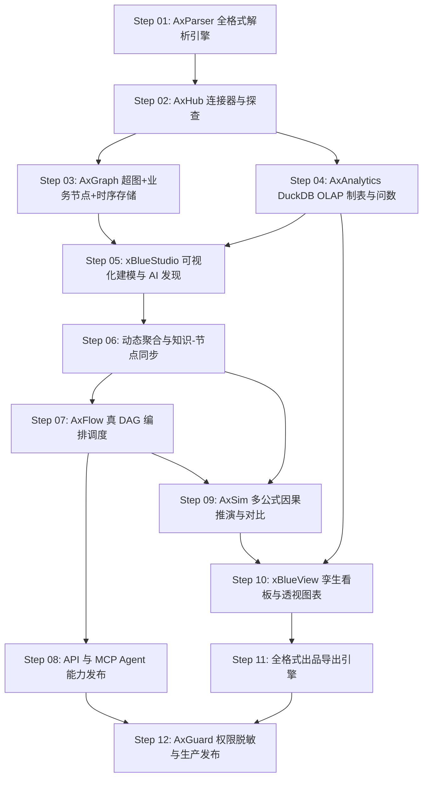

# xBlueNode / AxPoint 全栈平台工程落地总蓝图

## 1. 平台定位与自主核心架构

**xBlueNode / AxPoint** 是自主研发的企业级**节点智能、全源数据分析与动态超图决策平台**。平台将多源异构数据接入、结构化 OLAP 分析制表、非结构化超图知识推理、业务节点关系建模、自动化流水线编排、因果策略推演以及数字孪生可视化出品整合为单一闭环底座。

- **xBlueNode（前端工作台与业务节点层）**：面向业务建模与决策交互，覆盖 **xBlueStudio**（节点与因果关系建模）、**xBlueGraph**（动态拓扑浏览器）、**xBlueView**（孪生驾驶舱与全格式出品中心）。
- **AxPoint（Rust 高性能引擎底座）**：面向算法计算与数据执行，覆盖 **AxHub / AxParser**（全源数据连接与双轨解析）、**AxGraph / AxAnalytics**（超图时序与 DuckDB OLAP 制表分析）、**AxQuery**（五路检索 + 智能问数）、**AxFlow**（DAG 编排与 API/MCP 发布）、**AxSim**（写时复制因果推演沙盘）、**AxGuard**（权限与脱敏底座）。

### 1.1 核心子系统能力矩阵

| 子系统标识 | 核心定位 | 关键能力范围 | 核心技术栈 |
| :--- | :--- | :--- | :--- |
| **AxHub & AxParser** | 全源数据接入与探查层 | `CSV` / `TXT` / `Excel` / `PPT` / `Word` / `PDF` / `JSON` / `XML` / `Logs`、SQL/NoSQL 数据库、REST/GraphQL API、元数据探查 | Python FastAPI、DuckDB、Polars、Docling、SQLAlchemy / ConnectorX |
| **AxGraph & AxAnalytics** | 双擎图谱与分析制表底座 | 非结构化三级超图（`Doc → Para → Entity`）+ 多维自适应向量（`pgvector`）+ 业务节点与时序指标 + DuckDB/Parquet OLAP 制表与 Text-to-SQL | Rust `axpoint-db`、`axpoint-analytics`、PostgreSQL 16 (`pgvector`)、DuckDB |
| **xBlueStudio** | 业务节点可视化设计器 | 交互式拖拽画布设计节点类型（`BlueNodeType`）、因果关系（`BlueEdgeType`）、属性、动态聚合规则、数据源映射、AI 自动探查建模 | Rust `axpoint-domain`、React Flow / TypeScript |
| **AxFlow** | 应用构建与 DAG 编排引擎 | DAG 拓扑编排（摄取/清洗/映射/人工审批/动作输出）、Cron/事件调度、API 与 MCP Skill 一键发布、多智能体工具调用 | Rust `axpoint-flow`、Tokio、MCP Protocol |
| **AxSim** | 写时复制因果推演沙盘 | CoW 沙盘快照克隆、多指标公式传导与环路阻断、多方案（A/B/C）并行对比、AI 归因分析、人确认后决策下发生产 | Rust `axpoint-domain::topology`、安全表达式求值引擎 |
| **xBlueView** | 孪生可视与全格式出品中心 | 对象驱动孪生视图、低代码驾驶舱、交互式透视制表、全格式出品（Excel/PDF/Word/PPT/CSV/独立分享页） | React 19、ECharts、TanStack Table、WeasyPrint / python-pptx / openpyxl |
| **AxGuard** | 企业级安全与治理底座 | JWT/OIDC 认证、四级 RBAC、行级数据过滤、查询/LLM/导出三道动态 PII 脱敏门禁、操作审计与可观测性 | Rust `axpoint-security`、Argon2id、OpenTelemetry |

---

## 2. 目标全局技术架构拓扑



---

## 3. 目标工程目录结构规范

```text
xBlueNode-AxPoint/
├── deploy/
│   ├── docker-compose.yml            # PostgreSQL(pgvector) + Rust Core + Parser + Web
│   ├── .env.example
│   └── migrations/                   # 编号化 SQL 迁移脚本
│       ├── 001_hypergraph_core.sql
│       ├── 002_data_fabric.sql
│       ├── 003_xblue_timeseries.sql
│       ├── 003b_xbluestudio_mappings.sql
│       ├── 004_axflow_and_agents.sql
│       ├── 005_axsim_and_xblueview.sql
│       └── 006_axguard_security.sql
├── axpoint-core/                     # Rust 1.100.0 (edition = "2024") Cargo Workspace
│   ├── Cargo.toml
│   └── crates/
│       ├── axpoint-domain/           # 纯领域模型、表达式 AST 求值器、RRF、AxSim 因果推演内核
│       ├── axpoint-llm/              # OpenAI 兼容网关、Prompt 模板、结构化 JSON Schema 约束输出
│       ├── axpoint-db/               # PostgreSQL 持久化（超图/业务节点/连接元数据/流程/安全/时序）
│       ├── axpoint-analytics/        # DuckDB/Parquet OLAP 查询、透视制表、Text-to-SQL 校验执行
│       ├── axpoint-flow/             # DAG 拓扑调度器、算子运行时、Cron/Webhook 触发器、MCP 服务
│       ├── axpoint-security/         # JWT 认证、RBAC 策略判定、敏感字段动态脱敏、审计日志
│       └── axpoint-server/           # Axum HTTP/SSE 网关、统一错误处理、中间件、静态托管
├── axpoint-parser/                   # Python 3.11+ FastAPI 解析、连接器与全格式出品服务
│   ├── pyproject.toml
│   ├── main.py
│   ├── parsers/                      # CSV/Excel/PPT/Word/PDF/JSON/XML/Logs 解析器矩阵
│   ├── connectors/                   # SQL/NoSQL/API 连接器、凭证解密、Schema Profiling
│   └── exporters/                    # Excel / PDF / Word / PPT / CSV 出品渲染引擎
├── xbluenode-web/                    # React 19 + Vite 6 + TypeScript + Tailwind v4
│   └── src/
│       ├── pages/                    # Dashboard / AxHub / AxIngest / AxQuery / xBlueGraph / xBlueStudio / AxFlow / AxSim / xBlueView / AxGuard
│       └── components/               # 画布组件、ECharts 图表、TanStack 透视表、脱敏展示器
└── docs/
    └── blueprint/                    # 本工程落地蓝图目录
```

---

## 4. 全局代码与质量强制规范

### 4.1 Rust Workspace 约束（沿用 `axpoint-core/Cargo.toml` 最高级别 Lint）
所有新增与既有 Crate 必须 100% 满足以下编译约束：
- `unsafe_code = "forbid"`
- `clippy::all = "deny"`、`clippy::pedantic = "deny"`
- `clippy::unwrap_used = "deny"`、`clippy::expect_used = "deny"`、`clippy::panic = "deny"`
- `clippy::as_conversions = "deny"`（数值类型转换统一使用 `try_from` / `from` / 显式安全方法）
- `clippy::indexing_slicing = "deny"`（集合访问统一使用 `.get(...)` 或迭代器）
- `missing_docs = "deny"`、`missing_errors_doc = "deny"`、`missing_panics_doc = "deny"`

### 4.2 Python Sidecar 约束
- 全量使用 Python `3.11+` 类型注解（`from __future__ import annotations` + Pydantic v2 数据模型）。
- 所有外部输入、连接器凭证均需经过严格校验；SQL 连接器禁止拼接原始字符串，必须使用参数化查询或只读探查白名单。
- 统一采用结构化错误返回（HTTP 状态码 + `{"error_code": "...", "message": "..."}`）。

### 4.3 前端 TypeScript 约束
- 启用 `strict: true`，禁止 `any` 类型逃逸；所有接口类型在 `src/lib/api/` 中按模块精确定义。
- 维持黑白灰 + 极简科技蓝（`#2563eb`）视觉语言，保持高频数据表与图表在浅色/深色主题下的一致性。

---

## 5. 蓝图文件索引与实施步骤依赖

本蓝图拆分为 7 份独立实践规范文件，按严格的底层依赖顺序划分 **Step 01 至 Step 12**。每一步均包含**完整架构定义、数据表 DDL、核心接口契约与可执行验证门禁（Verification Gate）**，前一步门禁全部通过后方可进入下一步。

| 文件 | 覆盖步骤 | 核心交付内容 | 依赖前置 |
| :--- | :--- | :--- | :--- |
| [01-AXHUB-DATA-CONNECTORS-AND-PARSERS.md](./01-AXHUB-DATA-CONNECTORS-AND-PARSERS.md) | **Step 01 ~ Step 02** | 全格式文件解析引擎 + SQL/NoSQL/API 连接器 + 元数据探查 | 无 |
| [02-AXGRAPH-CORE-AND-OLAP-ENGINE.md](./02-AXGRAPH-CORE-AND-OLAP-ENGINE.md) | **Step 03 ~ Step 04** | AxGraph 超图+业务节点+时序存储 + DuckDB OLAP 制表与智能问数 | Step 01 ~ 02 |
| [03-XBLUESTUDIO-MODELING-AND-AGGREGATION.md](./03-XBLUESTUDIO-MODELING-AND-AGGREGATION.md) | **Step 05 ~ Step 06** | xBlueStudio 可视化建模 + AI 发现模型 + 数据映射 + 动态聚合 | Step 03 ~ 04 |
| [04-AXFLOW-DAG-ORCHESTRATOR-AND-AGENTS.md](./04-AXFLOW-DAG-ORCHESTRATOR-AND-AGENTS.md) | **Step 07 ~ Step 08** | AxFlow 真 DAG 编排执行引擎 + 定时/事件调度 + API/MCP 发布 | Step 05 ~ 06 |
| [05-AXSIM-CAUSAL-SIMULATION-AND-DECISION.md](./05-AXSIM-CAUSAL-SIMULATION-AND-DECISION.md) | **Step 09** | AxSim 多指标公式因果推演 + 防环收敛 + 多方案 Diff 对比 + 决策回写 | Step 06, Step 07 |
| [06-XBLUEVIEW-TWIN-AND-PUBLISHING.md](./06-XBLUEVIEW-TWIN-AND-PUBLISHING.md) | **Step 10 ~ Step 11** | xBlueView 孪生看板与透视图表 + 全格式出品导出引擎 | Step 04, Step 06, Step 09 |
| [07-AXGUARD-SECURITY-AND-DEPLOYMENT.md](./07-AXGUARD-SECURITY-AND-DEPLOYMENT.md) | **Step 12** | AxGuard 权限脱敏、可观测性与生产发布总验收 | Step 01 ~ 11 |

---

## 6. 依赖拓扑与全局验证矩阵



### 全局基线检查命令（贯穿每一步骤）
- **Rust 静态检查与单测**：
  ```bash
  cargo clippy --workspace --all-targets -- -D warnings
  cargo test --workspace
  ```
- **Python 侧服务与单测**：
  ```bash
  pytest -v axpoint-parser/tests
  ```
- **前端构建与类型校验**：
  ```bash
  cd xbluenode-web && npm run build
  ```
