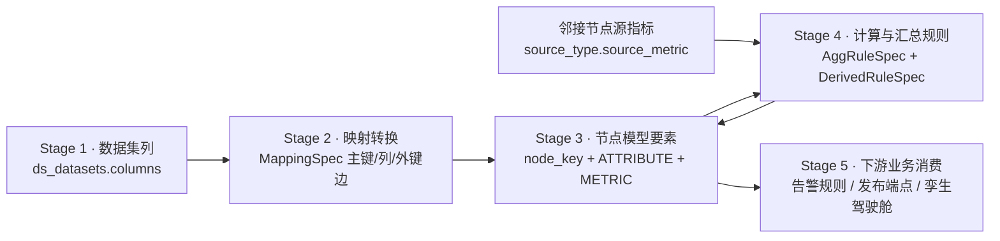

# 04 · Step 18：`xBlueStudio` 焦点感知助手、单节点横向血缘与模型全景规格书

本步骤围绕 `xBlueStudio` 构建期可解释性与人机协同闭环交付三项核心能力：① 右栏常驻**焦点感知 AI 助手**，严格区分只读诊断（`DIAGNOSE_ONLY`）与带前置快照保护的受限解码改写（`PATCH_DRAFT`），配合模型要素 `PROPOSED / CONFIRMED` 成熟度签收工作流；② 双击任意业务节点切入**左→右五级全链路数据血缘管道图**（源数据集列 → 映射规格 → 节点主键/属性/指标 → 聚合与派生规则 → 运营规则/发布端点/驾驶舱）；③ 实时确定性编译 **7 章节模型全景规格书**（内置 `q1..q6` 推荐验收问数集），支持对接全格式出品引擎一键归档交付。

关联总览与工程约束：
- [00-V2-MASTER-INDEX.md](../00-V2-MASTER-INDEX.md)
- [03-STEP17-AXBUILDER-MCP-AND-DEV-SUBGRAPH.md](./03-STEP17-AXBUILDER-MCP-AND-DEV-SUBGRAPH.md)
- [IRON_RULES.md](../../../../IRON_RULES.md)
- [A1-CONVENTIONS-ENUMS-ROUTES.md](../../../../docs/standards/A1-CONVENTIONS-ENUMS-ROUTES.md)
- [A2-DATABASE-MIGRATIONS-INDEX.md](../../../../docs/standards/A2-DATABASE-MIGRATIONS-INDEX.md)
- [06-STEP05-06-XBLUESTUDIO-MODELING-AND-ROLLUP.md](../../v1-foundation-step00-14/06-STEP05-06-XBLUESTUDIO-MODELING-AND-ROLLUP.md)

---

## 18.0 目标、前置与契约

- **目标**：
  1. 建立 `xb_schema_draft_snapshots` 草案级快照链与 `xb_schema_drafts.pass_count` 正向完备度通过项计数。
  2. 为 `NodeTypeSpec`、`PropertySpec`、`EdgeTypeSpec`、`AggRuleSpec`、`DerivedRuleSpec` 增加向后兼容的 `maturity: DesignMaturity`（默认 `CONFIRMED`；AI 生成或补丁写入元素自动标记为 `PROPOSED`，正式发布版本前强制校验全部要素均已人工确认为 `CONFIRMED`），并在 `NodeTypeSpec` 支持可选 `semantic_layer_tier`（`STATIC_FACT | EVENT_DYNAMIC | CUBE_ROLLUP`）与 `domain_group`。
  3. 实现 `POST /api/xblue/drafts/{id}/copilot`（零温采样 + Step 15 `json_schema` 受限解码），支持 `DIAGNOSE_ONLY` 只读体检与 `PATCH_DRAFT` 自动保存前置快照、应用补丁及 `POST /api/xblue/drafts/{id}/snapshots/{snap_id}/restore` 快照回退。
  4. 实现纯确定性计算的单节点横向血缘接口 `GET /api/xblue/subgraphs/{slug}/lineage/{node_type}` 与 7 章节模型全景规格书接口 `GET /api/xblue/subgraphs/{slug}/spec-doc`。
  5. 在前端 `components/xbluestudio/` 交付 `StudioCopilotPanel.tsx`、`NodeLineageCanvas.tsx`、`ModelSpecOverview.tsx`，并升级 `NodeTypeCard.tsx`（紧凑 `Np·Nm·Nr` 统计徽标）与 `IssueList.tsx`（`pass_count` 通过项徽标 + 完备度警告）。
- **前置**：Step 15、Step 17 通过（所属并行层 **L13**，可与 Step 16、Step 21 并发实施；契约迁移按 `0016 → 0018 → 0019` 顺序合入）。
- **覆盖能力项**：`C68`、`C69`、`C70`（映射至 [A7-REQUIREMENTS-TRACEABILITY.md](../../../../docs/standards/A7-REQUIREMENTS-TRACEABILITY.md)）。
- **契约清单**：
  - `deploy/migrations/0018_studio_proposal_status.sql`
  - `axpoint-domain::enums`：`DesignMaturity`（`PROPOSED | CONFIRMED`）、`SemanticLayerTier`（`STATIC_FACT | EVENT_DYNAMIC | CUBE_ROLLUP`）、`CopilotActionMode`（`DIAGNOSE_ONLY | PATCH_DRAFT`）、`AuditAction::StudioSnapshotRestore`
  - `axpoint-domain::studio`：`NodeTypeSpec` / `PropertySpec` / `EdgeTypeSpec` / `AggRuleSpec` / `DerivedRuleSpec` 扩展字段；`DraftSnapshotSummary`、`StudioCopilotRequest`、`StudioCopilotResponse`、`ConfirmProposalsRequest`、`NodeLineageGraph`、`SubgraphSpecDoc`、`AcceptancePromptItem`
  - `axpoint-llm::studio_copilot`：受限解码 Schema、焦点上下文组装与补丁归并器
  - `docs/API_CONTRACT.md`：`/api/xblue/drafts/{id}/copilot`、`/api/xblue/drafts/{id}/snapshots*`、`/api/xblue/drafts/{id}/confirm-proposals`、`/api/xblue/subgraphs/{slug}/lineage/{node_type}`、`/api/xblue/subgraphs/{slug}/spec-doc`
  - `xbluenode-web/src/lib/api/xblue.ts`

### 文件变更清单

| 动作 | 路径 | 内容 |
| :--- | :--- | :--- |
| 新建 | `deploy/migrations/0018_studio_proposal_status.sql` | 草案快照表、`pass_count` 列、节点语义分层列与审计枚举扩展（§18.1） |
| 修改 | `axpoint-core/crates/axpoint-domain/src/enums.rs` | 新增 `DesignMaturity`、`SemanticLayerTier`、`CopilotActionMode`；`AuditAction` 追加 `StudioSnapshotRestore` |
| 修改 | `axpoint-core/crates/axpoint-domain/src/studio/{mod.rs, doc.rs, validate.rs}` | 模型要素 `maturity` 与分层字段、正向 `pass_count` 统计与发布前未确认提议守卫（§18.2） |
| 新建 | `axpoint-core/crates/axpoint-domain/src/studio/{lineage.rs, spec_doc.rs}` | 单节点五级横向血缘构建器与 7 章节全景规格书编译器（§18.4） |
| 新建 | `axpoint-core/crates/axpoint-llm/src/studio_copilot.rs` | 焦点感知提示词组装、`json_schema` 受限解码诊断与补丁提取器（§18.3） |
| 修改 | `axpoint-core/crates/axpoint-db/src/studio_repo.rs` | 快照追加/列表/恢复事务、`pass_count` 落盘、跨模块下游消费反查（规则/端点/看板） |
| 修改 | `axpoint-core/crates/axpoint-server/src/routes/xblue.rs` | 挂载 Copilot、快照回退、提议确认、节点血缘与规格书路由（§18.3～§18.4） |
| 修改 | `xbluenode-web/src/lib/api/{enums.ts, xblue.ts}` | 对齐 Step 18 类型与 API 客户端方法 |
| 新建 | `xbluenode-web/src/components/xbluestudio/{StudioCopilotPanel.tsx, NodeLineageCanvas.tsx, ModelSpecOverview.tsx}` | 焦点感知助手侧栏、单节点左→右血缘画布、全景规格书面板（§18.5） |
| 修改 | `xbluenode-web/src/pages/XBlueStudioPage.tsx`、`src/components/xbluestudio/{NodeTypeCard.tsx, PropertyTable.tsx, RuleEditor.tsx, IssueList.tsx}` | 双击进入血缘画布、`Np·Nm·Nr` 徽标、`PROPOSED` 确认流与 `pass_count` 指标展示 |
| 新建 | `tests/cassettes/studio_copilot_diagnose.json`、`tests/cassettes/studio_copilot_patch.json` | Copilot 离线确定性录制回放夹具 |
| 新建 | `scripts/gate/step18.sh` | Step 18 自动化门禁（§18.6） |

---

## 18.1 迁移 `deploy/migrations/0018_studio_proposal_status.sql`

```sql
-- 0018_studio_proposal_status.sql：模型草案版本快照、校验通过项计数、节点语义分层与快照回退审计

-- 1. 模型草案增量快照表：每次 AI 改写或批量确认前自动写入回退点
CREATE TABLE IF NOT EXISTS xb_schema_draft_snapshots (
    id          UUID PRIMARY KEY DEFAULT gen_random_uuid(),
    tenant_id   TEXT NOT NULL,
    draft_id    UUID NOT NULL REFERENCES xb_schema_drafts(id) ON DELETE CASCADE,
    snapshot_no INT NOT NULL CHECK (snapshot_no > 0),
    reason      TEXT NOT NULL DEFAULT 'COPILOT_PATCH'
                CHECK (reason IN ('MANUAL', 'COPILOT_PATCH', 'BATCH_CONFIRM', 'PRE_MERGE')),
    schema_doc  JSONB NOT NULL,
    created_by  UUID,
    created_at  TIMESTAMPTZ NOT NULL DEFAULT NOW(),
    UNIQUE (draft_id, snapshot_no)
);

CREATE INDEX IF NOT EXISTS idx_xb_draft_snapshots_lookup
    ON xb_schema_draft_snapshots (tenant_id, draft_id, snapshot_no DESC);

SELECT ax_enable_tenant_rls('xb_schema_draft_snapshots');
GRANT SELECT, INSERT, DELETE ON xb_schema_draft_snapshots TO axpoint_app;

-- 2. 扩展模型草案：记录正向静态校验通过项数量
ALTER TABLE xb_schema_drafts
    ADD COLUMN IF NOT EXISTS pass_count INT NOT NULL DEFAULT 0 CHECK (pass_count >= 0);

-- 3. 扩展已发布节点类型：可选语义层级与业务域分组
ALTER TABLE xb_node_types
    ADD COLUMN IF NOT EXISTS semantic_layer_tier TEXT
        CHECK (semantic_layer_tier IN ('STATIC_FACT', 'EVENT_DYNAMIC', 'CUBE_ROLLUP'));

ALTER TABLE xb_node_types
    ADD COLUMN IF NOT EXISTS domain_group TEXT;

-- 4. 扩展审计动作枚举：追加 STUDIO_SNAPSHOT_RESTORE
ALTER TABLE sec_audit_logs DROP CONSTRAINT IF EXISTS sec_audit_logs_action_check;
ALTER TABLE sec_audit_logs ADD CONSTRAINT sec_audit_logs_action_check
    CHECK (action IN (
        'LOGIN','LOGOUT','TOKEN_ISSUE','TOKEN_REVOKE','QUERY_SQL','ASK_DATA','RAG_ASK','DATA_SYNC',
        'FILE_UPLOAD','SCHEMA_PUBLISH','FLOW_RUN','APPROVAL_DECIDE','MCP_CALL','AGENT_CHAT','SIM_APPLY',
        'EXPORT_FILE','SHARE_CREATE','SHARE_ACCESS','POLICY_CHANGE','BACKUP_RUN','TEMPLATE_INSTALL',
        'BUILDER_MCP_MUTATE','TRIAL_TEMPLATE_CLONE','STUDIO_SNAPSHOT_RESTORE'
    ));
```

---

## 18.2 成熟度状态流、语义分层与正向完备度校验（`axpoint-domain::studio`）

### 18.2.1 `DesignMaturity` 与 `NodeTypeSpec` 扩展字段

```rust
/// Design sign-off state attached to schema elements (`NodeTypeSpec`, `PropertySpec`, `EdgeTypeSpec`, rules).
#[derive(
    Debug, Clone, Copy, Default, PartialEq, Eq, PartialOrd, Ord, Hash, Serialize, Deserialize,
)]
#[serde(rename_all = "SCREAMING_SNAKE_CASE")]
pub enum DesignMaturity {
    /// Generated or patched by AI; requires explicit human review before version publication.
    Proposed,
    /// Human-authored or explicitly reviewed and accepted (default for backward compatibility).
    #[default]
    Confirmed,
}

/// Optional semantic role tier of a `NodeTypeSpec` within an enterprise domain graph.
#[derive(
    Debug, Clone, Copy, PartialEq, Eq, PartialOrd, Ord, Hash, Serialize, Deserialize,
)]
#[serde(rename_all = "SCREAMING_SNAKE_CASE")]
pub enum SemanticLayerTier {
    /// Master/reference entity changing slowly (e.g., `Supplier`, `Warehouse`, `Equipment`).
    StaticFact,
    /// Transactional or operational event entity (e.g., `PurchaseOrder`, `WorkTicket`).
    EventDynamic,
    /// Rollup hub or management summary node aggregating multi-hop metrics (e.g., `RegionCenter`).
    CubeRollup,
}
```

在 `axpoint-domain/src/studio/doc.rs` 中以 `#[serde(default)]` 无损扩展以下结构：
- `NodeTypeSpec`：新增 `#[serde(default)] pub maturity: DesignMaturity`、`#[serde(default, skip_serializing_if = "Option::is_none")] pub semantic_layer_tier: Option<SemanticLayerTier>`、`#[serde(default, skip_serializing_if = "Option::is_none")] pub domain_group: Option<String>`，以及只读辅助方法 `pub fn badge_counts(&self) -> NodeBadgeCounts`（返回 `{ attr_count, metric_count, rule_count }`，对应前端 `Np·Nm·Nr` 紧凑徽标：`Np = properties.len()`、`Nm = metric properties count`、`Nr = agg_rules.len() + derived_rules.len()`）。
- `PropertySpec`、`EdgeTypeSpec`、`AggRuleSpec`、`DerivedRuleSpec`：各自新增 `#[serde(default)] pub maturity: DesignMaturity`。
- **向后兼容不变量**：存量数据库 `xb_schema_versions`、`xb_schema_drafts` 及 `templates/packs/*/schema.json` 未携带 `maturity` 字段时，反序列化一律归为 `DesignMaturity::Confirmed`，不破坏 Step 05～14 既有测试与种子数据。

### 18.2.2 正向完备度计数 `pass_count` 与发布签收守卫（`validate.rs`）

`validate_with_metrics(doc: &SchemaDoc, ctx: &ValidationContext) -> ValidationSummary` 同时输出负面问题清单 `issues: Vec<ValidationIssue>` 与正向通过项计数 `pass_count: u32`：

| 检查维度 | 正向计分规则（每通过一项 `pass_count += 1`） | 完备度警告与错误码（`ValidationIssue`） |
| :--- | :--- | :--- |
| 节点类型基础定义 | 每个 `NodeTypeSpec` 标识符、显示名与标题模板语法合法记 `1` 项 | 缺失业务描述报 `INFO: NODE_DESCRIPTION_EMPTY`；孤立无边且无映射节点报 `WARNING: ISOLATED_NODE_TYPE` |
| 属性与指标规范 | 每个类型合法、命名合规的 `PropertySpec` 记 `1` 项 | `kind == METRIC` 未填写 `unit` 报 `WARNING: METRIC_UNIT_MISSING` |
| 有向关系与传导参数 | 每条源/目标类型存在、基数与 `impact_weight` 合法的 `EdgeTypeSpec` 记 `1` 项 | 未配置传导参数且被推演引用报 `INFO: EDGE_PROPAGATION_DEFAULT` |
| 派生与跨边聚合规则 | 每条 AST 类型检查通过且无循环依赖的 `DerivedRuleSpec` / `AggRuleSpec` 记 `1` 项 | 类型不匹配或引用不存在指标报 `ERROR: RULE_EXPR_INVALID` / `ERROR: AGG_CYCLE` |
| 数据集映射完整性 | 每条主键列与目标属性列类型兼容的 `MappingSpec` 记 `1` 项 | 节点类型未绑定任何映射且非 `CUBE_ROLLUP` 层级报 `WARNING: NODE_UNMAPPED` |
| AI 提议签收状态 | 整个草案无遗留 `PROPOSED` 要素额外记 `1` 项 | 存在 `maturity == PROPOSED` 要素时：草案保存态记 `WARNING: UNCONFIRMED_PROPOSAL`；调用 `publish_draft` 时升级为阻断级 `400 UNCONFIRMED_PROPOSALS_REMAIN` |

---

## 18.3 焦点感知 AI 助手与快照回退协议（`axpoint-llm::studio_copilot`）

### 18.3.1 接口契约

| 方法与路径 | 所需权限 | 请求体核心字段 | 响应体核心字段 |
| :--- | :--- | :--- | :--- |
| `POST /api/xblue/drafts/{id}/copilot` | `STUDIO_EDIT` | `{ mode: "DIAGNOSE_ONLY"\|"PATCH_DRAFT", prompt: string, focus?: CopilotFocusContext, refs?: { dataset_ids?: string[], include_spec_doc?: boolean } }` | `{ mode, mutated: boolean, snapshot_id: string\|null, snapshot_no: number\|null, diagnosis: CopilotDiagnosis, diff: SchemaDiff\|null, pass_count: number, issues: ValidationIssue[] }` |
| `GET /api/xblue/drafts/{id}/snapshots` | `DATA_READ` | 查询参数 `?limit=20` | `{ items: [{ id, snapshot_no, reason, created_by, created_at }] }` |
| `POST /api/xblue/drafts/{id}/snapshots/{snap_id}/restore` | `STUDIO_EDIT` | `{}` | 恢复后的完整 `SchemaDraft`（含重算 `issues` 与 `pass_count`），写 `STUDIO_SNAPSHOT_RESTORE` 审计 |
| `POST /api/xblue/drafts/{id}/confirm-proposals` | `STUDIO_EDIT` | `{ scope: "ALL"\|"SELECTED", node_types?: string[], edge_types?: string[] }` | 先生成 `reason = 'BATCH_CONFIRM'` 快照，再将目标要素及子项置为 `CONFIRMED`，返回更新后的 `SchemaDraft` |

### 18.3.2 确定性安全护栏

1. **受限解码与零温锁定**：调用 `LlmRouter`（`Purpose::Extract`）时强制设定 `temperature = 0.0` 并附带严格 JSON Schema（`DIAGNOSE_ONLY` 绑定 `CopilotDiagnosisSchema`，`PATCH_DRAFT` 绑定 `CopilotPatchEnvelopeSchema`）；传入模型的 `@dataset` 元数据仅含列名、逻辑类型、空值率与基数统计，经过 `redact_for_egress` 剥离敏感样本。
2. **`DIAGNOSE_ONLY` 零副作用保证**：服务端仅执行 `SELECT` 加载草案与数据集画像，不开启写事务、不更新 `xb_schema_drafts.updated_at`、不写入 `xb_schema_draft_snapshots`，返回结构化审查结论 `findings[]`（每项含 `severity`、`target_path`、`rationale`、`suggested_fix`）。
3. **`PATCH_DRAFT` 先快照后变更原子事务**：
   - 在 `begin_tenant_tx` 内对 `xb_schema_drafts` 执行 `SELECT ... FOR UPDATE`。
   - 计算 `next_no = COALESCE((SELECT MAX(snapshot_no) FROM xb_schema_draft_snapshots WHERE draft_id = $1), 0) + 1`，将修改前的 `schema_doc` 原样插入 `xb_schema_draft_snapshots`（`reason = 'COPILOT_PATCH'`）。
   - 应用补丁生成的增量节点、属性、关系、规则一律强制标记 `maturity = DesignMaturity::Proposed`（保留未被触碰的既有 `Confirmed` 要素不变）。
   - 执行 `validate_with_metrics` 更新 `issues` 与 `pass_count`，返回 `snapshot_id`、`diff` 与最新校验结果。

---

## 18.4 单节点五级血缘与 7 章节全景规格书（`lineage.rs` & `spec_doc.rs`）

### 18.4.1 单节点左→右血缘管道图（`GET /api/xblue/subgraphs/{slug}/lineage/{node_type}`）

查询参数支持可选 `?draft_id=<uuid>`（传入时基于工作草案计算，省略时基于子图最新已发布 `SchemaDoc` 计算）。纯函数 `build_node_lineage` 结合 `studio_repo` 反查的下游绑定元数据，输出严格五列有向无环管道图 `NodeLineageGraph`：



`NodeLineageGraph` JSON 响应契约：

```json
{
  "subgraph_slug": "main",
  "node_type": "Warehouse",
  "display_name": "区域仓",
  "badge_counts": { "property_count": 6, "metric_count": 3, "rule_count": 2 },
  "stages": [
    { "stage": "DATASET_COLUMNS", "nodes": [{ "id": "col:warehouses.stock_qty", "label": "warehouses.stock_qty", "meta": { "data_type": "FLOAT64" } }] },
    { "stage": "MAPPING_SPEC", "nodes": [{ "id": "map:wh_sync", "label": "wh_sync (FULL)", "meta": { "key_column": "wh_code" } }] },
    { "stage": "NODE_SCHEMA", "nodes": [{ "id": "prop:Warehouse.stock_qty", "label": "stock_qty (件)", "meta": { "kind": "METRIC", "maturity": "CONFIRMED" } }] },
    { "stage": "COMPUTE_RULES", "nodes": [{ "id": "derived:Warehouse.shortage_gap", "label": "max(0, safety_stock - stock_qty)", "meta": { "kind": "DERIVED" } }] },
    { "stage": "DOWNSTREAM_CONSUMERS", "nodes": [
      { "id": "rule:low_stock_alert", "label": "库存低于安全线告警", "meta": { "consumer_kind": "ALERT_RULE" } },
      { "id": "ep:warehouse-objects", "label": "warehouse-objects (PROD)", "meta": { "consumer_kind": "ENDPOINT" } },
      { "id": "dash:supply-overview", "label": "供应链总览驾驶舱", "meta": { "consumer_kind": "DASHBOARD" } }
    ] }
  ],
  "edges": [
    { "from": "col:warehouses.stock_qty", "to": "map:wh_sync", "label": "DIRECT" },
    { "from": "map:wh_sync", "to": "prop:Warehouse.stock_qty", "label": "SYNC" },
    { "from": "prop:Warehouse.stock_qty", "to": "derived:Warehouse.shortage_gap", "label": "INPUT" },
    { "from": "derived:Warehouse.shortage_gap", "to": "rule:low_stock_alert", "label": "EVAL" }
  ]
}
```

### 18.4.2 7 章节模型全景规格书（`GET /api/xblue/subgraphs/{slug}/spec-doc`）

支持 `?draft_id=<uuid>&format=json|markdown`（需 `DATA_READ`），由纯函数 `compile_subgraph_spec_doc` 100% 基于领域元数据确定性生成（零大模型幻觉）：

1. **`sec_01_overview`（模型总览与健康度）**：子图名称、版本/草案状态、节点类型数、关系数、指标总数、`pass_count`、未确认 `PROPOSED` 计数。
2. **`sec_02_semantic_layers`（业务域与语义分层矩阵）**：按 `domain_group` 与 `semantic_layer_tier`（`STATIC_FACT` 静态主数据 / `EVENT_DYNAMIC` 动态业务事件 / `CUBE_ROLLUP` 汇总中心）分组展示架构层次。
3. **`sec_03_entity_dictionary`（实体、属性与指标字典）**：逐表列出每个 `NodeTypeSpec` 的 `title_template`、属性类型、必填约束、计量单位 `unit` 与 `PiiCategory` 脱敏等级。
4. **`sec_04_topology_matrix`（拓扑关系与因果传导）**：源节点 → 关系名 → 目标节点、基数（`1:1` / `1:N` / `N:1` / `N:M`）与 `AxSim` 传导权重 `impact_weight`。
5. **`sec_05_compute_formulas`（跨边聚合与节点内派生公式）**：全部 `AggRuleSpec`（聚合函数、遍历方向、过滤表达式、权重开关）与 `DerivedRuleSpec` 公式清单。
6. **`sec_06_source_mappings`（数据湖映射与入图规则）**：源数据集名称、主键列、外键边生成规则与最近同步批次状态。
7. **`sec_07_acceptance_prompts`（`q1..q6` 推荐验收问数集）**：从当前子图的已定义指标、多跳关系与分组维度确定性合成 `q1`～`q6` 共 6 条标准业务问句（覆盖单实体过滤、认证指标按维汇总、跨法定关系边关联问数、派生缺口排名、异常阈值排查、拓扑上下游穿透），每条包含 `{ id: "q1".."q6", question, expected_grounding_mode, target_node_types, target_metrics }`。

规格书导出衔接：前端在 `ModelSpecOverview.tsx` 触发导出时，调用既有 `POST /api/xblueview/exports`（传入 `spec_doc.markdown` 作为报告源文档，支持 `MARKDOWN` / `DOCX` / `PDF`），复用 `AxGuard` 水印与审计链路。

---

## 18.5 前端工作台组件规格（`xbluenode-web/src/components/xbluestudio/`）

| 组件文件 | 位置与触发方式 | 核心状态与交互规格 | 控件微文案规范（中 / 英 `tx()`） |
| :--- | :--- | :--- | :--- |
| `StudioCopilotPanel.tsx` | `XBlueStudioPage.tsx` 右侧可折叠常驻栏 | ① 顶部焦点感知横条自动同步画布选中态（如 `焦点：Warehouse`、`焦点：SUPPLIES` 或 `焦点：全局子图`）；② 模式切换 `Tabs`：`诊断`（对应 `DIAGNOSE_ONLY`）与 `改写草案`（对应 `PATCH_DRAFT`）；③ 内置 6 枚快捷动作胶囊：`完备度体检`、`补全单位描述`、`推导聚合指标`、`检查映射对齐`、`生成派生公式`、`审查敏感字段`；④ 输入框支持输入 `@spec`（挂载规格摘要）与 `@dataset`（选择挂载数据集列画像）胶囊；⑤ 每次改写卡片显示新增/变更要素数与 `回退快照` 按钮 | 模式：`诊断` / `Diagnose`、`改写草案` / `Patch Draft`；提交：`发送` / `Send`；回退：`回退快照` / `Rollback` |
| `NodeTypeCard.tsx`（增强） | 主建模画布节点卡片 | 右上角渲染紧凑指标徽标 `Np·Nm·Nr`（如 `6p·3m·2r`，`tabular-nums` 等宽字体）与可选分层标签（`主数据` / `事件` / `汇总`）；若节点或其内部属性/规则含 `PROPOSED`，卡片边框呈琥珀色虚线并显示 `待确认` 徽标；**双击卡片**直接切入该节点的 `NodeLineageCanvas.tsx` | 徽标：`待确认` / `Proposed`；快捷操作：`确认` / `Confirm` |
| `NodeLineageCanvas.tsx` | 双击画布节点或顶部切换栏进入 | 左→右五栏式管道布局（`源数据集列` → `映射规格` → `节点属性与指标` → `聚合与派生` → `规则/端点/驾驶舱`）；悬停任一节点或字段时，高亮其完整上下游连接边，其余节点降为 `opacity-35`；右上角返回主画布 | 视图切换：`血缘视图` / `Lineage`、`返回画布` / `Canvas` |
| `ModelSpecOverview.tsx` | 顶部工具栏入口打开全屏抽屉 | 左侧 7 章节锚点目录，右侧渲染实时结构化规格表与 `q1..q6` 推荐验收问数卡片（每张卡片带预期路由标签与跳转 `/query` 预填提问入口）；右上角提供格式选择器（`PDF` / `DOCX` / `MARKDOWN`）与导出触发器 | 入口：`模型规格书` / `Spec Doc`；问数跳转：`去问数` / `Ask`；导出：`导出文档` / `Export` |
| `IssueList.tsx`（增强） | 底部校验面板 | 标题栏左侧并列展示绿色通过徽标 `{pass_count} 项通过`、错误数、警告数与待确认提议数；当存在 `PROPOSED` 要素时，右侧提供批量签收按钮 | 批量签收：`全部确认` / `Confirm All` |

---

## 18.6 门禁 `scripts/gate/step18.sh`

```bash
#!/usr/bin/env bash
set -euo pipefail
source "$(dirname "$0")/lib.sh"

# 1. 单元与文档测试：覆盖成熟度反序列化兼容、pass_count 计算、单节点血缘与 7 章节规格书确定性编译
(cd axpoint-core && cargo test -p axpoint-domain studio && cargo test -p axpoint-llm studio_copilot)

# 2. 创建独立测试子图与初始草案，验证正向 pass_count 完备度计数
SUB_SLUG="dev_step18_studio"
api POST /api/xblue/subgraphs "{\"slug\":\"$SUB_SLUG\",\"display_name\":\"Step18 建模演练\",\"is_dev_sandbox\":true}" >/dev/null || true

DRAFT_RES=$(api POST /api/xblue/drafts "{
  \"subgraph_slug\": \"$SUB_SLUG\",
  \"title\": \"Step18 助手与血缘验证草案\",
  \"source\": \"MANUAL\",
  \"schema_doc\": {
    \"node_types\": [
      {
        \"name\": \"Supplier\",
        \"display_name\": \"供应商\",
        \"description\": \"上游物料供应商\",
        \"semantic_layer_tier\": \"STATIC_FACT\",
        \"domain_group\": \"采购域\",
        \"properties\": [
          { \"name\": \"tier_code\", \"display_name\": \"等级\", \"data_type\": \"STRING\", \"kind\": \"ATTRIBUTE\", \"required\": true },
          { \"name\": \"lead_days\", \"display_name\": \"交付周期\", \"unit\": \"天\", \"data_type\": \"FLOAT64\", \"kind\": \"METRIC\", \"required\": false }
        ]
      },
      {
        \"name\": \"Warehouse\",
        \"display_name\": \"区域仓\",
        \"description\": \"区域履约仓库\",
        \"semantic_layer_tier\": \"CUBE_ROLLUP\",
        \"domain_group\": \"履约域\",
        \"properties\": [
          { \"name\": \"wh_region\", \"display_name\": \"大区\", \"data_type\": \"STRING\", \"kind\": \"ATTRIBUTE\", \"required\": true },
          { \"name\": \"stock_qty\", \"display_name\": \"在库量\", \"unit\": \"件\", \"data_type\": \"FLOAT64\", \"kind\": \"METRIC\", \"required\": false },
          { \"name\": \"avg_supplier_lead\", \"display_name\": \"上游平均交期\", \"unit\": \"天\", \"data_type\": \"FLOAT64\", \"kind\": \"METRIC\", \"required\": false }
        ],
        \"agg_rules\": [
          {
            \"target_metric\": \"avg_supplier_lead\",
            \"op\": \"AVG\",
            \"via_link_type\": \"SUPPLIES\",
            \"direction\": \"IN\",
            \"source_type_name\": \"Supplier\",
            \"source_metric\": \"lead_days\"
          }
        ]
      }
    ],
    \"edge_types\": [
      { \"name\": \"SUPPLIES\", \"src_type_name\": \"Supplier\", \"dst_type_name\": \"Warehouse\", \"cardinality\": \"MANY_TO_MANY\", \"impact_weight\": 0.7 }
    ],
    \"mappings\": []
  }
}")
DRAFT_ID=$(echo "$DRAFT_RES" | jq -r .id)
expect_json "pass-count-metrics" "$DRAFT_RES" '.pass_count >= 5'

# 3. 验证 Copilot DIAGNOSE_ONLY 只读诊断：零草案修改、零快照新增
BEFORE_DOC=$(api GET "/api/xblue/drafts/$DRAFT_ID" | jq -c .schema_doc)
SNAP_BEFORE=$(sql_app default "SELECT count(*) FROM xb_schema_draft_snapshots WHERE draft_id = '$DRAFT_ID'")

DIAG_RES=$(api POST "/api/xblue/drafts/$DRAFT_ID/copilot" '{
  "mode": "DIAGNOSE_ONLY",
  "prompt": "完备度体检：检查 Warehouse 的指标与映射完备度",
  "focus": { "selected_node_type": "Warehouse", "active_tab": "properties" }
}')
AFTER_DIAG_DOC=$(api GET "/api/xblue/drafts/$DRAFT_ID" | jq -c .schema_doc)
SNAP_AFTER_DIAG=$(sql_app default "SELECT count(*) FROM xb_schema_draft_snapshots WHERE draft_id = '$DRAFT_ID'")
expect_json "copilot-readonly-diag" "$DIAG_RES" \
  '.mode == "DIAGNOSE_ONLY" and .mutated == false and .snapshot_id == null and (.diagnosis.findings | length) >= 1'
expect_eq "copilot-readonly-immutable" "$BEFORE_DOC|$SNAP_BEFORE" "$AFTER_DIAG_DOC|$SNAP_AFTER_DIAG"

# 4. 验证 Copilot PATCH_DRAFT：自动写入前置快照、新要素标记 PROPOSED、一键回退精准复原并写审计
PATCH_RES=$(api POST "/api/xblue/drafts/$DRAFT_ID/copilot" '{
  "mode": "PATCH_DRAFT",
  "prompt": "为 Warehouse 增加安全库存指标 safety_stock（单位：件）与缺口派生公式 shortage_gap = max(0, safety_stock - stock_qty)",
  "focus": { "selected_node_type": "Warehouse", "active_tab": "rules" }
}')
SNAP_ID=$(echo "$PATCH_RES" | jq -r .snapshot_id)
expect_json "copilot-patch-applied" "$PATCH_RES" \
  '.mutated == true and (.snapshot_id | length) > 10 and .snapshot_no == 1'

# 回退至快照 #1，验证 schema_doc 完整恢复且记录 STUDIO_SNAPSHOT_RESTORE 审计
RESTORED=$(api POST "/api/xblue/drafts/$DRAFT_ID/snapshots/$SNAP_ID/restore" '{}')
RESTORED_DOC=$(echo "$RESTORED" | jq -c .schema_doc)
AUDIT_RESTORE=$(sql_app default "SELECT count(*) > 0 FROM sec_audit_logs WHERE action = 'STUDIO_SNAPSHOT_RESTORE'")
expect_eq "copilot-mutate-rollback" "$RESTORED_DOC|$AUDIT_RESTORE" "$BEFORE_DOC|t"

# 5. 再次应用补丁，验证 PROPOSED 阻断未签收直接发布，确认后成功发布正式版本
PATCH2=$(api POST "/api/xblue/drafts/$DRAFT_ID/copilot" '{
  "mode": "PATCH_DRAFT",
  "prompt": "为 Warehouse 增加安全库存指标 safety_stock（单位：件）",
  "focus": { "selected_node_type": "Warehouse" }
}')
expect_code "unconfirmed-publish-blocked" 400 POST "/api/xblue/drafts/$DRAFT_ID/publish" '{"change_summary":"try before confirm"}'

CONFIRM_RES=$(api POST "/api/xblue/drafts/$DRAFT_ID/confirm-proposals" '{"scope":"ALL"}')
PUB_RES=$(api POST "/api/xblue/drafts/$DRAFT_ID/publish" '{"change_summary":"confirm proposals and publish v1"}')
expect_json "proposal-confirm-flow" "$PUB_RES" '.version >= 1'

# 6. 验证单节点左→右五段血缘管道图与 Np·Nm·Nr 徽标计数
LINEAGE_RES=$(api GET "/api/xblue/subgraphs/$SUB_SLUG/lineage/Warehouse")
expect_json "node-lineage-graph" "$LINEAGE_RES" \
  '.node_type == "Warehouse" and (.stages | length) == 5 and .badge_counts.metric_count >= 2 and (.edges | length) >= 1'

# 7. 验证 7 章节模型全景规格书与 q1..q6 推荐验收问数集
SPEC_RES=$(api GET "/api/xblue/subgraphs/$SUB_SLUG/spec-doc?format=json")
expect_json "subgraph-spec-doc" "$SPEC_RES" \
  '(.sections | length) == 7 and (.acceptance_prompts | length) == 6 and .acceptance_prompts[0].id == "q1"'

gate_pass step18
```

**通过标准**：最后一行输出 `GATE step18 PASS`；`axpoint-domain::studio` 单测覆盖存量 JSON 默认 `CONFIRMED` 兼容、`PROPOSED` 发布阻断、五栏血缘图拓扑连通与 7 章节规格书生成。
