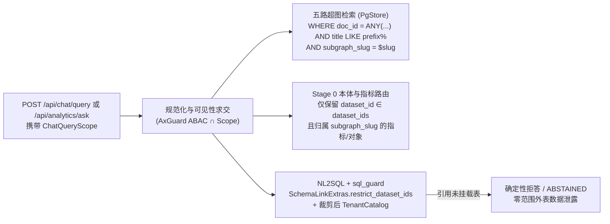

# 06 · Step 20：AxSim 范围预检、AxQuery 显式作用域与五区驾驶舱

本步在推演沙盘创建、多源融合问数、数字孪生驾驶舱发布与业务图谱检索四个高频交互出口建立**静态完整度预检**与**显式上下文边界锁定**：`AxSim` 在克隆生产切片前静态评估因果传导覆盖率、跨边聚合闭合度与孤立节点占比；`AxQuery` 支持会话级 `@` 提及与胶囊式范围挂载，在检索与语义编译入口硬隔离数据集、文档、子图与技能端点；`xBlueView` 提供标准 12 列五区语义驾驶舱预设骨架（`CONTROL / SCENE / KPI / INSIGHT / DECISION`）与发布/分享前全组件健康度自检；`xBlueGraph` 提供基于本体 Schema 自动补全的 `(src:NodeType)-[r:EdgeType]->(dst:NodeType)` 图模式筛选栏与可折叠底部汇总表。

总览索引与工程约束见 [00-V2-MASTER-INDEX.md](../00-V2-MASTER-INDEX.md)、[IRON_RULES.md](../../../../IRON_RULES.md) 与 [A1-CONVENTIONS-ENUMS-ROUTES.md](../../../../docs/standards/A1-CONVENTIONS-ENUMS-ROUTES.md)。

---

## 20.0 目标、前置与契约

- **目标**：
  1. `AxSim` 沙盘范围预检接口 `POST /api/axsim/sandboxes/preflight`、纯领域评估内核 `axpoint-domain::sim::preflight` 与 `SandboxWizard.tsx` 预检诊断卡片；
  2. `AxQuery` 会话级显式作用域 `ChatQueryScope`（覆盖 `POST /api/chat/query` 与 `POST /api/analytics/ask`），严格约束五路超图召回与 `SchemaLinkExtras.restrict_dataset_ids` / `TenantCatalog` 白名单；
  3. `xBlueView` 五区语义驾驶舱预设生成器（`CockpitZoneLayout::StandardFiveZone`）与发布前组件级健康预检 `POST /api/xblueview/dashboards/{id}/preflight`（阻断存在缺失数据集、失效指标、越权端点或未配置动作 Schema 的看板进入 `PUBLISHED` 或外部分享态）；
  4. `xBlueGraph` Schema 感知图模式自动补全栏 `GraphPatternBar.tsx` 与底部可折叠统计汇总抽屉。
- **前置**：[Step 16](../grounded-ai/02-STEP16-ONTOLOGY-GROUNDED-ASK-AND-CITATION-GUARD.md)（本体优先问数与引用核验）、[Step 18](./04-STEP18-STUDIO-COPILOT-LINEAGE-AND-SPEC-DOC.md)（Studio 成熟度状态与血缘）通过；底层存储复用已有迁移 `0005`、`0010`、`0011`（见 [A2](../../../../docs/standards/A2-DATABASE-MIGRATIONS-INDEX.md)，**本步无新增 SQL 表**）。
- **关联能力追踪**：
  - `C73`：`step20` `"sim-preflight-warn"`、`"sim-preflight-closed"`
  - `C74`：`step20` `"scoped-ask-isolated"`、`"view-zone-preset"`、`"view-publish-preflight"`
- **契约清单**：
  - `axpoint-domain::sim::preflight`：`ScopePreflightRequest`、`ScopePreflightSlice`、`ScopePreflightReport`、`ScopeReadinessGrade`、`TruncatedEdgeDiagnostic`
  - `axpoint-domain::analytics` & `axpoint-domain`：`ChatQueryScope`、`ChatQueryRequest.scope`、`ChatQueryResponse.applied_scope`、`AskContext` 扩展字段
  - `axpoint-domain::view`：`CockpitZoneLayout`、`SemanticZoneKind`、`CockpitZoneSlot`、`DashboardPreflightReport`、`DashboardPreflightStatus`、`WidgetPreflightIssue`、`WidgetIssueCode`
  - `axpoint-domain::graph`：`SubgraphQuery` 模式过滤扩展（`src_type`、`edge_type`、`dst_type`、`subgraph`）
  - 端口扩展：`SimRepository::preview_scope_slice`、`ViewRepository::load_preflight_dependencies`
  - 接口契约：[API_CONTRACT.md](../../../../docs/API_CONTRACT.md) 与 [A4-API-CONTRACT-INDEX.md](../../../../docs/standards/A4-API-CONTRACT-INDEX.md) 增量路由
  - 前端客户端：`src/lib/api/{axsim,rag,analytics,xblueview,xblue}.ts`

### 文件变更清单

| 动作 | 路径 | 内容 |
| :--- | :--- | :--- |
| 新建 | `axpoint-core/crates/axpoint-domain/src/sim/preflight.rs` | 沙盘范围完整度纯函数评估内核（§20.1） |
| 修改 | `axpoint-core/crates/axpoint-domain/src/sim/mod.rs` | 导出 `preflight` 模块公共契约类型 |
| 修改 | `axpoint-core/crates/axpoint-domain/src/{lib.rs, analytics.rs, enums.rs, graph.rs, ports.rs}` | `ChatQueryScope`、`CockpitZoneLayout`、`SubgraphQuery` 模式字段与端口定义 |
| 新建 | `axpoint-core/crates/axpoint-domain/src/view_zones.rs`（并在 `view.rs` 导出） | 五区语义驾驶舱 12 列预设生成与组件预检规则（§20.3） |
| 修改 | `axpoint-core/crates/axpoint-db/src/{sim_repo.rs, graph_repo.rs, rag_repo.rs}` | 只读范围切片统计查询、五路检索作用域下推过滤、三元图模式子图查询 |
| 修改 | `axpoint-core/crates/axpoint-analytics/src/nl2sql/{mod.rs, schema_link.rs}` | 作用域锁定 `TenantCatalog` 子集与 `SchemaLinkExtras.restrict_dataset_ids` |
| 修改 | `axpoint-core/crates/axpoint-server/src/routes/{axsim.rs, documents.rs, analytics.rs, xblueview.rs, xblue.rs}` | 挂载沙盘预检、作用域问数、驾驶舱预设与发布预检、图模式过滤处理器 |
| 修改 | `xbluenode-web/src/lib/api/{axsim.ts, rag.ts, analytics.ts, xblueview.ts, xblue.ts}` | Zod 校验与强类型客户端方法 |
| 修改 | `xbluenode-web/src/components/axsim/SandboxWizard.tsx` | 接入防抖预检请求、四维健康指标卡、`补齐类型` 快捷操作与阻断保护 |
| 新建 | `xbluenode-web/src/components/axquery/QueryScopeBar.tsx`；修改 `src/pages/AxQueryPage.tsx` | `@` 提及检索浮层与会话级胶囊式范围栏（§20.2） |
| 新建 | `xbluenode-web/src/components/xblueview/PublishPreflightModal.tsx`；修改 `src/pages/XBlueViewPage.tsx`、`src/components/xblueview/DashboardGrid.tsx` | 五区语义布局骨架初始化、分区边框标题与发布/分享前健康自检弹窗（§20.3） |
| 新建 | `xbluenode-web/src/components/xbluegraph/GraphPatternBar.tsx`；修改 `src/pages/XBlueGraphPage.tsx` | `(src)-[r]->(dst)` 自动补全模式栏与底部可折叠统计表（§20.4） |
| 新建 | `scripts/gate/step20.sh` | Step 20 自动化业务门禁（§20.6） |

---

## 20.1 `AxSim` 沙盘范围静态健康预检

在 [Step 10](../../v1-foundation-step00-14/09-STEP10-AXSIM-SIMULATION-AND-DECISION.md) 基线中，创建沙盘直接按 `SandboxScope` 异步克隆节点与关系。若用户筛选的 `type_names`、`link_types` 或跳数 `depth` 截断了关键上游传导边或跨边聚合邻居，稳态求解会出现“有干预无传导”或聚合基线失真。本节在不写库的前提下对候选 `SandboxScope` 执行只读静态健康诊断。

### 20.1.1 领域契约（`axpoint-domain::sim::preflight`）

```rust
/// Readiness classification returned by `POST /api/axsim/sandboxes/preflight`.
#[derive(Debug, Clone, Copy, PartialEq, Eq, PartialOrd, Ord, Hash, Serialize, Deserialize)]
#[serde(rename_all = "SCREAMING_SNAKE_CASE")]
pub enum ScopeReadinessGrade {
    /// Scope forms a well-connected causal & aggregation-closed subgraph.
    Ready,
    /// Cloning is allowed, but truncated causal edges or open aggregation rules may degrade fidelity.
    Degraded,
    /// Scope is empty, exceeds `max_nodes`, or lacks any valid causal propagation edge across multiple nodes.
    Blocked,
}

/// Request payload for `POST /api/axsim/sandboxes/preflight`.
#[derive(Debug, Clone, PartialEq, Eq, Serialize, Deserialize)]
#[serde(deny_unknown_fields)]
pub struct ScopePreflightRequest {
    /// Target subgraph slug (defaults to `"main"`).
    #[serde(default = "default_main_subgraph")]
    pub subgraph_slug: String,
    /// Candidate extraction scope to evaluate before cloning.
    pub scope: SandboxScope,
}

/// Per-edge-type truncation diagnostic across the candidate scope boundary.
#[derive(Debug, Clone, PartialEq, Eq, Serialize, Deserialize)]
pub struct TruncatedEdgeDiagnostic {
    /// Relationship type identifier (`EdgeTypeSpec.name`).
    pub link_type: String,
    /// Count of links of this type whose both endpoints lie inside the candidate scope.
    pub in_scope_count: usize,
    /// Count of links incident to in-scope nodes whose opposite endpoint was excluded by `scope`.
    pub boundary_dropped_count: usize,
    /// Upstream or downstream node type excluded at the boundary.
    pub excluded_neighbor_type: String,
    /// Whether `EdgeTypeSpec.propagation` declares active causal rules on this link type.
    pub has_causal_rule: bool,
    /// Whether an `AggRuleSpec` on an in-scope node type aggregates across this link type.
    pub has_agg_rule: bool,
}

/// Deterministic health report produced by `evaluate_scope_preflight`.
#[derive(Debug, Clone, PartialEq, Serialize, Deserialize)]
pub struct ScopePreflightReport {
    /// Overall readiness grade (`READY` | `DEGRADED` | `BLOCKED`).
    pub readiness_grade: ScopeReadinessGrade,
    /// Total matched nodes in candidate scope `S`.
    pub estimated_nodes: usize,
    /// Total induced links with both `src_node_id ∈ S` and `dst_node_id ∈ S`.
    pub estimated_links: usize,
    /// Ratio (`0.0..=1.0`) of in-scope links covered by executable `PropagationSpec` rules.
    pub causal_edge_coverage_ratio: f64,
    /// Ratio (`0.0..=1.0`) of incident aggregation links whose neighbor nodes also belong to `S`.
    pub agg_rule_closure_ratio: f64,
    /// Ratio (`0.0..=1.0`) of in-scope nodes having zero incident in-scope links.
    pub isolated_node_ratio: f64,
    /// Sorted node type names excluded by `scope` but required by causal inflow or `AggRuleSpec`.
    pub missing_upstream_types: Vec<String>,
    /// Detailed edge truncation breakdown ordered by `boundary_dropped_count` descending.
    pub truncated_edge_types: Vec<TruncatedEdgeDiagnostic>,
    /// Concise machine codes explaining `DEGRADED` or `BLOCKED` status.
    pub reason_codes: Vec<String>,
}
```

### 20.1.2 只读切片采样与精确指标定义

1. **数据库只读切片提取（`SimRepository::preview_scope_slice`）**：
   - 在 `axpoint-db/src/sim_repo.rs` 复用沙盘克隆的同一条递归 CTE 展开候选节点集合 $S$（上限截取 `min(scope.max_nodes + 1, 100_000)` 以判定是否超限，不写入 `ax_sim_base_*`）。
   - 单次 SQL 聚合统计：
     - 按 `type_name` 分组的范围节点数与孤立节点数（在诱导子图 $G[S] = (S, E_S)$ 中度数 $\deg_{G[S]}(v) = 0$ 的节点）；
     - 诱导边集 $E_S = \{(u, v) \in E \mid u \in S \land v \in S\}$ 按 `(link_type, src_type_name, dst_type_name)` 的分组计数；
     - 跨边界截断边集 $E_{\partial S} = \{(u, v) \in E \mid (u \in S \land v \notin S) \lor (u \notin S \land v \in S)\}$ 按 `(link_type, direction_from_S, excluded_type_name)` 的分组计数。
   - 同时读取对应子图最新发布或当前草稿的 `SchemaDoc`（含 `EdgeTypeSpec.propagation` 与 `NodeTypeSpec.agg_rules`），交由纯函数 `axpoint-domain::sim::preflight::evaluate_scope_preflight` 计算。

2. **四项核心比率与分级判定公式**：
   - **因果边覆盖率（`causal_edge_coverage_ratio`）**：设 $E_S^{\text{causal}} \subseteq E_S$ 为所属 `EdgeTypeSpec` 配置了至少一条有效 `PropagationRule`（源指标存在于 `src_type_name` 且目标指标存在于 `dst_type_name`）的诱导边子集：
     $$
     R_{\text{causal}} = \begin{cases} 1.0, & |S| \le 1 \land |E_S| = 0 \\ 0.0, & |S| > 1 \land |E_S| = 0 \\ \dfrac{|E_S^{\text{causal}}|}{|E_S|}, & |E_S| > 0 \end{cases}
     $$
   - **跨边聚合闭合度（`agg_rule_closure_ratio`）**：对 $S$ 中所有声明了 `AggRuleSpec` 的节点类型，设其匹配 `(via_link_type, direction, source_type_name)` 的内部闭合边总数为 $M_{\text{in}}$，被边界排除邻居的同类跨界边总数为 $M_{\text{drop}}$：
     $$
     R_{\text{agg}} = \begin{cases} 1.0, & M_{\text{in}} + M_{\text{drop}} = 0 \\ \dfrac{M_{\text{in}}}{M_{\text{in}} + M_{\text{drop}}}, & M_{\text{in}} + M_{\text{drop}} > 0 \end{cases}
     $$
   - **孤立节点占比（`isolated_node_ratio`）**：
     $$
     R_{\text{iso}} = \begin{cases} 0.0, & |S| = 0 \\ \dfrac{|\{v \in S \mid \deg_{G[S]}(v) = 0\}|}{|S|}, & |S| > 0 \end{cases}
     $$
   - **缺失上游/依赖类型集合（`missing_upstream_types`）**：所有满足 `boundary_dropped_count > 0` 且（属于入向因果传导边 `u ∉ S -> v ∈ S` 或命中 `AggRuleSpec.source_type_name`）的 `excluded_neighbor_type`，按字典序去重输出。
   - **确定性分级表（`ScopeReadinessGrade`）**：

| 等级 | 触发条件（自上而下短路匹配） | `reason_codes` 取值 | 前端行为 |
| :--- | :--- | :--- | :--- |
| `BLOCKED` | `estimated_nodes == 0` | `EMPTY_SCOPE` | 禁用「创建沙盘」按钮并高亮范围条件 |
| `BLOCKED` | `estimated_nodes > scope.max_nodes` | `MAX_NODES_EXCEEDED` | 禁用「创建沙盘」按钮，提示收敛深度或种子 |
| `BLOCKED` | `estimated_nodes > 1 && estimated_links > 0 && causal_edge_coverage_ratio == 0.0` 或 `estimated_nodes > 1 && estimated_links == 0` | `NO_CAUSAL_PATH` | 禁用「创建沙盘」按钮，列出缺失传导边 |
| `DEGRADED` | `agg_rule_closure_ratio < 0.80` / `causal_edge_coverage_ratio < 0.50` / `isolated_node_ratio > 0.40` / `!missing_upstream_types.is_empty()` | `OPEN_AGG_BOUNDARY` / `LOW_CAUSAL_COVERAGE` / `HIGH_ISOLATED_RATIO` / `MISSING_UPSTREAM_TYPES` | 允许创建，展示黄色诊断条与「补齐类型」按钮 |
| `READY` | 其余全部闭合场景 | `[]` | 展示绿色「就绪」状态徽标 |

3. **前端交互（`SandboxWizard.tsx`）**：
   - 当向导处于新建态且任一范围条件变更时，经 `350ms` 防抖调用 `axsimApi.preflightSandbox({ subgraph_slug: selectedSubgraph, scope })`。
   - 渲染紧凑预检面板：顶部右侧显示 `StatusBadge`（`就绪` / `有损` / `阻断`），四格指标展示 `预计节点`、`因果覆盖率`、`聚合闭合度`、`孤立占比`。
   - 当 `missing_upstream_types.length > 0` 时，渲染缺失类型胶囊与单个 `补齐类型` 按钮（触发后将缺失类型并入 `selectedTypes`、清空过窄 `selectedLinkTypes` 限制并自动重跑预检）。

---

## 20.2 `AxQuery` 会话级显式上下文选择器

默认全局检索在租户存在数十张相近业务表或历史版本规程文档时容易引入跨业务域噪声。本节在 `AxQuery` 引入会话级显式作用域 `ChatQueryScope`，支持用户通过 `@` 符号呼出检索浮层或通过输入栏上方胶囊条精确钉住本会话的数据与技能范围。

### 20.2.1 作用域契约与请求透传

在 `axpoint-core/crates/axpoint-domain/src/analytics.rs` 定义（并由 `axpoint-domain` 根模块重导出）：

```rust
/// Explicit session-pinned retrieval and analytical scope (`06-STEP20` §20.2).
#[derive(Debug, Clone, Default, PartialEq, Eq, Serialize, Deserialize)]
#[serde(deny_unknown_fields)]
pub struct ChatQueryScope {
    /// Restrict structured SQL / metric candidates to these `ds_datasets.id` UUIDs.
    #[serde(default)]
    pub dataset_ids: Vec<Uuid>,
    /// Restrict hypergraph document recall to these `hg_docs.id` UUIDs.
    #[serde(default)]
    pub doc_ids: Vec<Uuid>,
    /// Optional document title prefix filter (`hg_docs.title LIKE prefix || '%'`).
    #[serde(default, skip_serializing_if = "Option::is_none")]
    pub doc_title_prefix: Option<String>,
    /// Optional business subgraph slug bounding `NodeTypeSpec`, `xb_nodes`, and ontology routing.
    #[serde(default, skip_serializing_if = "Option::is_none")]
    pub subgraph_slug: Option<String>,
    /// Optional published capability endpoint slugs (`ax_published_endpoints.slug`) pinned for hybrid invocation.
    #[serde(default)]
    pub endpoint_slugs: Vec<String>,
}
```

- `POST /api/chat/query`：`ChatQueryRequest` 增加 `#[serde(default)] pub scope: Option<ChatQueryScope>`；`ChatQueryResponse` 增加 `#[serde(skip_serializing_if = "Option::is_none")] pub applied_scope: Option<ChatQueryScope>`。
- `POST /api/analytics/ask`：`AskContext` 同步扩展可选字段 `doc_ids: Vec<Uuid>`、`doc_title_prefix: Option<String>`、`subgraph_slug: Option<String>`、`endpoint_slugs: Vec<String>`（与既有 `dataset_ids` 保持 100% 向后兼容）。

### 20.2.2 后端五路召回与语义编译硬边界

`ChatQueryScope` 非空时，严禁采用“全库召回后再做应用层截断”的软过滤，必须在存储层与 AST 守卫层双向硬锁死：



1. **权限求交优先**：先按当前 `AuthPrincipal` 计算 `AxGuard` 允许访问的数据集、子图与端点集合，再与 `ChatQueryScope` 求交集；若用户显式传入无权访问的 `dataset_id` 或 `subgraph_slug`，立即返回 `403 FORBIDDEN`（不静默忽略，防止探测枚举）。
2. **五路超图检索下推（`axpoint-db/src/rag_repo.rs`）**：
   - 当 `doc_ids` 非空或 `doc_title_prefix` 非空时，向量通道（`hg_embeddings`）、全文通道（`hg_paras` FTS）、实体共现通道（`hg_edges`）均在 SQL 子查询内联 `JOIN hg_docs d ON d.id = p.doc_id` 并施加 `d.id = ANY($doc_ids)` 与 `starts_with(d.title, $prefix)`（使用参数化绑定并转义 `%` / `_` 通配符）。
   - 当 `subgraph_slug` 非空时，业务图谱节点召回通道限定 `xb_nodes.subgraph_slug = $subgraph_slug`（主图对应 `'main'`）。
3. **问数目录裁剪与 AST 守卫（`axpoint-analytics`）**：
   - 当 `scope.dataset_ids` 非空时：
     - `SchemaLinkExtras.restrict_dataset_ids` 设为 `scope.dataset_ids.clone()`；
     - 传入 Stage 0 本体指标路由器（Step 16）的 `all_metrics` 仅保留 `m.dataset_id` 落在 `restrict_dataset_ids` 内的认证指标；
     - 传入 `sql_guard::guard` 的 `TenantCatalog` 裁剪为**仅含 `restrict_dataset_ids` 对应的数据湖表**。即使模型在上下文中猜测同租户其他表名，`sql_guard` 也会因目录未命中直接拒绝执行；若问题询问的对象完全不在已挂载数据集中，路由器直接返回 `grounding_mode = "ABSTAINED"` 确定性拒答说明，零范围外行数据返回。
4. **技能端点收窄**：当 `endpoint_slugs` 非空时，混合问答可调用的已发布端点候选集仅保留 `slug ∈ endpoint_slugs` 的 `PROD` 端点。

### 20.2.3 前端组件 `QueryScopeBar.tsx`

- **位置与状态**：挂载于 `AxQueryPage.tsx` 底部提问框上方；当前会话的 `ChatQueryScope` 随 `StoredConversationSession` 持久化至本地会话记录，切换历史会话自动恢复对应挂载胶囊。
- **双入口交互**：
  1. **`@` 提及浮层**：在输入框键入 `@` 字符时弹出分类检索列表（Tab 分组：`数据集`、`文档`、`子图`、`技能`），支持上下方向键与回车选中，选中后剥离输入串中的 `@关键词` 并追加顶部蓝色范围胶囊。
  2. **工具栏快捷挂载**：提供紧凑按钮 `挂载范围` 与一键 `清空`；文档分组支持按标题前缀锁定（如 `SOP-2026-`），显示为 `前缀: SOP-2026-` 胶囊。
- **回执透出**：每轮回答卡片顶栏若存在 `resp.applied_scope`，以浅灰紧凑徽标展示本轮生效的作用域项计数（如 `已限定 2 表 · 1 子图`）。

---

## 20.3 `xBlueView` 五区语义驾驶舱预设与发布前自检

### 20.3.1 五区语义布局枚举与 12 列标准网格预设

在 `axpoint-domain/src/enums.rs` 注册 `CockpitZoneLayout`（同步写入 [A1](../../../../docs/standards/A1-CONVENTIONS-ENUMS-ROUTES.md)）：

```rust
define_str_enum! {
    /// Canvas layout preset mode on `xv_dashboards.canvas.zone_layout` (`06-STEP20` §20.3).
    pub enum CockpitZoneLayout {
        /// Unconstrained grid canvas (default 24-column or custom geometry).
        FreeGrid => "FREE_GRID",
        /// Canonical 12-column five-zone operational twin cockpit.
        StandardFiveZone => "STANDARD_FIVE_ZONE",
    }
}

define_str_enum! {
    /// Semantic cockpit region identifier (`xv_widgets.options.semantic_zone`).
    pub enum SemanticZoneKind {
        /// Global time window, subgraph, and dimension filter strip.
        Control => "CONTROL",
        /// Primary north-star KPI summary strip.
        Kpi => "KPI",
        /// Spatial / topological twin scene (`GRAPH_TOPOLOGY`, `SCENE_3D`, `MAP`, `FLOOR_PLAN`).
        Scene => "SCENE",
        /// Multi-dimensional trend and attribution charts.
        Insight => "INSIGHT",
        /// Active alerts, scenario comparison, and writeback action controls.
        Decision => "DECISION",
    }
}
```

- **零迁移存储扩展**：`CanvasConfig`（映射 `xv_dashboards.canvas` JSONB）增加 `#[serde(default = "default_free_grid")] pub zone_layout: CockpitZoneLayout`。存量看板缺省反序列化为 `FREE_GRID`，无需修改 `xv_dashboards` 表结构。
- **12 列标准五区几何规范（`generate_five_zone_preset`）**：当 `CreateDashboardRequest` 指定 `zone_layout: Some(CockpitZoneLayout::StandardFiveZone)`（或调用 `POST /api/xblueview/dashboards/{id}/apply-zone-preset`）时，画布自动设置 `cols = 12, row_height = 32, screen_width = 1920, screen_height = 1080`，并在单事务内生成互不重叠、覆盖完整 12 列的五区标准骨架组件：

| 语义分区 (`semantic_zone`) | 分区标题 | 12 列网格区域 `(x, y, w, h)` | 默认初始化槽位组件 |
| :--- | :--- | :--- | :--- |
| `CONTROL` | `全局控制` | `(0, 0, 12, 2)` | 顶部筛选条关联说明卡（`MARKDOWN_NOTE` 或全局 `filters` 预置时间窗/子图过滤项） |
| `KPI` | `核心指标` | `(0, 2, 12, 3)` | 4 张并排 `KPI_CARD`：`(0,2,3,3)`、` (3,2,3,3)`、`(6,2,3,3)`、`(9,2,3,3)`（自动绑定租户前 4 个认证指标或主图核心节点指标，无指标时置为待绑定静态占位） |
| `SCENE` | `孪生态势` | `(0, 5, 7, 9)` | 1 张主视觉 `GRAPH_TOPOLOGY`：`(0,5,7,9)`（默认加载主图节点与关系） |
| `INSIGHT` | `归因洞察` | `(7, 5, 5, 9)` | 上下 2 张分析图表：`LINE_CHART` `(7,5,5,4)` + `BAR_CHART` `(7,9,5,5)` |
| `DECISION` | `协同决策` | `(0, 14, 12, 5)` | 左 `ALERT_LIST` `(0,14,8,5)`（打开态告警列表）+ 右 `SIM_COMPARE` / `ACTION_BUTTON` 决策槽 `(8,14,4,5)` |

前端 `DashboardGrid.tsx` 在 `canvas.zone_layout === "STANDARD_FIVE_ZONE"` 时按 12 列网格渲染，并在编辑态显示五个语义分区的浅色分区标签（`全局控制` · `核心指标` · `孪生态势` · `归因洞察` · `协同决策`）。

### 20.3.2 发布与分享前全组件健康预检（`POST /api/xblueview/dashboards/{id}/preflight`）

在看板转为 `PUBLISHED` 或创建外部只读分享链接前，后端对看板内全部 `xv_widgets` 及全局 `filters[].options_source` 逐一执行契约与依赖扫描：

```rust
/// Aggregated preflight status for a dashboard prior to publish or external share.
#[derive(Debug, Clone, Copy, PartialEq, Eq, Serialize, Deserialize)]
#[serde(rename_all = "SCREAMING_SNAKE_CASE")]
pub enum DashboardPreflightStatus {
    /// Zero blocking issues and zero warnings.
    Pass,
    /// Zero blocking issues, at least one non-blocking warning (e.g., static placeholder widget).
    Warn,
    /// One or more broken references, unconfigured actions, or unauthorized targets; publish/share blocked.
    Blocked,
}

/// Machine-readable widget validation issue code.
#[derive(Debug, Clone, Copy, PartialEq, Eq, Serialize, Deserialize)]
#[serde(rename_all = "SCREAMING_SNAKE_CASE")]
pub enum WidgetIssueCode {
    MissingDataset,
    BrokenMetric,
    MissingSavedQuery,
    InvalidSqlAst,
    MissingAsset,
    InsufficientScenarios,
    UnconfiguredAction,
    UnauthorizedTarget,
    StaticPlaceholder,
}

/// Single preflight finding tied to a specific widget (or global filter when `widget_id` is `None`).
#[derive(Debug, Clone, PartialEq, Eq, Serialize, Deserialize)]
pub struct WidgetPreflightIssue {
    pub widget_id: Option<Uuid>,
    pub widget_title: String,
    pub semantic_zone: Option<SemanticZoneKind>,
    pub severity: String, // "BLOCKING" | "WARNING"
    pub code: WidgetIssueCode,
    pub message: String,
}

/// Response returned by `POST /api/xblueview/dashboards/{id}/preflight`.
#[derive(Debug, Clone, PartialEq, Eq, Serialize, Deserialize)]
pub struct DashboardPreflightReport {
    pub dashboard_id: Uuid,
    pub status: DashboardPreflightStatus,
    pub checked_widgets: usize,
    pub blocking_count: usize,
    pub warning_count: usize,
    pub issues: Vec<WidgetPreflightIssue>,
}
```

#### 逐数据源类型自检矩阵

| 数据源 / 组件类型 | `BLOCKING` 阻断判定规则 | `WARNING` 提示规则 |
| :--- | :--- | :--- |
| `SavedQuery` | `saved_query_id` 在 `an_saved_queries` 不存在，或其底层 SQL 关联的数据集已被删除 | — |
| `Metric` | `an_metrics` 中不存在同名指标，或 `is_metric_broken(...) == true`（依赖数据集/列缺失） | 指标尚未标记 `certified = true` |
| `Sql` / `Pivot` | `sql_guard::guard` AST 校验不通过，或引用的数据湖表不在当前租户有效 `ds_datasets` 中，或发布者对该数据集无 `DATA_READ` 权限 | — |
| `NodeMetric` | 主图已发布 `SchemaDoc` 中不存在 `type_name`，或该节点类型下不存在对应 `METRIC` 属性 | 当前节点表暂无该类型的实例数据 |
| `FloorPlan` / `Scene3d` | `asset_id` 在 `xv_assets` 中不存在或资产类型不匹配 | 该资产尚未绑定任何节点坐标/Mesh |
| `SimScenarios` | 有效且状态为 `SUCCEEDED` 的 `scenario_ids` 数量 `< 2` | 任一引用场景 `is_stale == true` |
| `Action` (`ACTION_BUTTON` / `ACTION_FORM`) | `RUN_FLOW` 时 `flow_id` 为空、工作流不存在、未部署 `PROD` 版本或发布者无 `FLOW_RUN`；`WRITE_NODE` 时 `node_id` / `target_kind` / `key` 缺失或节点/属性不存在；`action_schema` 不是合法 JSON Schema `object` | — |
| `Static`（非 `MARKDOWN_NOTE`） | — | 图表/指标卡仍处于未绑定真实数据源的 `STATIC` 占位态（`STATIC_PLACEHOLDER`） |

- **硬门控联动**：
  - `POST /api/xblueview/dashboards/{id}/publish` 与 `POST /api/xblueview/shares`（目标为看板时）在事务提交前统一调用 `preflight_dashboard`；
  - 若 `report.blocking_count > 0`，立即拒绝操作并返回 HTTP `422 Unprocessable Entity`（`error_code = "VIEW_PREFLIGHT_BLOCKED"`，响应 `details` 附带完整 `issues` 数组）；`WARNING` 级别允许发布但随响应回传提示。
- **前端交互（`XBlueViewPage.tsx` + `PublishPreflightModal.tsx`）**：
  - 新建看板弹窗新增布局模式分段选择：`自由画布` / `五区驾驶舱`；
  - 工具栏新增 `自检` 按钮，且触发 `发布` 或 `分享` 时先展示 `PublishPreflightModal`：列出检查组件总数、异常项列表及每项右侧的 `定位` 按钮（关闭弹窗并滚动聚焦打开对应 `WidgetEditor`）；无 `BLOCKING` 项时启用主操作按钮 `确认发布`。

---

## 20.4 `xBlueGraph` Schema 感知图模式筛选栏

### 20.4.1 三元图模式查询扩展（`GET /api/xblue/graph/subgraph`）

扩展 `axpoint-domain/src/graph.rs` 中的 `SubgraphQuery`（保持与现有 `?type_names=&link_types=&limit=` 参数完全兼容）：

```rust
pub struct SubgraphQuery {
    #[serde(default)]
    pub type_names: Option<String>,
    #[serde(default)]
    pub link_types: Option<String>,
    /// Optional subgraph slug filter (defaults to `"main"`).
    #[serde(default)]
    pub subgraph: Option<String>,
    /// Pattern source node type (`(src:NodeType)-[r]->(dst)`).
    #[serde(default)]
    pub src_type: Option<String>,
    /// Pattern directed relationship type (`(src)-[r:EdgeType]->(dst)`).
    #[serde(default)]
    pub edge_type: Option<String>,
    /// Pattern destination node type (`(src)-[r]->(dst:NodeType)`).
    #[serde(default)]
    pub dst_type: Option<String>,
    #[serde(default = "default_subgraph_limit")]
    pub limit: u32,
}
```

当 `src_type`、`edge_type`、`dst_type` 中任意字段非空时，`PgStore::query_subgraph` 在 `xb_links l JOIN xb_nodes s ON s.id = l.src_node_id JOIN xb_nodes d ON d.id = l.dst_node_id` 上执行精确模式过滤：
- `($src_type IS NULL OR s.type_name = $src_type)`
- `($edge_type IS NULL OR l.link_type = $edge_type)`
- `($dst_type IS NULL OR d.type_name = $dst_type)`
返回命中的诱导边集合及两端去重节点集合（总节点数受 `limit <= 2000` 约束，并通过 `filter_and_mask_subgraph` 执行 `AxGuard` 节点可见性过滤与 PII 属性脱敏）。

### 20.4.2 前端 `GraphPatternBar.tsx` 与底部折叠汇总表

1. **`GraphPatternBar.tsx`（置于 `XBlueGraphPage.tsx` 画布顶栏）**：
   - 基于当前子图 `xblueApi.getSchema(subgraph)` 实时拉取 `node_types` 与 `edge_types`；
   - 提供三段联动槽位选择器（均基于 `primitives.tsx` 构建，严禁原生 `<select>`）：
     - 源节点槽 `( 源类型 )` → 选定后，关系槽 `[ 关系类型 ]` 自动优先置顶 `src_type_name === srcType` 的合法关系边；
     - 关系槽选定后，目标槽 `( 目标类型 )` 自动锁定或置顶 `dst_type_name`；
   - 同时支持切换至紧凑表达式输入态（占位符示例：`(Supplier)-[SUPPLIES]->(Factory)`），使用确定性状态机解析三元组并校验类型名存在性，操作按钮为 `筛选` 与 `重置`。
2. **可折叠底部汇总表**：
   - 画布底部内嵌折叠抽屉（标题栏显示 `汇总表` + 实时徽标 `节点 N · 关系 M`，右侧展开/收起图标按钮）；
   - 展开后左侧为按 `type_name` 聚合的计数与核心指标均值切面胶囊，右侧为当前命中节点的虚拟化明细表（列：`标识`、`名称`、`类型`、`度数`、前 3 个数值指标），选中任意行即刻联动 `SigmaCanvas` 居中高亮该节点并打开右侧 `NodeInspector`。

---

## 20.5 路由、枚举与标准表增量汇总

契约 PR 合入时同步追加至 [A1](../../../../docs/standards/A1-CONVENTIONS-ENUMS-ROUTES.md)、[A4](../../../../docs/standards/A4-API-CONTRACT-INDEX.md) 与 [A7](../../../../docs/standards/A7-REQUIREMENTS-TRACEABILITY.md)：

| 方法与路径 | 权限 | 请求 / 参数摘要 | 响应摘要 |
| :--- | :--- | :--- | :--- |
| `POST /api/axsim/sandboxes/preflight` | `SIM_RUN` | `{ subgraph_slug?, scope: SandboxScope }` | `ScopePreflightReport`（含 `readiness_grade`、覆盖率、闭合度、截断诊断） |
| `POST /api/chat/query`（扩展） | `DATA_READ` | 新增可选 `scope: ChatQueryScope` | `ChatQueryResponse` 新增 `applied_scope` |
| `POST /api/analytics/ask`（扩展） | `DATA_READ` | `context` 支持 `doc_ids`、`doc_title_prefix`、`subgraph_slug`、`endpoint_slugs` | `AskResponse` 严格受限于已挂载数据集 |
| `POST /api/xblueview/dashboards/{id}/apply-zone-preset` | `VIEW_EDIT` | `{ zone_layout: "STANDARD_FIVE_ZONE" }`（新建看板 `POST /api/xblueview/dashboards` 亦支持 `zone_layout`） | `DashboardDetail`（12 列五区骨架与默认槽位组件） |
| `POST /api/xblueview/dashboards/{id}/preflight` | `VIEW_EDIT` 或 `VIEW_SHARE` | `{}` | `DashboardPreflightReport`（`PASS / WARN / BLOCKED` 与 `issues`） |
| `GET /api/xblue/graph/subgraph`（扩展） | `DATA_READ` | 新增查询参数 `?subgraph=&src_type=&edge_type=&dst_type=` | `SubgraphResponse`（诱导模式子图与 `truncated` 标志） |

---

## 20.6 验收门禁 `scripts/gate/step20.sh`

```bash
#!/usr/bin/env bash
# Step 20 门禁：AxSim 范围预检、AxQuery 会话显式作用域、xBlueView 五区预设与发布自检、xBlueGraph 模式筛选
set -euo pipefail
source "$(dirname "$0")/lib.sh"

# 1. 领域内核与分析作用域单测
(cd "$ROOT/axpoint-core" && \
  cargo test -p axpoint-domain sim::preflight --locked && \
  cargo test -p axpoint-domain view_zones --locked && \
  cargo test -p axpoint-analytics schema_link --locked)

# 2. C73：AxSim 沙盘范围预检（残缺范围告警 vs 完整闭合范围就绪）
# 2a. 仅保留 Factory 类型、排除上游 Supplier 与下游 Warehouse/Order，触发有损告警与缺失上游诊断
PREFLIGHT_WARN=$(api POST /api/axsim/sandboxes/preflight '{
  "subgraph_slug": "main",
  "scope": {
    "root_node_ids": ["'"$FACTORY1_NODE_ID"'"],
    "depth": 2,
    "direction": "BOTH",
    "type_names": ["Factory"],
    "link_types": [],
    "max_nodes": 50000
  }
}')
expect_json "sim-preflight-warn" "$PREFLIGHT_WARN" '
  (.readiness_grade == "DEGRADED" or .readiness_grade == "BLOCKED")
  and (.agg_rule_closure_ratio < 1.0 or (.truncated_edge_types | length) > 0)
  and ((.missing_upstream_types | length) > 0 or (.reason_codes | length) > 0)
'

# 2b. 放开全链路相关节点类型与深度 3，因果覆盖与聚合闭合达到 READY
PREFLIGHT_OK=$(api POST /api/axsim/sandboxes/preflight '{
  "subgraph_slug": "main",
  "scope": {
    "root_node_ids": ["'"$FACTORY1_NODE_ID"'"],
    "depth": 3,
    "direction": "BOTH",
    "type_names": [],
    "link_types": [],
    "max_nodes": 50000
  }
}')
expect_json "sim-preflight-closed" "$PREFLIGHT_OK" '
  .readiness_grade == "READY"
  and .estimated_nodes >= 2
  and .estimated_links >= 1
  and .causal_edge_coverage_ratio > 0
  and .agg_rule_closure_ratio >= 0.8
  and (.missing_upstream_types | length) == 0
'

# 3. C74（上）：AxQuery 显式作用域隔离验证
# 获取租户内两个不同数据集：锁定 DS_A 后询问 DS_B 独有内容，严禁穿透访问 DS_B
DS_LIST=$(api GET '/api/axhub/datasets?limit=20')
DS_FIRST=$(printf '%s' "$DS_LIST" | jq -r '.items[0].id')
DS_FIRST_NAME=$(printf '%s' "$DS_LIST" | jq -r '.items[0].name')
DS_SECOND=$(printf '%s' "$DS_LIST" | jq -r '.items[1].id // empty')

# 创建一张仅用于隔离对照的独立文件数据集（若当前不足 2 张表）
if [[ -z "$DS_SECOND" ]]; then
  TMP_CSV="$ROOT/.gate/step20_isolated_secret.csv"
  printf 'secret_sku_code,isolated_vault_qty\nSKU-Z999,8421\n' > "$TMP_CSV"
  UP_ID=$(curl -sS -X POST -H "Authorization: Bearer $AXPOINT_DEV_TOKEN" \
    -F "file=@${TMP_CSV};type=text/csv" "$CORE_BASE_URL/api/axhub/uploads" | jq -r .id)
  DS_SECOND=$(api POST /api/axhub/datasets "{
    \"name\": \"step20_isolated_vault\",
    \"display_name\": \"隔离对照仓\",
    \"source_kind\": \"FILE_TABLE\",
    \"source_ref\": {\"upload_id\": \"$UP_ID\", \"sheet\": 0}
  }" | jq -r .id)
  wait_dataset_idle "$DS_SECOND"
fi
DS_SECOND_NAME=$(api GET "/api/axhub/datasets/$DS_SECOND" | jq -r .name)

SCOPED_OUT=$(api POST /api/chat/query "{
  \"query\": \"统计表 ${DS_SECOND_NAME} 中的记录总数\",
  \"mode\": \"DATA\",
  \"scope\": {
    \"dataset_ids\": [\"$DS_FIRST\"],
    \"subgraph_slug\": \"main\"
  }
}")
expect_json "scoped-ask-isolated" "$SCOPED_OUT" "
  (.applied_scope.dataset_ids == [\"$DS_FIRST\"])
  and (((.sql // \"\") | contains(\"$DS_SECOND_NAME\")) | not)
  and ((.rows | length) == 0 or .grounding_mode == \"ABSTAINED\" or .grounding_mode == \"CLARIFICATION\")
"

# 4. C74（中）：xBlueView 五区语义驾驶舱预设生成
SLUG_20="step20-five-zone-$(date +%s)"
DASH_20=$(api POST /api/xblueview/dashboards "{
  \"name\": \"五区语义联调驾驶舱\",
  \"slug\": \"$SLUG_20\",
  \"theme\": \"dark\",
  \"zone_layout\": \"STANDARD_FIVE_ZONE\"
}")
DASH_20_ID=$(printf '%s' "$DASH_20" | jq -r .id)
DASH_20_DETAIL=$(api GET "/api/xblueview/dashboards/$DASH_20_ID")
expect_json "view-zone-preset" "$DASH_20_DETAIL" '
  .dashboard.canvas.cols == 12
  and .dashboard.canvas.zone_layout == "STANDARD_FIVE_ZONE"
  and (([.widgets[].options.semantic_zone] | unique | sort) == ["CONTROL","DECISION","INSIGHT","KPI","SCENE"])
  and ([.widgets[] | (.position.x >= 0 and (.position.x + .position.w) <= 12)] | all)
'

# 5. C74（下）：xBlueView 发布前自检阻断失效组件，修复后放行发布
BROKEN_W=$(api POST "/api/xblueview/dashboards/$DASH_20_ID/widgets" '{
  "widget_kind": "ACTION_BUTTON",
  "title": "下发调拨",
  "position": {"x": 8, "y": 19, "w": 4, "h": 2},
  "data_source": {
    "kind": "ACTION",
    "action_type": "RUN_FLOW",
    "flow_id": null
  },
  "options": {"semantic_zone": "DECISION"}
}' | jq -r .id)

PRE_BLOCKED=$(api POST "/api/xblueview/dashboards/$DASH_20_ID/preflight" '{}')
expect_code "view-publish-blocked-http" 422 POST "/api/xblueview/dashboards/$DASH_20_ID/publish" '{}'

# 删除失效动作组件（并将残余未绑定指标槽切换或清理后再次自检发布）
api DELETE "/api/xblueview/dashboards/$DASH_20_ID/widgets/$BROKEN_W" >/dev/null
PRE_AFTER=$(api POST "/api/xblueview/dashboards/$DASH_20_ID/preflight" '{}')
expect_json "view-publish-preflight" "$PRE_BLOCKED" '
  .status == "BLOCKED"
  and .blocking_count >= 1
  and ([.issues[].code] | index("UNCONFIGURED_ACTION") != null)
'
expect_json "view-preflight-cleared" "$PRE_AFTER" '.blocking_count == 0 and (.status == "PASS" or .status == "WARN")'
expect_code "view-publish-ok" 200 POST "/api/xblueview/dashboards/$DASH_20_ID/publish" '{}'

# 6. xBlueGraph 三元图模式过滤核验
EDGE_SAMPLE=$(api GET '/api/xblue/graph/subgraph?limit=50')
SAMPLE_LINK_TYPE=$(printf '%s' "$EDGE_SAMPLE" | jq -r '.links[0].link_type // empty')
if [[ -n "$SAMPLE_LINK_TYPE" ]]; then
  PAT_RESP=$(api GET "/api/xblue/graph/subgraph?edge_type=${SAMPLE_LINK_TYPE}&limit=100")
  expect_json "graph-pattern-filter" "$PAT_RESP" "
    ([.links[].link_type] | all(. == \"$SAMPLE_LINK_TYPE\"))
  "
fi

gate_pass step20
```

**通过标准**：`scripts/gate/step20.sh` 末行输出 `GATE step20 PASS`；`SandboxWizard`、`QueryScopeBar`、`XBlueViewPage`、`GraphPatternBar` 通过 `npm run build` 与 `python3 scripts/web-guard.py` 零告警校验。
