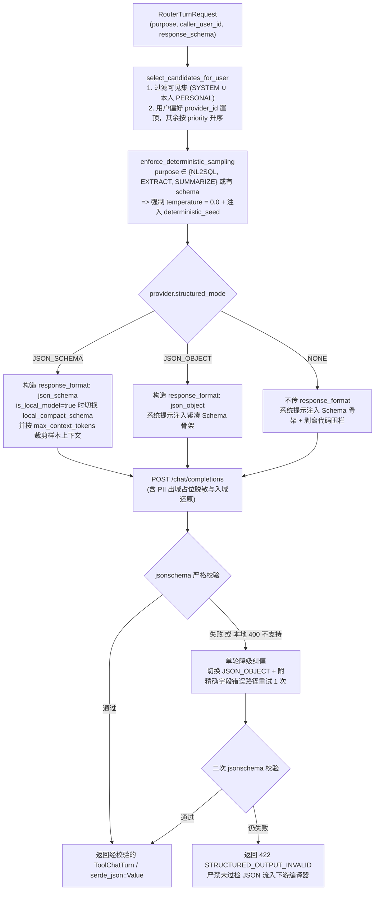

# 01 · Step 15：受限解码、模型能力分级与个人模型覆盖

Step 15 为 `AxPoint` 多模型路由层（`axpoint-llm`）建立面向云端 API 与本地私有化推理引擎（Ollama / vLLM / SGLang，覆盖 7B～32B 参数量级模型）的显式结构化受限解码协议、确定性零温采样锁以及系统级/个人级双层模型治理契约，作为 Phase 2 本体级无幻觉 AI 管道（[00-V2-MASTER-INDEX](../00-V2-MASTER-INDEX.md) §1.1）的底层底座。

---

## 15.0 目标、前置与契约

- **目标**：
  1. 在 `ax_llm_providers` 建立三档结构化解码能力分级（`NONE | JSON_OBJECT | JSON_SCHEMA`）、确定性随机种子（`deterministic_seed`）、本地中小模型标识（`is_local_model`）、最大上下文窗口（`max_context_tokens`）与归属人隔离字段（`owner_user_id`）。
  2. 在 `axpoint-domain::json_schema` 提供兼容 JSON Schema Draft 2020-12 严格子集（`strict: true`、`additionalProperties: false`、全量 `required`）的动态 `JsonSchemaSpec` 构造器，实时注入当前租户已发布的 `NodeTypeSpec`、`EdgeTypeSpec`、`MetricDef` 与 `RollupGrain` 枚举集合。
  3. 在 `axpoint-llm` 扩展 `WireChatCompletionRequest`（`response_format`、`seed`），对 `NL2SQL`、`EXTRACT`、`SUMMARIZE` 三类确定性用途以及所有携带 `response_schema` 的请求物理锁死 `temperature = 0.0`；在返回侧统一执行 `jsonschema` 强校验，并为 `is_local_model = true` 提供浅层语法裁剪与单轮降级修复闭环。
  4. 新增 `ax_user_llm_preferences` 表与 `/api/axagent/llm-preferences` 接口，实现「管理员维护只读系统模型（`owner_user_id IS NULL`）+ 普通用户登记个人模型并按用途指定个人默认模型」的分级覆盖机制。
- **前置**：[Step 14](../../v1-foundation-step00-14/12-STEP14-OPERATIONS-TEMPLATES-ACCEPTANCE.md) 通过（迁移 `0001`～`0014` 与 Phase 1 门禁全绿）。
- **覆盖能力项**：`C60`（受限解码与确定性零温采样，断言 `"schema-guided-ok"`、`"temp-zero-enforced"`）、`C61`（系统只读模型与个人默认模型覆盖，断言 `"user-default-provider"`、`"system-provider-readonly"`）。
- **契约清单**：
  - 数据库迁移：`deploy/migrations/0015_llm_structured_grounding.sql`；
  - 公共枚举：`axpoint-domain::enums::StructuredOutputMode`（同步写入 [A1](../../../../docs/standards/A1-CONVENTIONS-ENUMS-ROUTES.md) §4 与 `xbluenode-web/src/lib/api/enums.ts`）；
  - 领域模型与 Schema 构造器：`axpoint-domain::json_schema::{JsonSchemaSpec, TenantOntologyEnums}`、`axpoint-domain::agent::{LlmProviderRecord, SaveLlmProviderRequest, SaveLlmProviderInput, ProviderScope, UserLlmPreferenceRecord, PutUserLlmPreferencesRequest}`；
  - 端口接口：`axpoint-domain::ports::{LlmProviderStore, AgentRepository, AiPort}`（新增 `AiPort::chat_structured` 默认方法及个人模型偏好读写端口）；
  - 接口与标准文档：`docs/API_CONTRACT.md`、[A2](../../../../docs/standards/A2-DATABASE-MIGRATIONS-INDEX.md)、[A4](../../../../docs/standards/A4-API-CONTRACT-INDEX.md)、[A7](../../../../docs/standards/A7-REQUIREMENTS-TRACEABILITY.md) 增量条目；
  - 前端 API 契约：`xbluenode-web/src/lib/api/axagent.ts`。

### 文件变更清单

| 动作 | 路径 | 内容 |
| :--- | :--- | :--- |
| 新建 | `deploy/migrations/0015_llm_structured_grounding.sql` | 扩展 `ax_llm_providers` 结构化能力与归属列；新建 `ax_user_llm_preferences` 并开启租户 RLS（§15.1） |
| 修改 | `axpoint-core/crates/axpoint-domain/src/enums.rs` | 新增 `StructuredOutputMode`（`NONE` / `JSON_OBJECT` / `JSON_SCHEMA`）（§15.2.1） |
| 新建 | `axpoint-core/crates/axpoint-domain/src/json_schema.rs` | `JsonSchemaSpec`、`TenantOntologyEnums` 与严格 Draft 2020-12 动态枚举构造器（§15.2.2） |
| 修改 | `axpoint-core/crates/axpoint-domain/src/lib.rs` | 导出 `pub mod json_schema;` |
| 修改 | `axpoint-core/crates/axpoint-domain/src/agent.rs` | 扩展 `LlmProviderRecord`、`SaveLlmProviderRequest`、`SaveLlmProviderInput`、`ProviderTestResponse`；新增 `ProviderScope`、`UserLlmPreferenceRecord`、`PutUserLlmPreferencesRequest`（§15.2.3） |
| 修改 | `axpoint-core/crates/axpoint-domain/src/ports.rs` | `LlmProviderStore` 增加 `list_user_preferences`；`AgentRepository` 增加作用域过滤与偏好持久化；`AiPort` 增加 `chat_structured`（§15.2.4） |
| 新建 | `axpoint-core/crates/axpoint-llm/src/structured.rs` | `WireResponseFormat` 适配、本地 7B～32B 浅层 Schema 降级、`jsonschema` 返回核验与单轮纠偏（§15.3.2～§15.3.3） |
| 修改 | `axpoint-core/crates/axpoint-llm/src/tools.rs` | `WireChatCompletionRequest` 增加 `response_format`、`seed`；`canonical_request_transcript` 纳入 `SCHEMA:` 摘要（§15.3.1） |
| 修改 | `axpoint-core/crates/axpoint-llm/src/router.rs` | `RouterTurnRequest` 支持 `caller_user_id` 与 `response_schema`；零温强制守卫；用户默认模型优先选路与跨用户隔离（§15.3.4） |
| 修改 | `axpoint-core/crates/axpoint-llm/src/{lib.rs, cassette.rs, schema_draft.rs}` | `AiGateway::for_user` 与 `chat_structured` 接入；`CassetteEntry` 扩展 `response_schema_name`；`schema_draft` 改用受限解码 |
| 修改 | `axpoint-core/crates/axpoint-db/src/agent_repo/{mod.rs, providers.rs}` | 读写 `ax_llm_providers` 新增列与 `ax_user_llm_preferences`（§15.4.1） |
| 修改 | `axpoint-core/crates/axpoint-server/src/routes/axagent.rs` | 系统提供方只读保护（仅 `GUARD_ADMIN` / `OPS_ADMIN` 可写）、个人提供方 CRUD 隔离、`GET/PUT /api/axagent/llm-preferences`、连通测试结构化核验（§15.4.2） |
| 修改 | `docs/API_CONTRACT.md`、`docs/standards/{A1-CONVENTIONS-ENUMS-ROUTES.md, A2-DATABASE-MIGRATIONS-INDEX.md, A4-API-CONTRACT-INDEX.md, A7-REQUIREMENTS-TRACEABILITY.md}` | 同步 `StructuredOutputMode`、`0015` 迁移、偏好路由与 `C60`～`C61` 追踪项 |
| 修改 | `xbluenode-web/src/lib/api/{enums.ts, axagent.ts}` | 前端类型与 `getUserLlmPreferences` / `putUserLlmPreferences` 客户端 |
| 修改 | `xbluenode-web/src/components/axagent/ProviderTable.tsx` | 系统/个人作用域徽标、系统只读锁态、结构化解码模式与本地模型预设表单（§15.5） |
| 新建 | `xbluenode-web/src/components/axagent/UserLlmPreferencesBar.tsx` | 按用途（`NL2SQL` / `AGENT` / `CHAT` / `EXTRACT` / `SUMMARIZE` / `EMBED`）选择个人默认提供方（§15.5） |
| 新建 | `tests/cassettes/step15_structured.jsonl` | Step 15 离线确定性录制向量（§15.6） |
| 新建 | `scripts/gate/step15.sh` | Step 15 可执行验收门禁脚本（§15.7） |

---

## 15.1 迁移 `deploy/migrations/0015_llm_structured_grounding.sql`

> 遵循 [IRON_RULES](../../../../IRON_RULES.md) §二.2 幂等迁移规范：`ax_llm_providers` 原 `UNIQUE (tenant_id, name)` 拆分为系统级与个人级两条部分唯一索引，使不同用户的个人提供方名称互不冲突且不覆盖系统提供方；`ax_user_llm_preferences` 启用强制租户级 RLS。

```sql
-- 0015_llm_structured_grounding.sql：受限解码能力分级、确定性种子、本地小模型标识、个人模型归属与默认模型偏好

ALTER TABLE ax_llm_providers
    ADD COLUMN IF NOT EXISTS structured_mode TEXT NOT NULL DEFAULT 'NONE'
        CHECK (structured_mode IN ('NONE', 'JSON_OBJECT', 'JSON_SCHEMA'));

ALTER TABLE ax_llm_providers
    ADD COLUMN IF NOT EXISTS deterministic_seed BIGINT;

ALTER TABLE ax_llm_providers
    ADD COLUMN IF NOT EXISTS is_local_model BOOLEAN NOT NULL DEFAULT FALSE;

ALTER TABLE ax_llm_providers
    ADD COLUMN IF NOT EXISTS max_context_tokens INT NOT NULL DEFAULT 32768
        CHECK (max_context_tokens >= 2048 AND max_context_tokens <= 2097152);

-- NULL 表示租户级系统提供方（仅管理员可写、全员只读可见）；非空表示该用户私有提供方
ALTER TABLE ax_llm_providers
    ADD COLUMN IF NOT EXISTS owner_user_id UUID REFERENCES sec_users(id) ON DELETE CASCADE;

ALTER TABLE ax_llm_providers
    DROP CONSTRAINT IF EXISTS ax_llm_providers_tenant_id_name_key;

CREATE UNIQUE INDEX IF NOT EXISTS uq_ax_llm_providers_system_name
    ON ax_llm_providers (tenant_id, name)
    WHERE owner_user_id IS NULL;

CREATE UNIQUE INDEX IF NOT EXISTS uq_ax_llm_providers_owner_name
    ON ax_llm_providers (tenant_id, owner_user_id, name)
    WHERE owner_user_id IS NOT NULL;

CREATE INDEX IF NOT EXISTS idx_ax_llm_providers_owner
    ON ax_llm_providers (tenant_id, owner_user_id);

CREATE TABLE IF NOT EXISTS ax_user_llm_preferences (
    tenant_id   TEXT NOT NULL,
    user_id     UUID NOT NULL REFERENCES sec_users(id) ON DELETE CASCADE,
    purpose     TEXT NOT NULL
                CHECK (purpose IN ('CHAT', 'EMBED', 'NL2SQL', 'EXTRACT', 'AGENT', 'SUMMARIZE')),
    provider_id UUID NOT NULL REFERENCES ax_llm_providers(id) ON DELETE CASCADE,
    updated_at  TIMESTAMPTZ NOT NULL DEFAULT NOW(),
    PRIMARY KEY (tenant_id, user_id, purpose)
);

CREATE INDEX IF NOT EXISTS idx_ax_user_llm_preferences_provider
    ON ax_user_llm_preferences (provider_id);

SELECT ax_enable_tenant_rls('ax_user_llm_preferences');
```

---

## 15.2 领域契约与动态 JSON Schema 构造器（`axpoint-domain`）

### 15.2.1 `StructuredOutputMode`（`axpoint-domain/src/enums.rs`）

```rust
/// Capability level for structured JSON output decoding on an [`crate::agent::LlmProviderRecord`].
#[derive(Debug, Clone, Copy, Default, PartialEq, Eq, Hash, Serialize, Deserialize)]
#[serde(rename_all = "SCREAMING_SNAKE_CASE")]
pub enum StructuredOutputMode {
    /// Upstream endpoint does not accept `response_format`; prompt skeleton + post-parse validation only.
    #[default]
    None,
    /// Upstream accepts `response_format: {"type": "json_object"}`.
    JsonObject,
    /// Upstream accepts grammar-constrained `response_format: {"type": "json_schema", "json_schema": ...}`
    /// (cloud APIs, vLLM `guided_json`, SGLang `xgrammar`, Ollama `/v1/chat/completions` structured mode).
    JsonSchema,
}

impl StructuredOutputMode {
    /// Returns the canonical database and wire string representation.
    #[must_use]
    pub const fn as_str(self) -> &'static str {
        match self {
            Self::None => "NONE",
            Self::JsonObject => "JSON_OBJECT",
            Self::JsonSchema => "JSON_SCHEMA",
        }
    }
}
```

### 15.2.2 动态枚举注入与严格 Schema 构造器（`axpoint-domain/src/json_schema.rs`）

为同时兼容云端严格模式（要求每个 `type: "object"` 节点显式包含 `"additionalProperties": false` 且所有属性键全部列入 `"required"`）与本地推理引擎（vLLM `xgrammar` / `outlines`、Ollama GBNF 状态机），`JsonSchemaSpec` 统一生成符合 JSON Schema Draft 2020-12 严格交集规范的 Schema 树：

```rust
//! Strict Draft 2020-12 JSON Schema specifications with dynamic tenant ontology enum injection.

use std::collections::BTreeMap;

use serde::{Deserialize, Serialize};
use serde_json::{Map, Value, json};

use crate::analytics::MetricDef;
use crate::studio::{EdgeTypeSpec, NodeTypeSpec};

/// Dynamic tenant ontology & semantic catalog identifiers injected as `enum` constraints.
#[derive(Debug, Clone, Default, PartialEq, Eq, Serialize, Deserialize)]
pub struct TenantOntologyEnums {
    /// Published `NodeTypeSpec.name` values (e.g., `["Factory", "Order", "Warehouse"]`).
    pub node_types: Vec<String>,
    /// Published `EdgeTypeSpec.name` values (e.g., `["FULFILLS", "SUPPLIES"]`).
    pub edge_types: Vec<String>,
    /// Active non-broken `MetricDef.name` identifiers (e.g., `["paid_amount", "on_time_rate"]`).
    pub metric_names: Vec<String>,
    /// Allowed dimension identifiers per `MetricDef.name`.
    pub metric_dimensions: BTreeMap<String, Vec<String>>,
    /// Authorized dataset SQL names in the active `TenantCatalog`.
    pub dataset_names: Vec<String>,
}

/// Self-contained strict JSON Schema contract bound to a structured LLM request.
#[derive(Debug, Clone, PartialEq, Eq, Serialize, Deserialize)]
pub struct JsonSchemaSpec {
    /// Machine identifier (`^[a-zA-Z0-9_-]{1,64}$`) sent as `json_schema.name`.
    pub name: String,
    /// Concise schema description sent as `json_schema.description`.
    pub description: String,
    /// Root JSON Schema object (`type == "object"`, `additionalProperties == false`, full `required`).
    pub schema: Value,
    /// Optional shallow fallback schema (nesting depth <= 2) used when `provider.is_local_model == true`.
    #[serde(default, skip_serializing_if = "Option::is_none")]
    pub local_compact_schema: Option<Value>,
}

impl JsonSchemaSpec {
    /// Constructs a validated strict [`JsonSchemaSpec`], normalizing every nested object to carry
    /// `"additionalProperties": false` and deterministic `"required"` key arrays.
    #[must_use]
    pub fn new_strict(
        name: impl Into<String>,
        description: impl Into<String>,
        raw_schema: Value,
    ) -> Self {
        let mut normalized = raw_schema;
        enforce_strict_object_invariants(&mut normalized);
        Self {
            name: name.into(),
            description: description.into(),
            schema: normalized,
            local_compact_schema: None,
        }
    }

    /// Attaches a flattened grammar-friendly schema variant for `is_local_model = true` (7B–32B models).
    #[must_use]
    pub fn with_local_compact(mut self, raw_compact: Value) -> Self {
        let mut normalized = raw_compact;
        enforce_strict_object_invariants(&mut normalized);
        self.local_compact_schema = Some(normalized);
        self
    }

    /// Returns the effective JSON Schema for a provider (`local_compact_schema` when `is_local_model` is `true`).
    #[must_use]
    pub fn effective_schema(&self, is_local_model: bool) -> &Value {
        if is_local_model && let Some(ref compact) = self.local_compact_schema {
            return compact;
        }
        &self.schema
    }

    /// Builds the strict `{ sql, explanation }` schema for Stage 3 NL2SQL generation.
    #[must_use]
    pub fn nl2sql_draft() -> Self {
        Self::new_strict(
            "axpoint_nl2sql_draft",
            "Guarded DuckDB SELECT draft or clarification explanation when SQL is empty.",
            json!({
                "type": "object",
                "properties": {
                    "sql": { "type": "string" },
                    "explanation": { "type": "string" }
                },
                "required": ["sql", "explanation"],
                "additionalProperties": false
            }),
        )
    }

    /// Builds the Stage 0 semantic metric & domain-object slot extraction schema with dynamic enums (`Step 16`).
    #[must_use]
    pub fn ontology_slot_extraction(enums: &TenantOntologyEnums) -> Self {
        let metric_item = string_or_enum(&enums.metric_names);
        let node_type_prop = nullable_string_or_enum(&enums.node_types);
        let grain_enum = json!({
            "anyOf": [
                { "type": "string", "enum": ["MINUTE", "HOUR", "DAY", "MONTH"] },
                { "type": "null" }
            ]
        });
        let compare_enum = json!({
            "anyOf": [
                { "type": "string", "enum": ["PREVIOUS_PERIOD", "SAME_PERIOD_LAST_YEAR"] },
                { "type": "null" }
            ]
        });
        let full = json!({
            "type": "object",
            "properties": {
                "route": {
                    "type": "string",
                    "enum": ["SINGLE_METRIC", "MULTI_METRIC", "DOMAIN_OBJECT", "CLARIFY", "FALLBACK_SQL"]
                },
                "metric_names": { "type": "array", "items": metric_item.clone() },
                "target_node_type": node_type_prop,
                "dimensions": { "type": "array", "items": { "type": "string" } },
                "filters": {
                    "type": "array",
                    "items": {
                        "type": "object",
                        "properties": {
                            "field": { "type": "string" },
                            "op": {
                                "type": "string",
                                "enum": ["EQ", "NE", "GT", "GTE", "LT", "LTE", "IN", "NOT_IN", "LIKE", "IS_NULL", "IS_NOT_NULL"]
                            },
                            "value_text": { "type": "string" }
                        },
                        "required": ["field", "op", "value_text"],
                        "additionalProperties": false
                    }
                },
                "time_from": { "anyOf": [{ "type": "string" }, { "type": "null" }] },
                "time_to": { "anyOf": [{ "type": "string" }, { "type": "null" }] },
                "grain": grain_enum,
                "compare": compare_enum,
                "include_links": { "type": "array", "items": string_or_enum(&enums.edge_types) },
                "clarification": { "type": "string" }
            },
            "required": [
                "route", "metric_names", "target_node_type", "dimensions",
                "filters", "time_from", "time_to", "grain", "compare",
                "include_links", "clarification"
            ],
            "additionalProperties": false
        });

        // 浅层紧凑版：消除 anyOf 联合与深层嵌套，保证 7B~32B 模型 GBNF/xgrammar 首字节延迟 < 20ms
        let compact = json!({
            "type": "object",
            "properties": {
                "route": {
                    "type": "string",
                    "enum": ["SINGLE_METRIC", "MULTI_METRIC", "DOMAIN_OBJECT", "CLARIFY", "FALLBACK_SQL"]
                },
                "metric_names": { "type": "array", "items": metric_item },
                "target_node_type": { "type": "string" },
                "dimensions": { "type": "array", "items": { "type": "string" } },
                "filter_exprs": {
                    "type": "array",
                    "items": { "type": "string" }
                },
                "time_from": { "type": "string" },
                "time_to": { "type": "string" },
                "grain": { "type": "string", "enum": ["", "MINUTE", "HOUR", "DAY", "MONTH"] },
                "compare": { "type": "string", "enum": ["", "PREVIOUS_PERIOD", "SAME_PERIOD_LAST_YEAR"] },
                "include_links": { "type": "array", "items": string_or_enum(&enums.edge_types) },
                "clarification": { "type": "string" }
            },
            "required": [
                "route", "metric_names", "target_node_type", "dimensions",
                "filter_exprs", "time_from", "time_to", "grain", "compare",
                "include_links", "clarification"
            ],
            "additionalProperties": false
        });

        Self::new_strict(
            "axpoint_ontology_slots",
            "Deterministic ontology & certified metric slot extraction payload.",
            full,
        )
        .with_local_compact(compact)
    }

    /// Builds a single-metric compact slot schema pinned to `metric` and its declared `dimensions`.
    #[must_use]
    pub fn single_metric_slot(metric: &MetricDef) -> Self {
        let dim_names: Vec<String> = metric.dimensions.iter().map(|d| d.name.clone()).collect();
        let mut enums = TenantOntologyEnums::default();
        enums.metric_names.push(metric.name.clone());
        if !dim_names.is_empty() {
            enums.metric_dimensions.insert(metric.name.clone(), dim_names);
        }
        Self::ontology_slot_extraction(&enums)
    }

    /// Builds a domain-object query slot schema scoped to `node_type` and its incident `edge_types`.
    #[must_use]
    pub fn domain_object_slot(node_type: &NodeTypeSpec, edge_types: &[EdgeTypeSpec]) -> Self {
        let mut enums = TenantOntologyEnums::default();
        enums.node_types.push(node_type.name.clone());
        for edge in edge_types {
            if edge.src_type_name == node_type.name || edge.dst_type_name == node_type.name {
                enums.edge_types.push(edge.name.clone());
            }
        }
        Self::ontology_slot_extraction(&enums)
    }
}
```

> `enforce_strict_object_invariants` 递归遍历 `properties`、`items`、`anyOf`、`$defs`：凡含 `"type": "object"` 且存在 `"properties"` 的对象节点，自动补齐 `"additionalProperties": false` 并按字典序填充 `"required"`（排除动态键值映射），杜绝因手写 Schema 漏标属性导致云端 API 或 vLLM 返回 `400 invalid_json_schema`。

### 15.2.3 提供方作用域与用户偏好模型（`axpoint-domain/src/agent.rs`）

```rust
/// Ownership scope when listing or saving an [`LlmProviderRecord`].
#[derive(Debug, Clone, Copy, Default, PartialEq, Eq, Serialize, Deserialize)]
#[serde(rename_all = "SCREAMING_SNAKE_CASE")]
pub enum ProviderScope {
    /// Tenant-wide system provider (`owner_user_id IS NULL`), editable only by `GUARD_ADMIN` / `OPS_ADMIN`.
    #[default]
    System,
    /// Caller-owned personal provider (`owner_user_id == Some(caller.user_id)`).
    Personal,
}

/// Extended fields on [`LlmProviderRecord`] (`0015_llm_structured_grounding.sql`).
pub struct LlmProviderRecord {
    // ... 保留 Step 09 / Step 13 全部既有字段 ...
    /// Structured decoding mode supported by this upstream endpoint (`NONE` / `JSON_OBJECT` / `JSON_SCHEMA`).
    #[serde(default)]
    pub structured_mode: StructuredOutputMode,
    /// Optional fixed integer seed passed on deterministic workloads (`NL2SQL`, `EXTRACT`, `SUMMARIZE`).
    #[serde(default)]
    pub deterministic_seed: Option<i64>,
    /// `true` when backed by a local 7B–32B inference runtime (activates compact schema & tight context budget).
    #[serde(default)]
    pub is_local_model: bool,
    /// Maximum context window size in tokens (default `32768`).
    #[serde(default = "default_max_context_tokens")]
    pub max_context_tokens: i32,
    /// Owning user UUID (`None` = system-wide provider, `Some(uid)` = personal provider).
    #[serde(default)]
    pub owner_user_id: Option<Uuid>,
    /// Computed per-caller read-only flag (`true` for system providers when caller lacks `GUARD_ADMIN` / `OPS_ADMIN`).
    #[serde(default)]
    pub is_readonly: bool,
}

const fn default_max_context_tokens() -> i32 {
    32_768
}

/// Single `(purpose -> provider_id)` row in `ax_user_llm_preferences`.
#[derive(Debug, Clone, PartialEq, Eq, Serialize, Deserialize)]
pub struct UserLlmPreferenceRecord {
    /// Workload purpose (`CHAT`, `EMBED`, `NL2SQL`, `EXTRACT`, `AGENT`, `SUMMARIZE`).
    pub purpose: Purpose,
    /// Preferred `ax_llm_providers.id` (system or caller's own personal provider).
    pub provider_id: Uuid,
    /// Resolved provider display name.
    pub provider_name: String,
    /// Last update timestamp.
    pub updated_at: DateTime<Utc>,
}

/// Item inside [`PutUserLlmPreferencesRequest`].
#[derive(Debug, Clone, Deserialize)]
#[serde(deny_unknown_fields)]
pub struct UserLlmPreferenceItem {
    /// Target workload purpose.
    pub purpose: Purpose,
    /// Selected provider UUID.
    pub provider_id: Uuid,
}

/// Request payload for `PUT /api/axagent/llm-preferences`.
#[derive(Debug, Clone, Default, Deserialize)]
#[serde(deny_unknown_fields)]
pub struct PutUserLlmPreferencesRequest {
    /// Desired per-purpose default providers for the authenticated user (empty clears all overrides).
    #[serde(default)]
    pub preferences: Vec<UserLlmPreferenceItem>,
}

/// Extended [`ProviderTestResponse`] returned by `POST /api/axagent/providers/{id}/test`.
#[derive(Debug, Clone, Serialize, Deserialize)]
pub struct ProviderTestResponse {
    /// Connectivity and schema check status.
    pub ok: bool,
    /// Round-trip latency in milliseconds.
    pub latency_ms: u64,
    /// Echoed or configured model name.
    pub model: String,
    /// Text or serialized JSON probe reply.
    pub reply: String,
    /// Configured structured decoding mode on the provider.
    #[serde(default)]
    pub structured_mode: StructuredOutputMode,
    /// `true` when `response_format` + `jsonschema` verification succeeded during probe.
    #[serde(default)]
    pub structured_verified: bool,
    /// Actual outbound `temperature` sent in the wire payload (`0.0` for deterministic probe).
    #[serde(default)]
    pub effective_temperature: f32,
}
```

### 15.2.4 端口契约扩展（`axpoint-domain/src/ports.rs`）

1. **`LlmProviderStore`**（对象安全，供 `LlmRouter` 缓存）：
   - `list_tenant_providers(&self, tenant_id: &str) -> BoxFuture<'_, Vec<LlmProviderRecord>>`（返回租户内全部启用/禁用记录含 `owner_user_id`，由 `LlmRouter` 在内存中按 `caller_user_id` 过滤可见集，避免每用户穿透查库）；
   - 新增 `list_user_preferences<'a>(&'a self, tenant_id: &'a str, user_id: Uuid) -> BoxFuture<'a, BTreeMap<Purpose, Uuid>>`（默认实现返回空 `BTreeMap`，兼容既有单测桩）。
2. **`AgentRepository`**：
   - `list_visible_llm_providers(&self, tenant_id: &str, viewer_user_id: Uuid) -> impl Future<Output = Result<Vec<LlmProviderRecord>, AppError>> + Send`（SQL 条件：`owner_user_id IS NULL OR owner_user_id = $2`）；
   - `list_user_llm_preferences(&self, tenant_id: &str, user_id: Uuid) -> impl Future<Output = Result<Vec<UserLlmPreferenceRecord>, AppError>> + Send`；
   - `replace_user_llm_preferences(&self, tenant_id: &str, user_id: Uuid, items: &[(Purpose, Uuid)]) -> impl Future<Output = Result<Vec<UserLlmPreferenceRecord>, AppError>> + Send`。
3. **`AiPort`**：
   - 新增带默认回退实现的 `chat_structured` 方法，供 `axpoint-analytics`（Step 16 第 0 阶段槽位提取与第 3 阶段受控 SQL 生成）无需直接耦合 `axpoint-llm` 即可请求 `JsonSchemaSpec` 受限解码：

```rust
pub trait AiPort: Send + Sync {
    // ... 既有方法保持签名不变 ...

    /// Executes a structured completion validated against `schema` with deterministic `temperature = 0.0`.
    ///
    /// Default implementation delegates to [`AiPort::chat`] and validates the parsed JSON payload
    /// against `schema.schema` so lightweight test doubles remain compatible.
    fn chat_structured(
        &self,
        purpose: crate::enums::Purpose,
        system_prompt: &str,
        user_prompt: &str,
        schema: &crate::json_schema::JsonSchemaSpec,
    ) -> impl Future<Output = Result<serde_json::Value, AppError>> + Send {
        let _ = purpose;
        async move {
            let raw = self.chat(system_prompt, user_prompt).await?;
            crate::json_schema::parse_and_validate_json(&raw, &schema.schema)
        }
    }
}
```

---

## 15.3 受限解码协议、零温采样锁与本地小模型降级（`axpoint-llm`）



### 15.3.1 协议层扩展（`axpoint-llm/src/tools.rs`）

```rust
/// `json_schema` inner descriptor for `OpenAI` / `vLLM` / `SGLang` / `Ollama` constrained decoding.
#[derive(Debug, Clone, PartialEq, Eq, Serialize, Deserialize)]
pub struct WireJsonSchemaPayload {
    /// Schema identifier (`^[a-zA-Z0-9_-]{1,64}$`).
    pub name: String,
    /// Optional human-readable description.
    #[serde(skip_serializing_if = "String::is_empty")]
    pub description: String,
    /// Enforces exact grammar adherence (`true`).
    pub strict: bool,
    /// Draft 2020-12 strict JSON Schema object.
    pub schema: serde_json::Value,
}

/// Outbound `response_format` union on `POST /chat/completions`.
#[derive(Debug, Clone, PartialEq, Eq, Serialize, Deserialize)]
#[serde(tag = "type", rename_all = "snake_case")]
pub enum WireResponseFormat {
    /// `{"type": "json_object"}`
    JsonObject,
    /// `{"type": "json_schema", "json_schema": { "name", "description", "strict": true, "schema" }}`
    JsonSchema {
        /// Strict schema descriptor.
        json_schema: WireJsonSchemaPayload,
    },
}

/// Outbound `OpenAI` `POST /chat/completions` JSON request body (`tools.rs`).
#[derive(Debug, Clone, Serialize, Deserialize)]
pub struct WireChatCompletionRequest {
    /// Target model identifier.
    pub model: String,
    /// Conversation message list.
    pub messages: Vec<WireRequestMessage>,
    /// Sampling temperature (`0.0` enforced on deterministic purposes).
    pub temperature: f32,
    /// Optional maximum completion tokens.
    #[serde(skip_serializing_if = "Option::is_none")]
    pub max_tokens: Option<i32>,
    /// Optional function tools exposed to the model.
    #[serde(default, skip_serializing_if = "Vec::is_empty")]
    pub tools: Vec<ToolDefinition>,
    /// Optional constrained decoding format (`json_object` or `json_schema`).
    #[serde(skip_serializing_if = "Option::is_none")]
    pub response_format: Option<WireResponseFormat>,
    /// Optional deterministic sampling seed.
    #[serde(skip_serializing_if = "Option::is_none")]
    pub seed: Option<i64>,
    /// Enable SSE streaming when `Some(true)`.
    #[serde(skip_serializing_if = "Option::is_none")]
    pub stream: Option<bool>,
    /// Optional stream options (`include_usage: true` when streaming).
    #[serde(skip_serializing_if = "Option::is_none")]
    pub stream_options: Option<WireStreamOptions>,
}
```

`canonical_request_transcript` 同步扩展签名（新增 `schema_name: Option<&str>`），当携带 `response_schema` 时在 `PURPOSE:` 行之后写入 `SCHEMA:<name>\n`，确保离线 `Cassette` 精确区分普通自由文本轮次与受限解码轮次。

### 15.3.2 零温采样锁与种子注入规则（`axpoint-llm/src/structured.rs`）

1. **确定性用途集合**：`Purpose::Nl2Sql | Purpose::Extract | Purpose::Summarize`，以及任何显式挂载 `req.response_schema.is_some()` 的请求（例如建模草案生成、看板草案生成、Agent `output_schema` 收尾轮次）。
2. **物理零温锁（`resolve_effective_sampling`）**：
   - 满足上述任一条件时，无论数据库 `ax_llm_providers.temperature` 配置为 `0.7` 还是调用方传入 `RouterTurnRequest::with_temperature(0.5)`，出站 `WireChatCompletionRequest.temperature` 一律锁死为 **`0.0_f32`**；
   - 若发生温度钳制（原始温度 `> f32::EPSILON`），递增指标 `metrics::counter!("axpoint_llm_temperature_clamped_total", "purpose" => purpose.as_str()).increment(1)`；
   - `seed` 规则：若 `provider.deterministic_seed` 非空则透传该值；若为空且处于确定性用途且 `provider.structured_mode != StructuredOutputMode::None`，默认注入 `Some(42_i64)`。
3. **非确定性用途（`Purpose::Chat` / 无 `response_schema` 的 `Purpose::Agent`）**：保留 `req.temperature.unwrap_or(provider.temperature)`。

### 15.3.3 本地小模型（`7B–32B`）上下文裁剪与单轮降级纠偏（`structured.rs`）

针对私有化部署在单卡/工作站上的 Ollama、vLLM 或 SGLang 7B～32B 模型（`provider.is_local_model == true`）：

1. **浅层语法优先**：`build_wire_response_format(provider, schema)` 调用 `schema.effective_schema(provider.is_local_model)`，优先选用消除深层 `anyOf` 嵌套的 `local_compact_schema`，防止本地 GBNF / `xgrammar` 编译状态机膨胀或卡顿。
2. **输入预算保护（`trim_messages_to_context_budget`）**：按保守估算 `tokens ≈ utf8_chars / 3 + 16` 计算输入预算上限 `budget = provider.max_context_tokens.saturating_sub(eff_max_tokens).max(1024)`；若超出预算且存在多轮历史消息，保留首条 `system` 消息与末尾最新 `user` / `tool` 轮次，从最早历史轮次开始成对裁剪，避免本地小模型因上下文溢出静默截断尾部指令。
3. **后置 `jsonschema` 强校验与单轮降级（`validate_or_repair_structured`）**：
   - 先剥离可能包裹的 Markdown 代码围栏（```` ```json ... ``` ````），解析为 `serde_json::Value`，再使用 `jsonschema::validator_for(target_schema)` 逐项核验；
   - **降级分支 A（上游协议不兼容）**：若 `provider.structured_mode == StructuredOutputMode::JsonSchema` 时上游返回 `HTTP 400` 且响应体含 `response_format` / `json_schema` 不支持字样，自动降级为 `WireResponseFormat::JsonObject` + 系统提示内联 Schema 重发一次（不计入熔断器连续失败次数）；
   - **降级分支 B（内容未过 Schema 校验）**：收集前 3 条精确校验错误路径（如 `/grain: "WEEKLY" is not one of ["MINUTE","HOUR","DAY","MONTH"]`），追加一条 `user` 纠偏提示再调用 1 次零温请求；
   - 二次校验仍不通过时立即返回 `AppError::Unprocessable { code: "STRUCTURED_OUTPUT_INVALID", message }`（`HTTP 422`），严禁将残缺或越界枚举值交给下游语义编译器。

### 15.3.4 个人默认模型优先路由与跨用户隔离（`axpoint-llm/src/router.rs`）

`LlmRouter` 新增第二个轻量缓存 `user_pref_cache: Cache<(String, Uuid), Arc<BTreeMap<Purpose, Uuid>>>`（TTL `30s`，`PUT /api/axagent/llm-preferences` 时调用 `invalidate_user_preferences(tenant_id, user_id)` 立即失效）：

```rust
async fn select_candidates_for_user(
    &self,
    tenant_id: &str,
    user_id: Option<Uuid>,
    purpose: Purpose,
    pinned_id: Option<Uuid>,
    need_tools: bool,
) -> Result<Vec<LlmProviderRecord>, AppError> {
    let all = self.load_tenant_providers(tenant_id).await?;
    let is_visible = |p: &LlmProviderRecord| -> bool {
        p.owner_user_id.is_none() || (user_id.is_some() && p.owner_user_id == user_id)
    };

    if let Some(pid) = pinned_id {
        let found = all
            .iter()
            .find(|p| p.id == pid && is_visible(p))
            .ok_or(AppError::NotFound("PROVIDER_NOT_FOUND"))?;
        if !found.enabled {
            return Err(AppError::bad("INVALID_ARGUMENT", "pinned LLM provider is disabled"));
        }
        if need_tools && !found.flags.supports_tools {
            return Err(AppError::bad("INVALID_ARGUMENT", "pinned LLM provider does not support tool calling"));
        }
        return Ok(vec![found.clone()]);
    }

    let preferred_id = match user_id {
        Some(uid) => self.load_user_preferences(tenant_id, uid).await?.get(&purpose).copied(),
        None => None,
    };

    let mut eligible: Vec<LlmProviderRecord> = all
        .iter()
        .filter(|p| {
            is_visible(p)
                && p.enabled
                && p.purposes.contains(&purpose)
                && (!need_tools || p.flags.supports_tools)
        })
        .cloned()
        .collect();

    // 若用户为该用途绑定了个人默认提供方，则将其提升至首位；其余候选保持 priority ASC 作为熔断/限流后备
    if let Some(pref_uuid) = preferred_id
        && let Some(pos) = eligible.iter().position(|p| p.id == pref_uuid)
        && pos > 0
    {
        let favored = eligible.remove(pos);
        eligible.insert(0, favored);
    }
    Ok(eligible)
}
```

---

## 15.4 服务端路由与系统/个人模型权限隔离（`routes/axagent.rs`）

### 15.4.1 权限与可见性矩阵

| 操作 | 系统级提供方（`owner_user_id IS NULL`） | 个人提供方（`owner_user_id = caller.user_id`） | 他人个人提供方（`owner_user_id = other`） |
| :--- | :--- | :--- | :--- |
| `GET /api/axagent/providers` | 具备 `DATA_READ`、`AGENT_RUN` 或 `AGENT_EDIT` 均可见；非系统管理员返回 `is_readonly = true` | 仅本人可见，`is_readonly = false` | 永不返回 |
| `POST /api/axagent/providers` | `scope = "SYSTEM"` 必须具备 `GUARD_ADMIN` 或 `OPS_ADMIN`；否则返回 `403 PERMISSION_DENIED` | `scope = "PERSONAL"` 具备 `DATA_READ`、`AGENT_RUN` 或 `AGENT_EDIT` 即可创建；若开启 `allow_private_network` 或 `allow_pii` 仍须具备 `GUARD_ADMIN` | — |
| `PUT / DELETE /api/axagent/providers/{id}` | 必须具备 `GUARD_ADMIN` 或 `OPS_ADMIN`；仅持 `AGENT_EDIT` 的普通建模员/分析师一律返回 `403 PERMISSION_DENIED` | 仅归属人本人可修改或删除 | 返回 `404 PROVIDER_NOT_FOUND` |
| `POST /api/axagent/providers/{id}/test` | 具备 `AGENT_EDIT`、`GUARD_ADMIN` 或 `OPS_ADMIN` 可测 | 归属人本人可测 | 返回 `404 PROVIDER_NOT_FOUND` |
| `GET / PUT /api/axagent/llm-preferences` | 已登录用户可将任意 `enabled=true` 的系统提供方设为个人默认 | 已登录用户可将本人 `enabled=true` 的个人提供方设为个人默认 | 绑定他人私有提供方返回 `404 PROVIDER_NOT_FOUND` |

### 15.4.2 新增与扩展接口规范

#### 1. 创建/更新提供方 `POST /api/axagent/providers`、`PUT /api/axagent/providers/{id}`

请求体扩展字段（向后兼容 Step 09 载荷）：

```json
{
  "name": "local-qwen-14b-vllm",
  "scope": "SYSTEM",
  "base_url": "http://127.0.0.1:8000/v1",
  "model": "Qwen2.5-14B-Instruct",
  "purposes": ["NL2SQL", "EXTRACT", "SUMMARIZE", "AGENT"],
  "priority": 50,
  "temperature": 0.6,
  "max_tokens": 4096,
  "max_context_tokens": 32768,
  "timeout_s": 60,
  "structured_mode": "JSON_SCHEMA",
  "deterministic_seed": 42,
  "is_local_model": true,
  "supports_tools": true,
  "allow_private_network": true,
  "enabled": true
}
```

- `scope` 缺省值：调用者具备 `GUARD_ADMIN` 或 `OPS_ADMIN` 时缺省为 `"SYSTEM"`，否则缺省为 `"PERSONAL"`（保证 Step 09 门禁开发令牌默认创建系统级提供方的行为不变，同时允许普通成员免管理员权限创建个人模型）。
- `PUT /api/axagent/providers/{id}` 不允许跨作用域变更 `owner_user_id`；对 `owner_user_id IS NULL` 的记录，先执行 `if !principal.has(Permission::GuardAdmin) && !principal.has(Permission::OpsAdmin) { return Err(AppError::Forbidden("PERMISSION_DENIED")); }`。

#### 2. 查询与保存个人默认模型偏好 `GET / PUT /api/axagent/llm-preferences`

- `GET /api/axagent/llm-preferences`（鉴权：已登录 `AuthPrincipal`）：
  ```json
  {
    "items": [
      {
        "purpose": "NL2SQL",
        "provider_id": "9f82c1a0-4c11-4d8e-9c00-1e4a7c881001",
        "provider_name": "my-personal-sql-coder",
        "updated_at": "2026-11-22T08:00:00Z"
      }
    ]
  }
  ```
- `PUT /api/axagent/llm-preferences`（鉴权：已登录 `AuthPrincipal`）：
  - 校验 `preferences` 中不存在重复 `purpose`（重复返回 `400 INVALID_ARGUMENT`）；
  - 逐条校验 `provider_id` 属于当前租户、对当前用户可见（`owner_user_id IS NULL || owner_user_id == Some(principal.user_id)`，不可见一律返回 `404 PROVIDER_NOT_FOUND`）、`enabled == true` 且 `provider.purposes` 包含该 `purpose`（不匹配返回 `400 INVALID_ARGUMENT`）；
  - 事务替换 `ax_user_llm_preferences` 中 `(tenant_id, principal.user_id)` 的全部记录，调用 `state.llm_router.invalidate_user_preferences(&principal.tenant_id, principal.user_id).await`，写审计 `POLICY_CHANGE`（`resource_ref = "llm_preferences"`），返回更新后的 `{ "items": [...] }`。

#### 3. 连通与受限解码核验 `POST /api/axagent/providers/{id}/test`

当 `provider.structured_mode != StructuredOutputMode::None` 时，`probe_provider` 以 `Purpose::Extract` 发送受限解码探测请求（绑定 `JsonSchemaSpec::new_strict("axpoint_probe", "Connectivity probe", json!({"type":"object","properties":{"status":{"type":"string","enum":["OK"]}},"required":["status"],"additionalProperties":false}))`）：
- 实际发出的 `WireChatCompletionRequest` 经过 `resolve_effective_sampling`，确保 `effective_temperature == 0.0` 且携带对应的 `response_format` 与 `seed`；
- 返回经 `jsonschema` 核验后的 `ProviderTestResponse { ok, latency_ms, model, reply, structured_mode, structured_verified: true, effective_temperature: 0.0 }`。

---

## 15.5 前端交互规范（`ProviderTable.tsx` & `UserLlmPreferencesBar.tsx`）

所有控件标签、徽标、表单字段与占位符严格遵守极简微文案标准（仅使用 `src/components/ui/primitives.tsx` 中的 `Select` / `Button` / `Input` / `Badge` / `Modal`，禁用原生 `<select>`）：

1. **个人默认模型栏 `UserLlmPreferencesBar.tsx`**（挂载于 `AxAgentPage`「模型」页签顶部）：
   - 卡片标题：`默认模型`（英文 `Default Models`）；
   - 六项用途选择器（`AGENT`、`CHAT`、`NL2SQL`、`SUMMARIZE`、`EXTRACT`、`EMBED`），每项使用 `Select` 组件，标签直接显示用途名，未指定时显示 `跟随系统优先级`（`System Priority`），挂载 `data-testid="llm-pref-select-{purpose}"`；
   - 主操作按钮：`保存偏好`（`Save`），挂载 `data-testid="llm-pref-save"`；状态反馈短词：`已保存` / `保存失败`。
2. **提供方列表与表单 `ProviderTable.tsx`**：
   - 表格新增「作用域」与「解码能力」列：
     - 系统提供方显示 `Badge` `系统`（`System`，`data-testid="provider-scope-system-{id}"`）；当 `provider.is_readonly === true` 时显示锁态标签 `只读`（`Read-only`，`data-testid="provider-readonly-lock-{id}"`）并隐藏该行的编辑与删除按钮；
     - 个人提供方显示 `Badge` `个人`（`Personal`，`data-testid="provider-scope-personal-{id}"`）；
     - 解码徽标显示 `JSON_SCHEMA` / `JSON_OBJECT` / `NONE`（`data-testid="provider-structured-badge-{id}"`），`is_local_model` 为真时并列显示 `本地`（`Local`）。
   - 新建/编辑弹窗字段（按钮文案固定为 `取消` / `保存`）：
     - `作用域`：`系统` / `个人`（无 `GUARD_ADMIN` / `OPS_ADMIN` 时锁定为 `个人`）；
     - `结构化解码`：`NONE` / `JSON_OBJECT` / `JSON_SCHEMA`（`data-testid="provider-structured-mode-select"`）；
     - `随机种子`：占位符 `42`；
     - `上下文上限`：占位符 `32768`；
     - `本地小模型`：开关控件（`data-testid="provider-local-model-switch"`）；选择预设 `VLLM` 或 `OLLAMA` 时自动填入 `structured_mode = "JSON_SCHEMA"`、`is_local_model = true`、`deterministic_seed = 42`。

---

## 15.6 离线录制与单元测试矩阵

在 `axpoint-core/crates/axpoint-llm` 与 `axpoint-core/crates/axpoint-domain` 中补齐以下确定性测试（零外部网络依赖）：

1. **`axpoint-domain::json_schema::tests`**：
   - `strict_schema_enforces_additional_properties_and_required`：验证任意嵌套对象均包含 `"additionalProperties": false` 且属性键 100% 列入 `"required"`；
   - `ontology_slot_schema_injects_dynamic_enums`：注入租户 `NodeType`（`Warehouse`、`Order`）与 `MetricDef`（`paid_amount`），断言 `schema` 与 `local_compact_schema` 枚举集合一致，且非法粒度 `"WEEKLY"` 被 `jsonschema` 拦截。
2. **`axpoint-llm::structured::tests` & `router::tests`（本地回环 Axum 桩服务捕获真实 HTTP 报文）**：
   - `wire_payload_carries_strict_json_schema_and_clamps_temp_zero`：配置 `temperature = 0.85`、`structured_mode = JSON_SCHEMA`、`deterministic_seed = Some(77)` 的提供方，发起 `Purpose::Nl2Sql` 与 `Purpose::Extract` 请求，断言桩服务收到的原始 JSON 请求体满足 `temperature == 0.0`、`seed == 77`、`response_format.type == "json_schema"`、`response_format.json_schema.strict == true`；
   - `local_small_model_falls_back_on_400_and_repairs_invalid_slot`：模拟本地 7B 桩首次对 `json_schema` 返回 `400`、二次返回带代码围栏的越界枚举 JSON、三次纠偏后返回合法槽位，断言自动完成降级与 `jsonschema` 二次核验；
   - `personal_preference_overrides_system_priority_with_failover`：系统提供方 `priority = 10`，用户个人提供方 `priority = 200`；绑定个人 `NL2SQL` 偏好后首次请求命中个人提供方，当个人提供方返回 `503` 触发切换时自动回落至系统提供方，且另一用户完全不可见该个人提供方。

---

## 15.7 可执行门禁脚本 `scripts/gate/step15.sh`

```bash
#!/usr/bin/env bash
set -euo pipefail
source "$(dirname "$0")/lib.sh"

# 1. 领域 Schema 构造器、受限解码协议、零温钳制与路由器单测
(cd axpoint-core && cargo test -p axpoint-domain json_schema --locked && cargo test -p axpoint-llm structured --locked && cargo test -p axpoint-llm router --locked)

# 2. 启动本地一次性 OpenAI 兼容回环捕获桩，核验 Core 真实发出的 Wire JSON 请求体
MOCK_PORT=19951
MOCK_CAPTURE="$ROOT/.gate/step15_last_wire.json"
rm -f "$MOCK_CAPTURE"
python3 - "$MOCK_PORT" "$MOCK_CAPTURE" <<'PY' &
import http.server, json, pathlib, sys

port = int(sys.argv[1])
capture_path = pathlib.Path(sys.argv[2])

class Handler(http.server.BaseHTTPRequestHandler):
    def log_message(self, fmt, *args):
        pass
    def do_POST(self):
        length = int(self.headers.get("Content-Length", "0"))
        raw = self.rfile.read(length).decode("utf-8")
        payload = json.loads(raw)
        capture_path.write_text(json.dumps(payload), encoding="utf-8")
        reply_obj = {"status": "OK", "provider_echo": payload.get("model", "")}
        body = json.dumps({
            "id": "chatcmpl-step15",
            "model": payload.get("model", "mock"),
            "choices": [{"index": 0, "message": {"role": "assistant", "content": json.dumps(reply_obj)}}],
            "usage": {"prompt_tokens": 12, "completion_tokens": 6}
        }).encode("utf-8")
        self.send_response(200)
        self.send_header("Content-Type", "application/json")
        self.send_header("Content-Length", str(len(body)))
        self.end_headers()
        self.wfile.write(body)

http.server.HTTPServer(("127.0.0.1", port), Handler).serve_forever()
PY
MOCK_PID=$!

# 签发仅含 AGENT_EDIT + AGENT_RUN + DATA_READ（不含 GUARD_ADMIN / OPS_ADMIN）的受限个人令牌，用于核验系统提供方只读保护
ANALYST_PAT_RESP=$(api POST /api/auth/tokens '{"name":"step15-nonadmin-gate","scopes":["DATA_READ","AGENT_EDIT","AGENT_RUN"],"expires_in_days":1}')
ANALYST_PAT=$(printf '%s' "$ANALYST_PAT_RESP" | jq -r .token)
ANALYST_PAT_ID=$(printf '%s' "$ANALYST_PAT_RESP" | jq -r .id)
SYS_PROV_ID=""
USER_PROV_ID=""

cleanup_step15() {
  kill "$MOCK_PID" >/dev/null 2>&1 || true
  api PUT /api/axagent/llm-preferences '{"preferences":[]}' >/dev/null 2>&1 || true
  [[ -n "$USER_PROV_ID" && "$USER_PROV_ID" != "null" ]] && api DELETE "/api/axagent/providers/$USER_PROV_ID" >/dev/null 2>&1 || true
  [[ -n "$SYS_PROV_ID" && "$SYS_PROV_ID" != "null" ]] && api DELETE "/api/axagent/providers/$SYS_PROV_ID" >/dev/null 2>&1 || true
  [[ -n "$ANALYST_PAT_ID" && "$ANALYST_PAT_ID" != "null" ]] && api DELETE "/api/auth/tokens/$ANALYST_PAT_ID" >/dev/null 2>&1 || true
}
trap cleanup_step15 EXIT
sleep 0.4

# 3. 注册系统级受限解码提供方（故意传入 temperature=0.75，验证确定性探测强制锁死 0.0 且携带严格 json_schema）
SYS_PROV=$(api POST /api/axagent/providers "{
  \"name\":\"step15-sys-vllm\",
  \"scope\":\"SYSTEM\",
  \"base_url\":\"http://127.0.0.1:$MOCK_PORT/v1\",
  \"model\":\"qwen2.5-14b-instruct\",
  \"purposes\":[\"NL2SQL\",\"EXTRACT\",\"SUMMARIZE\",\"CHAT\"],
  \"priority\":10,
  \"temperature\":0.75,
  \"max_tokens\":1024,
  \"max_context_tokens\":32768,
  \"timeout_s\":15,
  \"structured_mode\":\"JSON_SCHEMA\",
  \"deterministic_seed\":42,
  \"is_local_model\":true,
  \"supports_tools\":true,
  \"allow_private_network\":true,
  \"enabled\":true
}")
SYS_PROV_ID=$(printf '%s' "$SYS_PROV" | jq -r .id)

# 在非回放模式下探测真实出站报文；若当前 Core 启用了全局 Cassette 回放，则联合回放校验与单测报文核验
PROBE_RESP=$(api POST "/api/axagent/providers/$SYS_PROV_ID/test" '{}')
if [[ -f "$MOCK_CAPTURE" ]]; then
  CAPTURED_WIRE=$(cat "$MOCK_CAPTURE")
  expect_json "schema-guided-ok" "$CAPTURED_WIRE" '.response_format.type == "json_schema" and .response_format.json_schema.strict == true and .seed == 42'
  expect_json "temp-zero-enforced" "$CAPTURED_WIRE" '.temperature == 0 or .temperature == 0.0'
else
  expect_json "schema-guided-ok" "$PROBE_RESP" '.ok == true and .structured_mode == "JSON_SCHEMA" and .structured_verified == true'
  expect_json "temp-zero-enforced" "$PROBE_RESP" '.effective_temperature == 0 or .effective_temperature == 0.0'
fi

# 4. 非系统管理员令牌不得修改或删除系统级提供方（403 PERMISSION_DENIED）
expect_code "system-provider-readonly" 403 DELETE "/api/axagent/providers/$SYS_PROV_ID" "" "$ANALYST_PAT"

# 5. 注册低优先级个人提供方（priority=500），绑定为当前用户 NL2SQL 默认模型，验证优先命中个人模型
USER_PROV=$(api POST /api/axagent/providers "{
  \"name\":\"step15-personal-coder\",
  \"scope\":\"PERSONAL\",
  \"base_url\":\"http://127.0.0.1:$MOCK_PORT/v1\",
  \"model\":\"personal-sql-7b\",
  \"purposes\":[\"NL2SQL\",\"EXTRACT\"],
  \"priority\":500,
  \"temperature\":0.5,
  \"max_tokens\":1024,
  \"max_context_tokens\":16384,
  \"timeout_s\":15,
  \"structured_mode\":\"JSON_SCHEMA\",
  \"deterministic_seed\":7,
  \"is_local_model\":true,
  \"supports_tools\":false,
  \"allow_private_network\":true,
  \"enabled\":true
}")
USER_PROV_ID=$(printf '%s' "$USER_PROV" | jq -r .id)

PREF_SAVED=$(api PUT /api/axagent/llm-preferences "{\"preferences\":[{\"purpose\":\"NL2SQL\",\"provider_id\":\"$USER_PROV_ID\"}]}")
BEFORE_REQ=$(sql_app default "SELECT COALESCE((SELECT requests FROM ax_llm_usage WHERE provider_id = '$USER_PROV_ID' AND purpose = 'NL2SQL' AND usage_date = CURRENT_DATE), 0)")
api POST /api/analytics/ask '{"question":"已支付订单总金额是多少？"}' >/dev/null
AFTER_REQ=$(sql_app default "SELECT COALESCE((SELECT requests FROM ax_llm_usage WHERE provider_id = '$USER_PROV_ID' AND purpose = 'NL2SQL' AND usage_date = CURRENT_DATE), 0)")

expect_json "user-default-provider" "$PREF_SAVED" \
  ".items | length == 1 and .[0].purpose == \"NL2SQL\" and .[0].provider_id == \"$USER_PROV_ID\" and ($AFTER_REQ > $BEFORE_REQ)"

gate_pass step15
```

**通过标准**：
1. `scripts/gate/step15.sh` 末行输出 `GATE step15 PASS`，4 个门禁断言（`"schema-guided-ok"`、`"temp-zero-enforced"`、`"system-provider-readonly"`、`"user-default-provider"`）全部通过；
2. `cd xbluenode-web && npm run build` 零警告通过，静态守卫 `lint-guard.py`、`web-guard.py`、`hallucination-guard.py`、`check_routes.py`、`check_traceability.py` 全绿。
