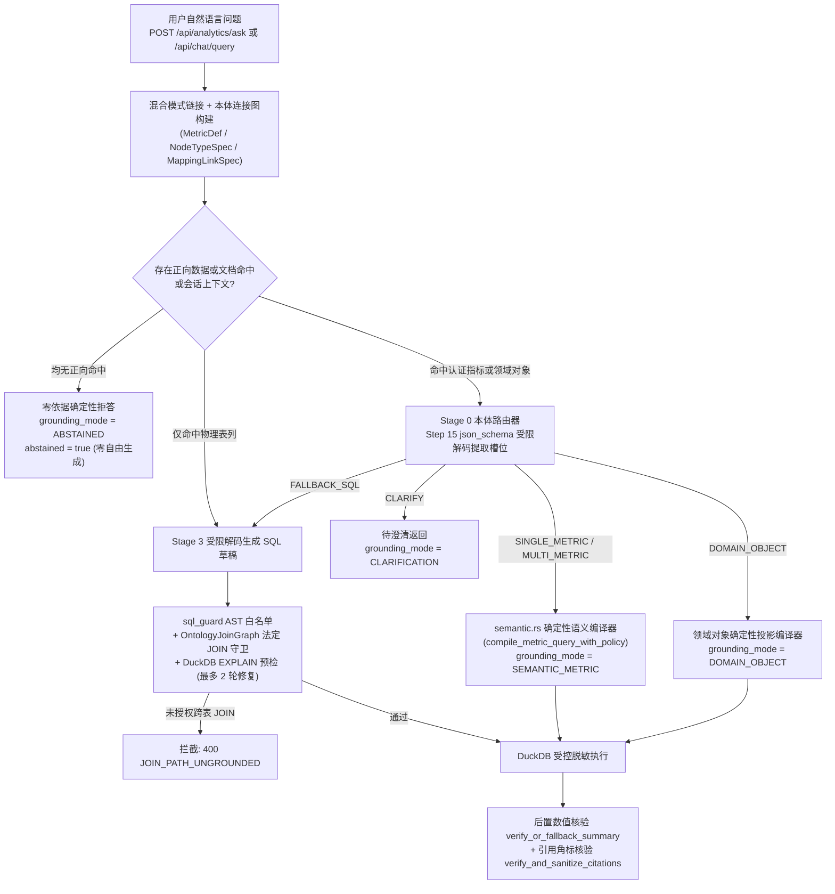

# 02 · Step 16：本体优先问数路由、法定 JOIN 守卫与引用核验

Step 16 在 [Step 15](./01-STEP15-CONSTRAINED-DECODING-AND-LLM-CAPS.md) 受限解码与确定性零温采样底座之上，为 `AxAnalytics` 与 `AxQuery` 建立全链路反幻觉执行引擎：通过第 0 阶段「本体与认证指标优先路由器」将高频指标与领域对象问答收敛为纯槽位确定性编译（彻底消除手写裸 SQL 偏差），在多表 SQL 路径强制执行 `MappingLinkSpec` 本体外键连接守卫，在知识与混合问答路径强制执行 `[文N]` 引用角标越界剥离与零召回确定性拒答，并通过云端 API 与本地 7B 双轨 50 例对抗基准实现 100% 幻觉拦截。

---

## 16.0 目标、前置与契约

- **目标**：
  1. 迁移 `0016_grounded_ask_eval.sql` 扩展 `an_ask_turns` 审计列（`grounding_mode`、`verified_numbers`、`verified_citations`、`abstained`、`slot_payload`）并新建反幻觉基准运行表 `an_grounding_eval_runs`（开启租户 RLS）。
  2. 在 `axpoint-analytics::nl2sql::ontology_route` 建立第 0 阶段本体与认证指标优先路由器：问题命中已定义 `MetricDef`（认证指标优先）或 `xBlueStudio` 主图已发布 `NodeTypeSpec` 时，通过 Step 15 `JSON_SCHEMA` 受限解码仅提取结构化参数槽位（`MetricQuery` / `MultiMetricQuery` / `DomainObjectSlotQuery`），交由 `semantic.rs` 或领域对象编译器直接编译为受控查询计划下推执行，全程零裸 SQL 自由生成。
  3. 在 `schema_link.rs` 与 `sql_guard.rs` 建立本体外键连接守卫（`OntologyJoinGraph`）：从已发布 `MappingSpec` 与 `MappingLinkSpec` 推导合法物理表间连接边注入提示与守卫，当 `strict_ontology_join = true` 时拦截任何无本体映射依据的跨表 `JOIN`（返回 `400 JOIN_PATH_UNGROUNDED`）。
  4. 在 `axpoint-domain::grounding` 与 `routes/documents.rs` 建立引用角标核验与零召回拒答器：校验 `[文N]` / `[Doc N]` 角标落在 `1..=recalled_chunks.len()` 范围内，自动剥离越界角标；当五路超图召回与模式链接均无正向依据时直接返回确定性 `ABSTAINED` 拒答，跳过自由生成模型调用。
  5. 交付 50 例云/端双轨反幻觉黄金基准（`axpoint-analytics/tests/hallucination_eval.rs`，拦截率 100%），并在 `AxQueryPage.tsx` 渲染接地路径徽标与核验统计。
- **前置**：[Step 15](./01-STEP15-CONSTRAINED-DECODING-AND-LLM-CAPS.md) 通过。
- **覆盖能力项**：
  - `C62`：本体与认证指标优先问数路由（断言 `"ontology-metric-route"`、`"slot-compile-exact"`）；
  - `C63`：多表问数本体外键路径守卫（断言 `"ungrounded-join-rejected"`、`"mapped-join-ok"`）；
  - `C64`：知识问答段落引用角标核验与零召回确定性拒答（断言 `"phantom-citation-stripped"`、`"empty-recall-abstain"`）；
  - `C65`：云/端双轨 50 例反幻觉对抗基准 100% 拦截（断言 `"hallucination-eval-100"`）。
- **契约清单**：
  - 数据库迁移：`deploy/migrations/0016_grounded_ask_eval.sql`；
  - 公共枚举与错误码：`axpoint-domain::enums::GroundingMode`、`AppError::bad("JOIN_PATH_UNGROUNDED", ...)`（同步写入 [A1](../../../../docs/standards/A1-CONVENTIONS-ENUMS-ROUTES.md) §4、§5）；
  - 领域核验模块：`axpoint-domain::grounding`（`CitationVerifyOutcome`、`verify_and_sanitize_citations`、`count_grounded_numbers`、`should_abstain_zero_evidence`、`ABSTAIN_NO_DOC_EVIDENCE_ZH`、`ABSTAIN_NO_DATA_OR_DOC_ZH`）；
  - 分析与问答模型：`axpoint-domain::analytics`（`AllowedDatasetJoinEdge`、`OntologySlotDraft`、`GroundingEvalTrack`、`GroundingEvalRunRecord`；扩展 `AskResponse`、`AskTurnRecord`、`NewAskTurnInput`、`QueryRequest`、`ChatQueryResponse`）；
  - 端口接口：`axpoint-domain::ports::AnalyticsRepository`（扩展 `insert_grounding_eval_run`、`list_grounding_eval_runs`）；
  - 接口与标准文档：`docs/API_CONTRACT.md`、[A2](../../../../docs/standards/A2-DATABASE-MIGRATIONS-INDEX.md)、[A4](../../../../docs/standards/A4-API-CONTRACT-INDEX.md)、[A7](../../../../docs/standards/A7-REQUIREMENTS-TRACEABILITY.md) 增量条目；
  - 前端类型定义：`xbluenode-web/src/lib/api/{enums.ts, analytics.ts, rag.ts}`。

### 文件变更清单

| 动作 | 路径 | 内容 |
| :--- | :--- | :--- |
| 新建 | `deploy/migrations/0016_grounded_ask_eval.sql` | 扩展 `an_ask_turns` 接地列；新建 `an_grounding_eval_runs` 并开启租户 RLS（§16.1） |
| 修改 | `axpoint-core/crates/axpoint-domain/src/enums.rs` | 新增 `GroundingMode`（6 枚举值）（§16.2.1） |
| 新建 | `axpoint-core/crates/axpoint-domain/src/grounding.rs` | 纯函数引用角标核验器、已核验数值计数器与零依据拒答判定器（§16.4.1） |
| 修改 | `axpoint-core/crates/axpoint-domain/src/lib.rs` | 导出 `pub mod grounding;`；扩展 `ChatQueryResponse` 接地元数据字段 |
| 修改 | `axpoint-core/crates/axpoint-domain/src/analytics.rs` | 新增 `AllowedDatasetJoinEdge`、`OntologySlotDraft`、`GroundingEvalRunRecord`；扩展 `QueryRequest`、`AskResponse`、`AskTurnRecord`、`NewAskTurnInput`（§16.2.1、§16.3.1） |
| 修改 | `axpoint-core/crates/axpoint-domain/src/ports.rs` | `AnalyticsRepository` 新增 `insert_grounding_eval_run`、`list_grounding_eval_runs` |
| 新建 | `axpoint-core/crates/axpoint-analytics/src/nl2sql/ontology_route.rs` | 第 0 阶段本体与认证指标槽位提取器及确定性语义编译桥接（§16.2.2） |
| 修改 | `axpoint-core/crates/axpoint-analytics/src/nl2sql/{mod.rs, schema_link.rs, prompt.rs, chart.rs}` | 串联第 0 阶段路由、零依据早退、法定连接边提示与核验数值统计（§16.2.3、§16.3.2） |
| 修改 | `axpoint-core/crates/axpoint-analytics/src/sql_guard.rs` | `GuardOptions` 增加 `strict_ontology_join` 与 `allowed_joins`；AST 多表 `JOIN ON` 边路径校验（§16.3.3） |
| 修改 | `axpoint-core/crates/axpoint-db/src/analytics_repo.rs` | 持久化 `an_ask_turns` 新增列与 `an_grounding_eval_runs` 评测结果 |
| 修改 | `axpoint-core/crates/axpoint-server/src/routes/{analytics.rs, documents.rs}` | 装配已发布主图 `SchemaDoc` 连接边；`DOC / HYBRID / AUTO` 接入引用角标核验与零召回确定性拒答；开放 `GET/POST /api/analytics/grounding-eval`（§16.4.2） |
| 新建 | `axpoint-core/crates/axpoint-analytics/tests/hallucination_eval.rs` | 50 例云/端双轨反幻觉黄金基准执行器（§16.5） |
| 新建 | `axpoint-core/crates/axpoint-analytics/tests/fixtures/hallucination_50.json`、`tests/cassettes/{hallucination_cloud_50.jsonl, hallucination_local7b_50.jsonl}` | 5 大类 50 例对抗样本与双轨离线录制向量（§16.5） |
| 修改 | `docs/API_CONTRACT.md`、`docs/standards/{A1-CONVENTIONS-ENUMS-ROUTES.md, A2-DATABASE-MIGRATIONS-INDEX.md, A4-API-CONTRACT-INDEX.md, A7-REQUIREMENTS-TRACEABILITY.md}` | 同步 `GroundingMode`、`JOIN_PATH_UNGROUNDED`、`0016` 迁移与 `C62`～`C65` |
| 修改 | `xbluenode-web/src/lib/api/{enums.ts, analytics.ts, rag.ts}`、`xbluenode-web/src/pages/AxQueryPage.tsx` | 接地徽标、核验数值/引用徽章与槽位参数折叠面板（§16.6） |
| 新建 | `xbluenode-web/src/components/analytics/GroundingBadge.tsx` | 接地模式状态徽标组件（§16.6） |
| 新建 | `scripts/gate/step16.sh` | Step 16 可执行验收门禁脚本（§16.7） |

---

## 16.1 迁移 `deploy/migrations/0016_grounded_ask_eval.sql`

```sql
-- 0016_grounded_ask_eval.sql：问数轮次接地路径审计列与双轨反幻觉评测记录表

ALTER TABLE an_ask_turns
    ADD COLUMN IF NOT EXISTS grounding_mode TEXT NOT NULL DEFAULT 'GUARDED_SQL'
        CHECK (grounding_mode IN (
            'SEMANTIC_METRIC',
            'DOMAIN_OBJECT',
            'GUARDED_SQL',
            'GROUNDED_DOC',
            'ABSTAINED',
            'CLARIFICATION'
        ));

ALTER TABLE an_ask_turns
    ADD COLUMN IF NOT EXISTS verified_numbers INT NOT NULL DEFAULT 0
        CHECK (verified_numbers >= 0);

ALTER TABLE an_ask_turns
    ADD COLUMN IF NOT EXISTS verified_citations INT NOT NULL DEFAULT 0
        CHECK (verified_citations >= 0);

ALTER TABLE an_ask_turns
    ADD COLUMN IF NOT EXISTS abstained BOOLEAN NOT NULL DEFAULT FALSE;

ALTER TABLE an_ask_turns
    ADD COLUMN IF NOT EXISTS slot_payload JSONB;

CREATE INDEX IF NOT EXISTS idx_an_ask_turns_grounding
    ON an_ask_turns (tenant_id, grounding_mode, created_at DESC);

CREATE TABLE IF NOT EXISTS an_grounding_eval_runs (
    id                 UUID PRIMARY KEY DEFAULT gen_random_uuid(),
    tenant_id          TEXT NOT NULL,
    suite_name         TEXT NOT NULL,
    track              TEXT NOT NULL CHECK (track IN ('CLOUD', 'LOCAL_7B')),
    model_name         TEXT NOT NULL,
    total_cases        INT NOT NULL CHECK (total_cases > 0),
    intercepted_cases  INT NOT NULL CHECK (intercepted_cases >= 0),
    pass_rate          DOUBLE PRECISION NOT NULL CHECK (pass_rate >= 0.0 AND pass_rate <= 1.0),
    category_breakdown JSONB NOT NULL DEFAULT '{}'::jsonb,
    failures           JSONB NOT NULL DEFAULT '[]'::jsonb,
    duration_ms        BIGINT NOT NULL DEFAULT 0,
    created_at         TIMESTAMPTZ NOT NULL DEFAULT NOW()
);

CREATE INDEX IF NOT EXISTS idx_an_grounding_eval_runs_lookup
    ON an_grounding_eval_runs (tenant_id, created_at DESC);

SELECT ax_enable_tenant_rls('an_grounding_eval_runs');
```

---

## 16.2 第 0 阶段本体与认证指标优先路由器（`nl2sql::ontology_route`）



### 16.2.1 `GroundingMode` 与响应扩展（`axpoint-domain`）

`axpoint-domain/src/enums.rs` 新增：

```rust
/// Execution and verification path taken to answer an `AxQuery` / `AxAnalytics` turn (`0016_grounded_ask_eval.sql`).
#[derive(Debug, Clone, Copy, Default, PartialEq, Eq, Hash, Serialize, Deserialize)]
#[serde(rename_all = "SCREAMING_SNAKE_CASE")]
pub enum GroundingMode {
    /// Compiled deterministically from `MetricDef` + structured `MetricQuery` / `MultiMetricQuery` slots (zero LLM SQL).
    SemanticMetric,
    /// Compiled deterministically from published `NodeTypeSpec` + `MappingSpec` slots (zero LLM SQL).
    DomainObject,
    /// Generated as SQL, validated by `sql_guard` + `OntologyJoinGraph` + `EXPLAIN`, and verified cell-by-cell.
    #[default]
    GuardedSql,
    /// Synthesized from recalled hypergraph paragraphs with verified in-bounds `[文N]` citations.
    GroundedDoc,
    /// Deterministically refused due to zero recalled evidence or unresolvable ungrounded join.
    Abstained,
    /// Model or slot router requested explicit user disambiguation before execution.
    Clarification,
}

impl GroundingMode {
    /// Canonical database string representation.
    #[must_use]
    pub const fn as_str(self) -> &'static str {
        match self {
            Self::SemanticMetric => "SEMANTIC_METRIC",
            Self::DomainObject => "DOMAIN_OBJECT",
            Self::GuardedSql => "GUARDED_SQL",
            Self::GroundedDoc => "GROUNDED_DOC",
            Self::Abstained => "ABSTAINED",
            Self::Clarification => "CLARIFICATION",
        }
    }
}
```

`AskResponse`、`AskTurnRecord`、`NewAskTurnInput` 与 `ChatQueryResponse` 统一追加以下字段（带 `#[serde(default)]`，100% 兼容 Step 04 / Step 09 既有调用方）：
- `pub grounding_mode: GroundingMode`
- `pub verified_numbers: u32`
- `pub verified_citations: u32`
- `pub abstained: bool`
- `#[serde(default, skip_serializing_if = "Option::is_none")] pub slot_payload: Option<serde_json::Value>`

### 16.2.2 槽位匹配、受限提取与确定性编译（`nl2sql/ontology_route.rs`）

1. **前置触发判定（`should_attempt_ontology_route`）**：
   - 在 `LinkedSchemaContext` 中，若最高分指标满足 `metric_score >= 0.45`（`certified == true` 的认证指标已在 `hybrid_link_score` 获得 `+0.10` 加成，并在本体路由评分中额外赋予 `+0.15` 精确词面匹配权重），或问题显式命中已发布 `SchemaDoc` 中绑定了 `MappingSpec` 的 `NodeTypeSpec`（`name` 或 `display_name`），且问题不含要求跨未建模自由列表达式的明细指令（如“列出原始流水前 50 行全部字段”），进入第 0 阶段本体路由。
2. **受限解码提取槽位（`extract_ontology_slots`）**：
   - 构造 `TenantOntologyEnums`（仅填入当前 `LinkedSchemaContext` 召回的非损坏 `MetricDef.name`、维度白名单、已发布 `NodeTypeSpec.name` 与 `EdgeTypeSpec.name`）；
   - 生成 `JsonSchemaSpec::ontology_slot_extraction(&enums)`，系统提示注入当前租户时区与标准参考时间 `now_rfc3339`（令模型将“上月”“今年 Q1”转化为精确 ISO-8601 半开区间 `[time_from, time_to)`，严禁模型自行计算数值），调用 `ai.chat_structured(Purpose::Nl2Sql, &sys, &usr, &schema).await?`。
3. **确定性编译执行（`compile_and_execute_slots`）**：
   - **`route == "SINGLE_METRIC"`**（`metric_names.len() == 1`）：
     - 定位目标 `MetricDef`，校验所有请求的 `dimensions` 属于 `metric.dimensions` 或底层数据集白名单列，`filters` 字段存在于底层 `CatalogDatasetEntry.columns`；
     - 组装强类型 `MetricQuery { dimensions, filters, time_range, grain, compare }`，直接调用 `crate::semantic::execute_metric_query(session, catalog, metric, &metric_query, opts)`（连接模式单测调用 `compile_metric_query_with_policy` + `execute_guarded_conn`）；
     - 置 `grounding_mode = GroundingMode::SemanticMetric`，`slot_payload = Some(serde_json::to_value(&metric_query)?)`，生成的标准受控 SQL 写入 `AskResponse.sql` 供审计与前端折叠查看。
   - **`route == "MULTI_METRIC"`**（`metric_names.len() >= 2`）：
     - 组装 `MultiMetricQuery`，调用 `crate::semantic::execute_multi_metric_query(session, catalog, &linked.metrics, &multi_query, opts)`，置 `grounding_mode = GroundingMode::SemanticMetric`。
   - **`route == "DOMAIN_OBJECT"`**：
     - 定位目标 `NodeTypeSpec` 及其关联 `MappingSpec`，将请求的节点属性、指标过滤与 1 跳 `include_links`（通过 `MappingLinkSpec` 解析关联表与外键列）确定性编译为参数化受控 `SELECT` 语句，经 `sql_guard::guard`（携带 `PolicyContext` 与 `allowed_joins`）校验后在 `DuckDB` 执行，置 `grounding_mode = GroundingMode::DomainObject`。
   - **`route == "CLARIFY"`**：
     - 直接返回 `need_clarification = true`、`grounding_mode = GroundingMode::Clarification`、空 `sql`。
   - **`route == "FALLBACK_SQL"` 或槽位引用的维度超出指标定义范围**：
     - 平滑回落至第 3 阶段受限解码 SQL 生成（`JsonSchemaSpec::nl2sql_draft()`）+ 法定 `JOIN` 守卫。

---

## 16.3 多表问数本体外键路径守卫（`schema_link.rs` + `sql_guard.rs`）

### 16.3.1 法定连接边推导模型（`AllowedDatasetJoinEdge`）

从 `xBlueStudio` 主图（`main`）及当前请求作用域子图的已发布 `SchemaDoc` 中，按以下两条确定性规则静态编译物理数据集之间的法定连接图 `OntologyJoinGraph`：

1. **跨对象关系映射边（`MappingLinkSpec`）**：设源映射 $M_s$ 将数据集 $D_1$（主键列 $K_1$）映射为节点类型 $T_1$，且其 `links` 包含 `MappingLinkSpec { link_type, target_type: T_2, target_key_column: FK_1, .. }`；对于任意目标映射 $M_t$（将数据集 $D_2$ 的主键列 $K_2$ 映射为节点类型 $T_2$），登记无向法定连接边：
   $$(D_1, FK_1) \leftrightarrow (D_2, K_2) \quad (\text{via } \texttt{link\_type})$$
2. **同对象多源共键边（Shared `NodeTypeSpec` Key）**：若两个映射 $M_a(D_1, K_1 \to T)$ 与 $M_b(D_2, K_2 \to T)$ 映射到同一业务节点类型 $T$，登记共键法定连接边：
   $$(D_1, K_1) \leftrightarrow (D_2, K_2) \quad (\text{via } \texttt{SAME\_ENTITY:}T)$$

```rust
/// Declared legal join edge between two physical datasets derived from published `xBlueStudio` mappings.
#[derive(Debug, Clone, PartialEq, Eq, PartialOrd, Ord, Hash, Serialize, Deserialize)]
pub struct AllowedDatasetJoinEdge {
    /// Left dataset SQL identifier (lowercased).
    pub left_dataset: String,
    /// Left dataset column identifier (lowercased).
    pub left_column: String,
    /// Right dataset SQL identifier (lowercased).
    pub right_dataset: String,
    /// Right dataset column identifier (lowercased).
    pub right_column: String,
    /// Originating ontology `EdgeTypeSpec.name` or `"SAME_ENTITY:<NodeType>"`.
    pub relationship_label: String,
}
```

### 16.3.2 模式链接与提示注入（`nl2sql/schema_link.rs` & `prompt.rs`）

- `SchemaLinkExtras` 增加 `pub published_schemas: Vec<SchemaDoc>` 与 `pub enforce_ontology_joins: bool`（当租户已发布至少一条 `MappingSpec` 时在 `execute_ask_for_principal` 中默认置 `true`）。
- `LinkedSchemaContext` 增加 `pub allowed_joins: Vec<AllowedDatasetJoinEdge>`：保留两端数据集均处于当前租户目录（且至少一端命中链接上下文，必要时自动补入 1 跳桥接数据集）的法定连接边。
- `build_nl2sql_user_prompt` 新增 `### 法定表间关联路径（严禁使用未列出的跨表 JOIN）` 段落，逐行渲染 `left_dataset.left_column = right_dataset.right_column -- 对应业务关系: relationship_label`；若当前候选表之间无任何法定连接边，显式声明 `当前候选表之间无已发布本体关联边，严禁编写跨表 JOIN`。

### 16.3.3 `sql_guard` AST 连接路径校验算法（`axpoint-analytics/src/sql_guard.rs`）

`GuardOptions` 与 `QueryRequest` 同步扩展：

```rust
pub struct GuardOptions {
    pub max_rows: u32,
    pub allow_live: bool,
    pub params: BTreeMap<String, serde_json::Value>,
    #[serde(default)]
    pub policy: Option<PolicyContext>,
    /// When `true`, multi-dataset `SELECT` queries must join exclusively along `allowed_joins` edges (`Step 16`).
    #[serde(default)]
    pub strict_ontology_join: bool,
    /// Canonical undirected dataset column join edges compiled from `xBlueStudio` mappings.
    #[serde(default)]
    pub allowed_joins: Vec<AllowedDatasetJoinEdge>,
}
```

在 `guard_with_ceiling` 完成表名解析与 CTE 作用域绑定后，若 `opts.strict_ontology_join == true`，执行 `validate_ontology_joins(&statement, &cte_lineages, catalog, &opts.allowed_joins)`：

1. **禁止隐式笛卡尔积与无条件连接**：
   - 同一 `SELECT` 的 `FROM` 列表若出现 `from.len() > 1`（逗号隐式连接 `FROM a, b`），或任一 `JoinOperator` 为 `CrossJoin`、`CrossApply`、`OuterApply`、无 `ON` 表达式的 `Inner/LeftOuter/RightOuter/FullOuter`、以及 `JoinConstraint::Natural`，只要涉及 `>= 2` 张物理数据集（或源自不同数据集的 CTE/子查询），立即返回：
     `AppError::bad("JOIN_PATH_UNGROUNDED", "cross join or implicit multi-table join without ontology MappingLinkSpec is forbidden")`。
2. **提取合取等值连接对并校验连通性**：
   - 将每个 `JOIN ... ON <expr>` 按顶层 `AND` 拆解，提取形如 `alias_lhs.col_lhs = alias_rhs.col_rhs` 的限定列等值断言（未加表别名前缀的歧义列名在多表场景直接拒绝）；
   - 将表别名还原为底层物理数据集标识 `(dataset_name, column_name)`（若别名指向单源透传 CTE，则追溯至该 CTE 暴露列的源 `(dataset_name, column_name)`；聚合脱敏后丢失原键语义的派生列视为不可作为外键桥接）；
   - 维护当前 `FROM` 子句已连通的数据集集合 $S$（初始为首张基表 $D_0$）：每步引入新关联数据集 $D_k$ 时，必须存在至少一条 `ON` 等值对 $(D_i.c_i, D_k.c_k)$（其中 $D_i \in S$）精确命中 `allowed_joins`（无向大小写不敏感匹配）；同表自连接（$D_k = D_i$）仅允许在同一主键列 `c_i == c_k` 上进行；
   - 任一步未命中时立即返回 `AppError::bad("JOIN_PATH_UNGROUNDED", format!("ungrounded join between '{}.{}' and '{}.{}': no published MappingLinkSpec connects these columns", lhs_ds, lhs_col, rhs_ds, rhs_col))`（对应 `HTTP 400`，`error_code == "JOIN_PATH_UNGROUNDED"`）。
3. **问数自修复协同**：
   - 在 `nl2sql` 自修复循环中，若模型草案触发 `JOIN_PATH_UNGROUNDED` 且两表之间存在合法连接边（例如模型误写 `o.id = s.id` 而法定边为 `o.order_id = s.order_id`），第 1 轮修复提示附带精确法定边列表供模型纠正；若两表之间根本不存在任何本体连接路径，跳过无效重试直接终止并返回拒答说明（记录 `an_query_history.status = REJECTED`、`error_code = Some("JOIN_PATH_UNGROUNDED")`）。

---

## 16.4 引用角标核验与零召回确定性拒答器（`axpoint-domain::grounding` + `routes/documents.rs`）

### 16.4.1 纯领域接地核验模块（`axpoint-domain/src/grounding.rs`）

严格遵循 [IRON_RULES](../../../../IRON_RULES.md) §二.1 纯领域零外部依赖原则，在 `axpoint-domain` 实现确定性核验算法：

```rust
//! Pure citation-bounds verification, grounded numeric counting, and zero-recall abstention rules (`Step 16`).

use std::collections::BTreeSet;

/// Deterministic abstention message when 5-way knowledge recall returns zero paragraphs.
pub const ABSTAIN_NO_DOC_EVIDENCE_ZH: &str =
    "未在当前授权知识库中检索到相关制度或文档依据，无法给出确定结论。请确认文档已入库或调整检索关键词。";

/// Deterministic abstention message when both schema linking and knowledge recall have zero positive hits.
pub const ABSTAIN_NO_DATA_OR_DOC_ZH: &str =
    "未在当前授权数据集、语义指标或知识库中匹配到相关依据，无法生成回答。请核对表名、指标名或补充上下文范围。";

/// Verification outcome for `[文N]` and `[Doc N]` inline paragraph citations.
#[derive(Debug, Clone, PartialEq, Eq)]
pub struct CitationVerifyOutcome {
    /// Answer text with all out-of-bounds (`0` or `> recalled_count`) citation tags stripped.
    pub sanitized_answer: String,
    /// Sorted unique 1-based indices (`1..=recalled_count`) validly referenced in `sanitized_answer`.
    pub verified_indices: Vec<usize>,
    /// Out-of-bounds indices (`0` or `> recalled_count`) intercepted and stripped.
    pub stripped_phantom_indices: Vec<usize>,
}

impl CitationVerifyOutcome {
    /// Number of unique verified in-bounds citations.
    #[must_use]
    pub fn verified_count(&self) -> u32 {
        u32::try_from(self.verified_indices.len()).unwrap_or(u32::MAX)
    }
}

/// Scans `raw_answer` for `[文N]` and `[Doc N]` (case-insensitive) markers against `1..=recalled_count`.
///
/// - In-bounds markers (`1 <= N <= recalled_count`) are normalized to `[文N]` (or preserved) and recorded in `verified_indices`.
/// - Out-of-bounds markers (`N == 0` or `N > recalled_count`) are removed cleanly without leaving orphan whitespace.
#[must_use]
pub fn verify_and_sanitize_citations(raw_answer: &str, recalled_count: usize) -> CitationVerifyOutcome {
    let chars: Vec<char> = raw_answer.chars().collect();
    let mut out = String::with_capacity(raw_answer.len());
    let mut verified = BTreeSet::new();
    let mut phantoms = Vec::new();
    let mut idx = 0_usize;

    while let Some(&ch) = chars.get(idx) {
        if ch == '[' && let Some((parsed_num, next_idx, raw_tag)) = try_parse_citation_tag(&chars, idx) {
            if parsed_num >= 1 && parsed_num <= recalled_count {
                verified.insert(parsed_num);
                out.push_str(&raw_tag);
            } else {
                phantoms.push(parsed_num);
            }
            idx = next_idx;
            continue;
        }
        out.push(ch);
        idx = idx.saturating_add(1);
    }

    CitationVerifyOutcome {
        sanitized_answer: collapse_orphan_spaces(&out),
        verified_indices: verified.into_iter().collect(),
        stripped_phantom_indices: phantoms,
    }
}

/// Returns `true` when retrieval and schema linking produced zero actionable evidence and the pipeline must abstain.
#[must_use]
pub const fn should_abstain_zero_evidence(
    has_schema_hit: bool,
    has_session_context: bool,
    recalled_doc_count: usize,
    is_chitchat: bool,
) -> bool {
    !is_chitchat && !has_schema_hit && !has_session_context && recalled_doc_count == 0
}
```

### 16.4.2 `routes/documents.rs` 与 `routes/analytics.rs` 接线规则

1. **知识问答路径（`DOC`：`run_doc_rag_pipeline` & `handle_doc_chat_query`）**：
   - 执行五路超图召回 `recall_knowledge_hits` 后，若 `hits.is_empty()`：
     - **零模型调用早退**：不调用 `synthesize_answer`，直接构造 `DocRagOutcome { answer: String::from(ABSTAIN_NO_DOC_EVIDENCE_ZH), hits: Vec::new(), seeds, citations: Vec::new(), grounding_mode: GroundingMode::Abstained, verified_citations: 0, abstained: true }`；
     - 持久化一条 `an_ask_turns` 审计记录（`intent = DOC`、`grounding_mode = ABSTAINED`、`abstained = true`），并在 `ChatQueryResponse` 中返回 `grounding_mode: "ABSTAINED"`、`abstained: true`、`citations: []`。
   - 若 `hits` 非空：
     - 调用 `synthesize_answer`（经 Step 15 `Purpose::Summarize` 零温采样）；
     - 对生成文本执行 `verify_and_sanitize_citations(&raw_answer, hits.len())`：剥离全部越界角标（如仅召回 2 段却出现 `[文5]` 或 `[Doc 9]`）；若剥离后正文无有效角标但内容非空，在段首锚定 `[文1]` 或回退至首段原文摘录模板 `根据《{doc_title}》[文1]：{snippet}`；
     - 仅保留被实际引用的段落或按召回顺序列出 `citations`，记录 `grounding_mode = GroundingMode::GroundedDoc`、`verified_citations = outcome.verified_count()`。
2. **结构化问数路径（`DATA`：`run_ask_pipeline_with_policy`）**：
   - 当 `should_abstain_zero_evidence(linked.has_positive_hit, !input.session_turns.is_empty(), 0, intent == AskIntent::Chitchat)` 为真时，不调用 SQL 生成模型，直接返回 `AskResponse`（`grounding_mode = GroundingMode::Abstained`、`abstained = true`、`answer = ABSTAIN_NO_DATA_OR_DOC_ZH`、`sql = ""`）；
   - 执行成功后，`verify_or_fallback_summary` 返回 `(verified_answer, verified_number_count)`：若候选摘要中所有数字均在结果表单元格中核验通过，`verified_numbers = verified_number_count`；若触发回退确定性模板（`查询返回 N 行，主要结果见表格`），`verified_numbers = 1`（对应核验无误的行数 `N`）。
3. **混合研判路径（`HYBRID`：`handle_hybrid_chat_query`）**：
   - 若 `data.abstained && doc.abstained`，直接返回合并确定性拒答（`grounding_mode = GroundingMode::Abstained`）；
   - 否则对合成文本先过 `verify_and_sanitize_citations(&raw, doc.citations.len())`，再剥离合法 `[文N]` / `[表]` 标签后过数值核验（允许来自 `data.rows` 单元格或已核验引用段落 `doc.citations[idx - 1].snippet` 原文逐字出现的数值），任一数值失真立即回退 `[表] {data.answer}\n\n[文1] {doc.answer}` 确定性拼接模板。

---

## 16.5 双轨 50 例反幻觉黄金基准（`axpoint-analytics/tests/hallucination_eval.rs`）

构建离线可重复执行的 50 例反幻觉红队评测套件（定义于 `tests/fixtures/hallucination_50.json`），同时针对**云端大模型录制轨**（`tests/cassettes/hallucination_cloud_50.jsonl`）与**本地 7B 小模型噪声录制轨**（`tests/cassettes/hallucination_local7b_50.jsonl`，模拟代码围栏包裹、字段顺序抖动、心算错数、瞎猜外键与越界角标）执行全量断言，**双轨通过率硬门槛均为 `100.0%`（`50/50`）**：

| 类别编码 | 样本范围 | 攻击面与噪声注入设计 | 强制通过判定条件 |
| :--- | :--- | :--- | :--- |
| `CAT1_METRIC_SLOT` | `H01`～`H10`（10 例） | 认证指标单指标汇总、分组、同比/环比（`SAME_PERIOD_LAST_YEAR` / `PREVIOUS_PERIOD`）、多指标并列查询；本地 7B 轨注入紧凑槽位格式 | 100% 命中 `GroundingMode::SemanticMetric`，输出与 `semantic.rs` 基准结果集精确相等，零自由 SQL 生成 |
| `CAT2_JOIN_GUARD` | `H11`～`H20`（10 例） | 6 例非法关联攻击（跨无关表 `JOIN`、`CROSS JOIN`、隐式逗号连接、错误列 `orders.amount = shipments.weight`）+ 4 例合法 `MappingLinkSpec` 关联（`FULFILLS` / `SUPPLIES`） | 6 例非法连接 100% 被 `JOIN_PATH_UNGROUNDED` 拦截且零脏数据返回；4 例合法连接 100% 执行成功 |
| `CAT3_NUMERIC_VERIFY` | `H21`～`H30`（10 例） | 模型在摘要中心算不存在的合计数、捏造同比涨幅（如表内仅单期 `33239.25` 却输出“同比增长 `18.6%`”）、小数位放大 10 倍 | 100% 被 `verify_or_fallback_summary` 拦截并回退确定性表格摘要，最终回答中零未接地数字 |
| `CAT4_CITATION_GUARD` | `H31`～`H40`（10 例） | 召回 1～3 段文档时，模型输出夹杂 `[文0]`、`[文5]`、`[文99]`、`[Doc 8]` 等越界幻觉角标或全篇漏标角标 | 100% 剥离越界角标（最终回答正则匹配 `\[文(\d+)\]` 的全部捕获值满足 `1 <= n <= citations.len()`） |
| `CAT5_ZERO_EVIDENCE` | `H41`～`H50`（10 例） | 询问未入库制度（如“核聚变冷却塔巡检细则”）或不存在的业务域指标（如“星际货运舱位周转率”），五路召回与模式链接均为空 | 100% 返回 `GroundingMode::Abstained` 且 `abstained == true`，下游自由合成调用次数 `== 0` |

同时在 `routes/analytics.rs` 暴露管理端评测接口：
- `POST /api/analytics/grounding-eval/run`（权限：`GUARD_ADMIN` 或 `OPS_ADMIN`）：运行内置 50 例套件并将 `CLOUD` 与 `LOCAL_7B` 两条结果写入 `an_grounding_eval_runs`，返回 `{ runs: [GroundingEvalRunRecord; 2] }`；
- `GET /api/analytics/grounding-eval/runs?limit=20`（权限：`DATA_READ`）：分页查询历史反幻觉基准记录。

---

## 16.6 前端 `AxQueryPage.tsx` 接地徽标与证据面板（`GroundingBadge.tsx`）

在 `AxQueryPage.tsx` 每轮回答卡片头部（紧邻 `intent` 徽标右侧）渲染 `GroundingBadge` 组件与核验计数胶囊，微文案保持 2～4 汉字 / 1～2 英文词，双语 `tx()` 对齐：

| `grounding_mode` 取值 | 中文徽标 | 英文徽标 | 视觉变体 | `data-testid` |
| :--- | :--- | :--- | :--- | :--- |
| `SEMANTIC_METRIC` | `认证指标` | `Metric` | `xblue`（科技蓝 `#2563eb`） | `grounding-badge-SEMANTIC_METRIC` |
| `DOMAIN_OBJECT` | `本体对象` | `Ontology` | `xblue` | `grounding-badge-DOMAIN_OBJECT` |
| `GUARDED_SQL` | `受控 SQL` | `Guarded SQL` | `neutral` | `grounding-badge-GUARDED_SQL` |
| `GROUNDED_DOC` | `原文溯源` | `Grounded Doc` | `neutral` | `grounding-badge-GROUNDED_DOC` |
| `ABSTAINED` | `无依据拒答` | `Abstained` | `outline` | `grounding-badge-ABSTAINED` |
| `CLARIFICATION` | `待澄清` | `Clarify` | `outline` | `grounding-badge-CLARIFICATION` |

附加交互元素：
1. **核验计数标签**（`data-testid="grounding-evidence-counts"`）：当 `verified_numbers > 0` 时显示 `核验数值 {n}`（`Verified {n}`）；当 `verified_citations > 0` 时显示 `核验引用 {m}`（`Citations {m}`）。
2. **槽位参数折叠区**：当 `slot_payload` 非空时，在「SQL」折叠按钮旁提供 `槽位参数`（`Slots`，`data-testid="grounding-slot-toggle"`）按钮，展开显示只读格式化的 `MetricQuery` / `DomainObject` JSON 载荷。

---

## 16.7 可执行门禁脚本 `scripts/gate/step16.sh`

```bash
#!/usr/bin/env bash
set -euo pipefail
source "$(dirname "$0")/lib.sh"

# 1. 领域接地核验器、本体连接守卫与双轨 50 例反幻觉基准测试（拦截率必须为 100%）
(
  cd axpoint-core
  cargo test -p axpoint-domain grounding --locked
  cargo test -p axpoint-analytics ontology_route --locked
  cargo test -p axpoint-analytics sql_guard --locked
  cargo test -p axpoint-analytics --test hallucination_eval --locked
)

# 触发管理端双轨基准持久化接口并核验云端轨 + 本地 7B 轨 50/50 100% 拦截
EVAL_RESP=$(api POST /api/analytics/grounding-eval/run '{}')
expect_json "hallucination-eval-100" "$EVAL_RESP" \
  '(.runs | length) == 2 and ([.runs[].pass_rate] | all(. == 1.0)) and ([.runs[].intercepted_cases] | all(. == 50))'

# 2. 第 0 阶段本体与认证指标优先路由：命中 paid_amount 认证指标时走 SEMANTIC_METRIC，且与直接调用指标语义接口结果完全一致
ASK_METRIC=$(api POST /api/analytics/ask '{"question":"按状态统计已支付订单金额（按月汇总）"}')
expect_json "ontology-metric-route" "$ASK_METRIC" \
  '.grounding_mode == "SEMANTIC_METRIC" and .abstained == false and (.slot_payload != null) and (.rows | length) >= 1'

DIRECT_METRIC=$(api POST /api/analytics/metrics/paid_amount/query '{"dimensions":["status"],"grain":"MONTH"}')
expect_eq "slot-compile-exact" \
  "$(printf '%s' "$ASK_METRIC" | jq -c '.rows')" \
  "$(printf '%s' "$DIRECT_METRIC" | jq -c '.rows')"

# 3. 多表本体外键路径守卫：无 MappingLinkSpec 依据的自由跨表 JOIN 返回 400 JOIN_PATH_UNGROUNDED；已建模关联边正常放行
UNGROUNDED_SQL=$(api POST /api/analytics/sql/run '{
  "sql":"SELECT o.order_id, w.warehouse_id FROM demo_orders o JOIN demo_warehouses w ON CAST(o.amount AS VARCHAR) = w.region",
  "strict_ontology_join":true
}')
expect_json "ungrounded-join-rejected" "$UNGROUNDED_SQL" '.error_code == "JOIN_PATH_UNGROUNDED"'

MAPPED_SQL=$(api POST /api/analytics/sql/run '{
  "sql":"SELECT o.order_id, w.warehouse_id FROM demo_orders o JOIN demo_warehouses w ON o.warehouse_id = w.warehouse_id LIMIT 5",
  "strict_ontology_join":true
}')
expect_json "mapped-join-ok" "$MAPPED_SQL" '(.rows | type) == "array" and (.columns | length) == 2'

# 4. 引用角标越界剥离核验：注入带越界幻觉角标 [文99] 的录制回复（或核验 DOC 问答返回），确保最终回答不含任何越界 [文N]
DOC_ANS=$(api POST /api/chat/query '{"query":"补货审批制度的具体触发条件是什么？","mode":"DOC","top_k":3}')
expect_json "phantom-citation-stripped" "$DOC_ANS" \
  '.grounding_mode == "GROUNDED_DOC" and ((.citations | length) as $max_c | $max_c >= 1 and ([.answer | scan("\\[文([0-9]+)\\]") | .[0] | tonumber] | all(. >= 1 and . <= $max_c)))'

# 5. 零召回确定性拒答：询问完全不存在的制度条款，五路召回为空时必须返回 ABSTAINED 且不编造引用
EMPTY_ANS=$(api POST /api/chat/query '{"query":"反物质曲率引擎反应堆舱门维护规程第88条是什么？","mode":"DOC","top_k":5}')
expect_json "empty-recall-abstain" "$EMPTY_ANS" \
  '.grounding_mode == "ABSTAINED" and .abstained == true and (.citations | length) == 0 and .verified_citations == 0'

gate_pass step16
```

**通过标准**：
1. `scripts/gate/step16.sh` 末行输出 `GATE step16 PASS`，7 个门禁断言（`"ontology-metric-route"`、`"slot-compile-exact"`、`"ungrounded-join-rejected"`、`"mapped-join-ok"`、`"phantom-citation-stripped"`、`"empty-recall-abstain"`、`"hallucination-eval-100"`）全部通过；
2. `an_grounding_eval_runs` 中 `CLOUD` 与 `LOCAL_7B` 双轨 `pass_rate` 均等于 `1.0`（`50/50`）；
3. 静态守卫 `naming-guard.sh`、`lint-guard.py`、`web-guard.py`、`hallucination-guard.py`、`docs-and-plans-guard.py`、`check_routes.py`、`check_traceability.py` 全绿。
