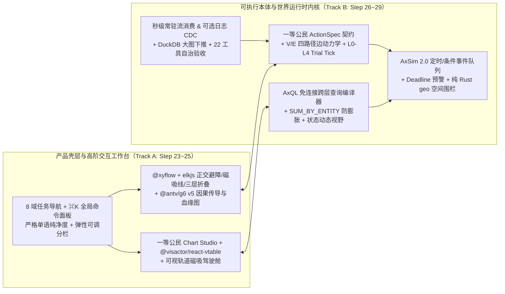
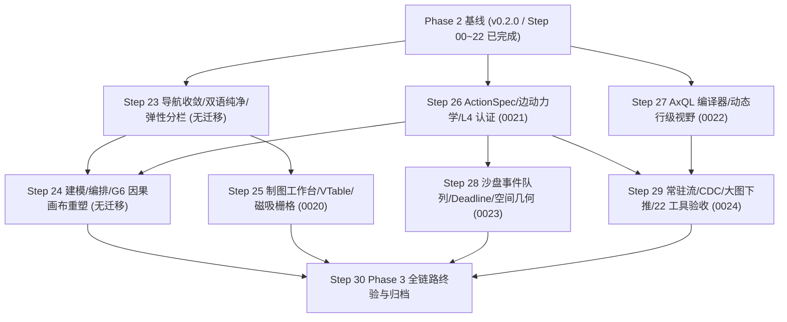

# xBlueNode / AxPoint Phase 3 实施总蓝图：产品级交互重塑与可执行世界运行时（Step 23～30）

本文件是 `plans/v3-craft-and-world-runtime/` 的**唯一总入口**，承接已完成归档的第一阶段基线（[Step 00～14](../v1-foundation-step00-14/00-MASTER-INDEX.md)，迁移 `0001`～`0014`，能力项 `C01`～`C59`）与第二阶段基线（[Step 15～22](../v2-ux-and-grounded-ai-step15-22/00-V2-MASTER-INDEX.md)，迁移 `0015`～`0019`，能力项 `C60`～`C75`）。

本阶段围绕**专项一：信息架构精简、严格双语纯净度与高级画布/图表交互重塑（`craft-ux/`，Step 23～25）**与**专项二：可执行本体动作契约、免连接跨层查询、时空事件推演与自治构建验收闭环（`world-runtime/`，Step 26～29）**双轨并行推进，并在 Step 30 完成全链路收官验收。全阶段严守三容器极简私有化架构（PostgreSQL 16 + Rust `axpoint-core` + Python `axpoint-parser` Sidecar）与本体级无幻觉五条铁律。

常驻工程约束、三级门禁与多团队/多代理并发规约见：
- [IRON_RULES.md](../../../IRON_RULES.md)
- [QUALITY_GATES_AND_VERIFICATION.md](../../../docs/QUALITY_GATES_AND_VERIFICATION.md)
- [MULTI_AGENT_TEAM_WORKFLOW.md](../../../docs/MULTI_AGENT_TEAM_WORKFLOW.md)
- [A1-CONVENTIONS-ENUMS-ROUTES.md](../../../docs/standards/A1-CONVENTIONS-ENUMS-ROUTES.md)

---

## 1. Phase 3 双轨核心演进目标

### 1.1 专项一：信息架构精简、严格 i18n 与高级画布/图表重塑（`craft-ux/`，Step 23～25）

1. **信息架构收敛、严格双语纯净度与弹性工作台壳层（Step 23）**：
   - 将侧边栏从按后端模块平铺的 13 个入口收敛为 **6 个高频业务工作域 + 底部 2 个折叠治理域**，提供全局 `⌘K` / `Ctrl+K` 命令直达面板（`cmdk`），并对历史路由提供前端无感兼容跳转；
   - 执行严格的**品牌唯一性与双语单态纯净原则**：主品牌 `xBlueNode` 仅保留在全局左上角、登录页与关于弹窗；全面移除侧边栏 `productTag` 灰色英文尾缀、页面一级标题 `Ax* / xBlue* · ` 前缀、中文态下裸露的 `SCREAMING_SNAKE_CASE` 枚举值、技术标语与英文单字母缩写，并在 `scripts/web-guard.py` 增加双语纯净度静态守卫；
   - 引入 `react-resizable-panels`（`^4.x`）替换全站死板固定像素列宽，支持拖拽分栏缩放、双击分隔条折叠与宽度记忆；将画布工作台升级为无边框全出血视口 + 悬浮毛玻璃工具坞，剥离多重套娃边框并优化字号与留白阶梯。
2. **建模、编排与因果图谱三大画布高阶交互工程（Step 24）**：
   - 深度升级 `xBlueStudio` 画布（`@xyflow/react` v12 + `elkjs`）：基于 `useNodesInitialized` 实测 DOM 宽高启用 `ORTHOGONAL` 正交避障路由与字段级双侧多端口 `FIXED_ORDER` 约束（彻底消除连线重合与关系标签遮挡截断）；支持**业务域泳道复合节点（Compound Group）**与**三层对象折叠卡片（静态主档内嵌动态事件与多维切片立方）**；内置 6 轴动态磁吸对齐辅助线（Helper Lines）、框选对齐/等距分布栏、240ms 平滑布局插值过渡、`zundo` 50 步撤销重做栈，以及「对象拓扑视图 ↔ 数据映射流水线视图」同源双模切换；
   - 升级 `AxFlow` 编排画布：支持已有连线中点悬停 `+` 一键切入新算子、算子拖拽吸附连线自动断线串联、端口拖出松手创建下游算子、运行态脉冲流光边及单步耗时与行数微胶囊；
   - 按路由懒加载引入 `@antv/g6`（`^5.x`）与 `@antv/g6-extension-react`，重构 `AxSim` 因果传导画布与全站血缘图（淘汰手写 SVG 绝对坐标与 ECharts 随机力导图），原生支持 `Combo` 业务域嵌套折叠、`Hull` 风险簇轮廓包络、三轨对比微卡片（`基线 | 干预 | 派生`）与脉冲波次动画。
3. **一等公民可视化制图工作台、高性能透视引擎与驾驶舱磁吸栅格（Step 25）**：
   - 新增独立可复用图表资产表 `xv_charts`（迁移 `0020`），在「探索与制图」工作台内置一等公民**可视化制图器（Chart Studio）**——任意问数、SQL 或语义指标结果可一键编码为 16 类图表并一键保存或钉入驾驶舱，将制图路径从 4 层压缩至 1 步；
   - 按需懒加载引入 `@visactor/react-vtable` 升级百万行 Canvas 级多维透视表，原生支持维度树折叠、行列头吸顶冻结、列宽拖拽、单元格内嵌迷你数据条与条件热力色阶；
   - 建立统一的 ECharts 6 语义设计令牌（10 色无障碍调色盘、圆角柱、柔和渐变面积、自适应千分位与万/亿/K/M 单位格式化、十字准星悬浮卡片）与带 Sparkline 趋势火花线的 `KpiWidget`；
   - 升级 `xBlueView` 驾驶舱栅格编辑态：叠加 12/24 列可视背景槽位网格、8 向显式缩放手柄、跨组件边缘磁吸辅助线、自由浮动防挤压开关（`float_mode`）及一键智能整齐排布（Tidy Up）。

### 1.2 专项二：可执行本体、免连接查询、时空事件推演与自治闭环（`world-runtime/`，Step 26～29）

1. **一等公民业务动作契约（`ActionSpec`）、边动力学与 L0–L4 发布就绪认证（Step 26）**：
   - 在 `SchemaDoc` 中新增挂靠于 `NodeTypeSpec` 的强类型 `ActionSpec`（输入参数 JSON Schema、前置状态断言表达式、显式 `ReadSet / WriteSet` 多对象原子修改模板、副作用级别 `SELF_ONLY | RELATED_NODES | EXTERNAL_EFFECT`、审批策略与幂等键模板），主图发布后自动同步暴露为 REST 动作端点、动态 GraphQL `Mutation`、`xBlueView` 动作按钮绑定源与受控 MCP 写工具；
   - 为关系边 `xb_links` 与 `EdgeTypeSpec` 扩展时序指标与边级聚合/派生能力，打通 **`V→V`、`V→E`、`E→V`、`E→E`** 四路径动力学传播（支撑航线运力、产线节拍、链路延迟等边状态实时演化）；
   - 在 `xBlueStudio` 建立 **L0–L4 Runtime Readiness 门禁**：内置**孤立死指标（Dead Knowledge）扫描**、高风险扇出预警，以及在隔离开发沙盒子图自动执行一轮物化 + 四路径传播 + 动作契约冒烟校验的 **`Trial Tick` 实算认证**。
2. **免连接跨层本体查询编译层（`AxQL`）与状态驱动动态行级视野（Step 27）**：
   - 在 `axpoint-analytics::axql` 构建零存储侵入的声明式本体查询编译器（目标编译为受 `sql_guard` 保护的 DuckDB SQL 与超图五路检索）：支持按主实体对象名自动合并静态主档、动态事件与多维切片立方侧面（免除手动编写多表 `JOIN`），内置 `SUM_BY_ENTITY(...)` 防一对多扇出重复累加重写器，并支持单语句融合超图混合检索命中集与结构化业务节点过滤；
   - 升级 `AxGuard` 行级安全策略谓词引擎（迁移 `0022`），支持引用节点实时指标与状态属性的**状态驱动动态视野**（例如当 `metrics.risk_score >= 0.8` 或 `properties.lifecycle == 'ESCALATED'` 时自动向应急/风控角色开放行级可见范围），并在 `AxSim` 沙盘克隆与推演中同源生效。
3. **`AxSim` 2.0：定时/条件事件队列、最晚干预窗口（Deadline）与纯 Rust 空间几何算子（Step 28）**：
   - 在 `axpoint-domain::sim` 离散分步求解器中引入 `ScheduledEvent`（定时外部事件，如第 8 步恢复某港口吞吐）与 `ConditionalTrigger`（状态阈值触发器，如库存跌破安全线自动激活备仓补货），结合红线目标约束（`SimGoalConstraint`）自动反推指标失守前的**最晚有效干预步（`deadline_step`）**；
   - 引入纯 Rust 几何计算库 `geo`（零 PostGIS 外部依赖），为 `xb_nodes`、`xBlueView` 地图组件与 `AxSim` 目标约束补齐多边形围栏包含判定（`GeoWithin`）、缓冲圈距离计算（`GeoDistance`）与活动轨迹凸包（`GeoConvexHull`）算子。
4. **常驻轻量流消费、可选日志级 CDC、大图算法下推与 22 工具自治验收闭环（Step 29）**：
   - 在 `axpoint-parser` 与 `axpoint-core` 提供可选的常驻异步微批流消费协程（Kafka / MQTT 持久订阅秒级入湖并触发增量映射与规则评估），并为 PostgreSQL（逻辑复制槽）与 MySQL（Binlog）提供可选增量 CDC 连接器以精确捕获源端物理硬删除；
   - 在 `axpoint-db::graph_query` 为超过 `500,000` 条边的子图提供基于 DuckDB 迭代关系代数的度中心性、弱连通分量与标签传播下推实现，突破单机内存 `petgraph` 阈值限制；
   - 将 `AxBuilder` 构建态 MCP 从 9 个工具扩充至 **22 个细粒度工程工具**（涵盖源表列画像探查、表达式单步试算、`Trial Tick` 触发、沙盘试跑及黄金能力问答集回归核验 `axbuilder_verify_questions`），建立“需求与验收集输入 → 构建草案 → 开发子图试算验证 → 缺口自动回改 → 人工确认发布”闭环。
5. **Phase 3 全旅程端到端验收、交互帧率基准与总门禁归档（Step 30）**：
   - 落地 `xbluenode-web/e2e/v3-craft-and-runtime.spec.ts`、画布与百万行透视性能基准、双语零泄漏全路由 DOM 扫描，将能力追踪下限提升至 `C01`～`C92`（92 项），升级 `scripts/gate/all.sh` 覆盖 `Step 00～30`。

---

## 2. 目标演进架构图



---

## 3. 步骤总表与文件索引（Step 23～30）

| Step | 名称 | 方案文件 | 迁移文件 | 涉及 Crate / 包 | 前置 Step | 负责分队 |
| :--- | :--- | :--- | :--- | :--- | :--- | :--- |
| **23** | 导航层级收敛、严格双语纯净度、弹性分栏与视觉去拘谨升级 | [01-STEP23](./craft-ux/01-STEP23-IA-CONVERGENCE-I18N-PURITY-AND-RESIZABLE-SHELL.md) | 无 | `docs/standards/A1`、`scripts/web-guard.py`、web（全局壳与分栏） | 22 | `orchestrator` + `squad-web` + `squad-qa` |
| **24** | 建模、编排与因果图谱三大画布高阶交互重塑 | [02-STEP24](./craft-ux/02-STEP24-ADVANCED-MODELING-FLOW-AND-CAUSAL-CANVASES.md) | 无 | web（`xbluestudio`、`axflow`、`axsim`、`axhub` 画布组件） | 23 | `squad-web` + `squad-qa` |
| **25** | 一等公民可视化制图器、VTable 多维透视表与驾驶舱磁吸栅格 | [03-STEP25](./craft-ux/03-STEP25-CHART-STUDIO-VTABLE-PIVOT-AND-MAGNETIC-GRID.md) | `0020_saved_charts.sql` | `axpoint-domain`、`axpoint-db`、`axpoint-server`、web | 23 | `squad-domain-agent` + `squad-web` |
| **26** | 一等公民 `ActionSpec` 动作契约、边动力学与 L0–L4 就绪门禁 | [04-STEP26](./world-runtime/04-STEP26-ACTION-CONTRACTS-EDGE-DYNAMICS-AND-L4-CERT.md) | `0021_actions_and_edge_dynamics.sql` | `axpoint-domain`、`axpoint-db`、`axpoint-flow`、`axpoint-agent`、`axpoint-server`、web | 22 | `squad-domain-agent` + `squad-web` |
| **27** | 免连接本体查询编译层（`AxQL`）与状态驱动动态行级视野 | [05-STEP27](./world-runtime/05-STEP27-AXQL-ONTOLOGY-COMPILER-AND-DYNAMIC-VISIBILITY.md) | `0022_state_visibility_policies.sql` | `axpoint-domain`、`axpoint-analytics`、`axpoint-security`、`axpoint-db`、`axpoint-server`、web | 22 | `squad-analytics-guard` + `squad-web` |
| **28** | `AxSim` 2.0：未来事件队列、Deadline 窗口与纯 Rust 空间几何 | [06-STEP28](./world-runtime/06-STEP28-SIM-EVENT-QUEUE-DEADLINE-AND-RUST-GEOSHAPE.md) | `0023_sim_events_and_geoshape.sql` | `axpoint-domain`、`axpoint-db`、`axpoint-server`、web | 26 | `squad-domain-agent` + `squad-web` |
| **29** | 常驻轻量流消费、可选日志 CDC、大图下推与 22 工具自治闭环 | [07-STEP29](./world-runtime/07-STEP29-STREAM-WORKERS-LOG-CDC-AND-AUTONOMOUS-HARNESS.md) | `0024_streams_and_harness_runs.sql` | `axpoint-parser`、`axpoint-domain`、`axpoint-db`、`axpoint-agent`、`axpoint-server`、web | 26、27 | `squad-data` + `squad-analytics-guard` + `squad-domain-agent` + `squad-web` |
| **30** | Phase 3 全旅程 E2E、交互性能基准与全栈总门禁终验 | [08-STEP30](./world-runtime/08-STEP30-V3-E2E-CRAFT-BENCHMARKS-AND-ACCEPTANCE.md) | 无 | `scripts/gate`、`scripts/bench`、`xbluenode-web/e2e` | 24、25、28、29 | `squad-qa` + `orchestrator` |

---

## 4. 双轨并行依赖拓扑与多 Subagent 分队排期（L16～L19）



按 [MULTI_AGENT_TEAM_WORKFLOW.md](../../../docs/MULTI_AGENT_TEAM_WORKFLOW.md) 三级代理规范，各依赖层内部文件修改路径互不重叠，可在独立 `git worktree` 与独立数据库端口槽位（`WT_SLOT=1..4`）上满负荷双轨并行推进（有迁移的契约 PR 严格按 `0020 → 0021 → 0022 → 0023 → 0024` 编号顺序由 `orchestrator` 先行合入）：

| 依赖层 | 双轨并行 Step | 契约 PR 顺序 | 并行 Worktree 与多 Subagent 分队编组 |
| :--- | :--- | :--- | :--- |
| **L16（首发三路并发）** | **Track A**: Step 23<br/>**Track B**: Step 26、Step 27 | `Step 23`（无迁移）→ `Step 26`（先占 `0020` 或与 Step 25 按合入批次分配，统一约定：`0020` 归 Step 25、`0021` 归 Step 26、`0022` 归 Step 27；若 L16 先行合入契约，可一次性由 `orchestrator` 按 `0020..0022` 顺序合入基础表结构契约） | • `wt-web-step23`（`squad-web`：壳层、分栏、双语清理）+ `wt-qa-step23`（`squad-qa`：E2E 标题同步）<br/>• `wt-domain-step26`（`squad-domain-agent`：`ActionSpec`、边传播、`Trial Tick`）<br/>• `wt-analytics-step27`（`squad-analytics-guard`：`AxQL` 编译器、动态行视野） |
| **L17（双轨四路并发）** | **Track A**: Step 24、Step 25<br/>**Track B**: Step 28、Step 29 | `0020`（若未在 L16 预置）→ `0023` → `0024` | • `wt-web-step24`（`squad-web` 子代理 A：`StudioCanvas`/`FlowCanvas`/`G6` 画布）<br/>• `wt-web-step25` + `wt-domain-step25`（`squad-web` 子代理 B + `squad-domain-agent` 子代理 A：`xv_charts`、制图器、`VTable`、驾驶舱网格）<br/>• `wt-domain-step28`（`squad-domain-agent` 子代理 B：`AxSim` 事件队列、Deadline、`geo` 围栏）<br/>• `wt-data-step29` + `wt-analytics-step29` + `wt-agent-step29`（`squad-data` 流与 CDC + `squad-analytics-guard` DuckDB 图算法 + `squad-domain-agent` 子代理 C 22 工具验收） |
| **L18（终验与归档）** | Step 30 | 无新迁移 | • `wt-qa-step30`（`squad-qa` + `RedTeam Subagent` + `orchestrator`：全旅程 E2E、性能基准、`all.sh` 总门禁与 `plans/completed/` 归档） |

> **迁移序号锁死规则**：为保证 `sqlx migrate` 严格单调递增，若按 L16 先于 L17 落地契约 PR，`orchestrator` 在 L16 批次一次性注册 `0020_saved_charts.sql`、`0021_actions_and_edge_dynamics.sql`、`0022_state_visibility_policies.sql`，在 L17 批次注册 `0023_sim_events_and_geoshape.sql`、`0024_streams_and_harness_runs.sql`。

---

## 5. 计划新增能力追踪映射（`C76`～`C92`，随各 Step 契约 PR 追加至 `A7`）

> 说明：`docs/standards/A7-REQUIREMENTS-TRACEABILITY.md` 由 `scripts/check_traceability.py` 实时核验已存在门禁脚本；以下 `C76`～`C92` 在对应 Step 的契约 PR 提交 `scripts/gate/stepNN.sh` 时同步写入 `A7`。

| 编号 | 所属域 | 能力项 | 负责 Step | 目标门禁断言（`stepNN.sh`） |
| :--- | :--- | :--- | :--- | :--- |
| `C76` | G 系统 | 8 域任务流导航收敛、历史路由无感兼容与全局 `⌘K` 命令直达 | 23 | `step23` `"ia-8-domains"`、`"legacy-route-redirect"`、`"cmdk-jump-ok"` |
| `C77` | G 系统 | 严格中英单语纯净度（零内部代号尾缀/零裸枚举）与可拖拽弹性分栏 | 23 | `step23` `"zh-zero-codename"`、`"i18n-guard-ok"`、`"resizable-pane-persist"` |
| `C78` | B 设计 | `xBlueStudio` 正交避障多锚点连线、6 轴磁吸对齐线、业务域复合泳道与三层对象折叠及 50 步撤销 | 24 | `step24` `"elk-orthogonal-no-overlap"`、`"compound-tier-fold"`、`"canvas-undo-redo"` |
| `C79` | C / E | `AxFlow` 边中点快捷插算子与 `@antv/g6` v5 嵌套折叠因果传导及全站血缘画布 | 24 | `step24` `"flow-edge-insert"`、`"g6-causal-combo-hull"` |
| `C80` | D / F | 一等公民可视化制图工作台（`xv_charts`）与问数结果 1 步钉入驾驶舱 | 25 | `step25` `"chart-asset-crud"`、`"pin-chart-to-dashboard"` |
| `C81` | D / F | `@visactor/react-vtable` 高性能多维透视表、KPI 火花线与驾驶舱可视轨道磁吸网格 | 25 | `step25` `"vtable-pivot-render"`、`"grid-float-tidy"` |
| `C82` | B / C | 一等公民 `ActionSpec` 多对象动作契约与自动暴露 REST / GraphQL `Mutation` / MCP 写工具 | 26 | `step26` `"action-spec-precondition"`、`"graphql-action-mutation"` |
| `C83` | B 设计 | 关系边时序指标与 `V→E / E→V / E→E` 四路径动力学传播 | 26 | `step26` `"edge-metric-ingest"`、`"four-path-propagation"` |
| `C84` | B 设计 | `xBlueStudio` 孤立死指标（Dead Knowledge）扫描与开发子图 L0–L4 `Trial Tick` 实算认证 | 26 | `step26` `"dead-knowledge-detected"`、`"trial-tick-certified"` |
| `C85` | D 智能 | `AxQL` 免手动 `JOIN` 跨三层对象查询编译器与 `SUM_BY_ENTITY` 防扇出重复累加 | 27 | `step27` `"axql-cross-tier-compile"`、`"sum-by-entity-exact"` |
| `C86` | G 安全 | 基于节点实时指标与生命周期状态的状态驱动动态行级视野（生产与沙盘同源继承） | 27 | `step27` `"state-visibility-escalate"`、`"sim-inherits-state-visibility"` |
| `C87` | E 推演 | `AxSim` 定时事件与条件触发事件队列及红线约束最晚干预步（`deadline_step`）反推 | 28 | `step28` `"sim-scheduled-conditional-events"`、`"sim-deadline-step"` |
| `C88` | B / E / F | 纯 Rust `geo` 多边形地理围栏（`GeoWithin`）、缓冲距离与轨迹凸包算子 | 28 | `step28` `"geo-polygon-within"`、`"geo-convex-hull"` |
| `C89` | A 接入 | 常驻异步微批流消费协程（Kafka / MQTT 秒级触发）与可选 PG/MySQL 日志级硬删除 CDC | 29 | `step29` `"stream-daemon-subsecond"`、`"cdc-hard-delete-captured"` |
| `C90` | B 存储 | 超过 50 万边大规模子图的 DuckDB 迭代关系代数图算法下推 | 29 | `step29` `"duckdb-graph-algo-pushdown"` |
| `C91` | C 构建 | `AxBuilder` 22 工具工程集与黄金能力问答集自动回归验收及缺口回改闭环 | 29 | `step29` `"axbuilder-22-tools"`、`"competency-qa-harness"` |
| `C92` | G 质量 | Phase 3 全旅程端到端验收、画布/透视 60fps 基准与全量 92 项能力零漂移总门禁 | 30 | `step30` `"v3-journey-pass"`、`"traceability-92-ok"` |

---

## 6. 计划新增公共枚举、权限与审计动作预览（随契约 PR 同步至 `A1`）

| 枚举 / 权限名 | 新增取值 | 所属 Step | 用途 |
| :--- | :--- | :--- | :--- |
| `StudioCanvasViewMode` | `ONTOLOGY_TOPOLOGY` `MAPPING_PIPELINE` | 24 | `xBlueStudio` 对象拓扑态与数据映射流水线态同源双模切换 |
| `GridCompactMode` | `VERTICAL_COMPACT` `FREE_FLOAT` | 25 | `xBlueView` 驾驶舱网格自动上紧或锁定位置防挤压模式 |
| `ActionSideEffectTier` | `SELF_ONLY` `RELATED_NODES` `EXTERNAL_EFFECT` | 26 | `ActionSpec` 显式声明动作写入与外部副作用边界 |
| `RuntimeCertLevel` | `L0_INVALID` `L1_CONFIGURED` `L2_RUNNABLE` `L3_VERIFIED` `L4_CERTIFIED` | 26 | 子图模型发布前运行时就绪认证五级阶梯 |
| `PropagationPathKind` | `VERTEX_TO_VERTEX` `VERTEX_TO_EDGE` `EDGE_TO_VERTEX` `EDGE_TO_EDGE` | 26 | 全路径属性与关系边动力学传播类型 |
| `SimEventTriggerKind` | `AT_STEP` `METRIC_THRESHOLD` | 28 | `AxSim` 沙盘未来定时事件与条件触发事件类别 |
| `GeoPredicateOp` | `BBOX` `GEO_WITHIN_POLYGON` `GEO_DWITHIN_METERS` | 28 | 空间几何过滤谓词类型 |
| `SyncMode`（扩展） | `LOG_CDC` | 29 | 基于数据库逻辑复制槽 / Binlog 的增量捕获硬删除同步模式 |
| `AuditAction`（追加） | `CHART_PUBLISH` `OBJECT_ACTION_INVOKE` `TRIAL_TICK_CERTIFY` `HARNESS_VERIFY_RUN` | 25～29 | `sec_audit_logs.action` 哈希审计链扩展动作 |

---

## 7. 统一执行与门禁命令

每个 Step 交付合入前必须跑通单步门禁与全栈零绕过守卫：

```bash
# 1. 角色写入范围校验（分队分支必跑）
bash scripts/check-write-scope.sh <role> origin/main...HEAD

# 2. 全栈 G1 静态守卫
bash scripts/naming-guard.sh
python3 scripts/lint-guard.py
python3 scripts/web-guard.py
python3 scripts/python-guard.py
python3 scripts/hallucination-guard.py
python3 scripts/docs-and-plans-guard.py
python3 scripts/check_routes.py
python3 scripts/check_traceability.py

# 3. 当前 Step 门禁（例如 Step 26）
bash scripts/gate/step26.sh

# 4. 全阶段累计回归总门禁
bash scripts/gate/all.sh
```
