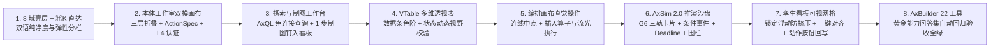

# 08 · Step 30：Phase 3 全旅程端到端验收、交互性能基准与全栈总门禁

本步是 Phase 3（Step 23～30）的双轨合流终验节点：通过端到端浏览器自动化套件 `xbluenode-web/e2e/v3-craft-and-runtime.spec.ts` 完整串联 Track A（8 域导航、`⌘K` 命令直达、弹性分栏、零代号双语纯净度、正交避障复合画布、一等公民制图与 VTable 透视表、磁吸驾驶舱）与 Track B（`ActionSpec` 契约与 GraphQL `Mutation`、四路径边动力学、L4 `Trial Tick` 认证、免连接 `AxQL`、状态动态视野、`AxSim` 事件队列与 Deadline 预警、空间多边形围栏及 22 工具问答验收闭环）；运行画布与透视表交互帧率及大图下推基准；将 [A7-REQUIREMENTS-TRACEABILITY.md](../../../../docs/standards/A7-REQUIREMENTS-TRACEABILITY.md) 能力追踪下限提升至 **92 项（`C01`～`C92`）**，升级 `scripts/gate/all.sh` 覆盖 `Step 00～30`，并在全绿合入后完成三期方案归档与 `v0.3.0` 版本发布就绪确认。

总览索引与门禁准则见 [00-V3-MASTER-INDEX.md](../00-V3-MASTER-INDEX.md)、[IRON_RULES.md](../../../../IRON_RULES.md) 与 [QUALITY_GATES_AND_VERIFICATION.md](../../../../docs/QUALITY_GATES_AND_VERIFICATION.md)。

---

## 30.0 目标、前置与契约

- **目标**：
  1. `xbluenode-web/e2e/v3-craft-and-runtime.spec.ts` 在前端桩模式与 `AXPOINT_E2E_LIVE=1` 真实全栈模式下均一次全绿通过；
  2. 全路由中英双态与亮暗双主题巡检确认：**中文态下零内部模块英文尾缀、零未翻译 `SCREAMING_SNAKE_CASE` 枚举、任意画布关系标签与节点卡片几何交集面积为 `0`**；
  3. 交互与内核性能红线达标：100 节点正交排布与拖拽对齐帧率 `>= 55fps`、`@visactor/react-vtable` 50,000 行透视表首屏渲染 `< 300ms`、60 万边 DuckDB 连通分量下推求解 `< 8s`、接地无幻觉双轨 50 例对抗拦截率保持 **100%**；
  4. `check_routes.py` 确认全部新增 REST / GraphQL / MCP 路由与 [A4-API-CONTRACT-INDEX.md](../../../../docs/standards/A4-API-CONTRACT-INDEX.md) 双向零差集；`check_traceability.py` 确认 `C01`～`C92`（92 项能力）与 `D01`～`D26`（26 类数据源）全部关联真实门禁断言；
  5. `scripts/gate/all.sh` 从干净环境顺序跑通 `step00`～`step30` 及三套全旅程 Playwright E2E（`full-journey`、`v2-grounded-journey`、`v3-craft-and-runtime`），末行输出 `ALL GATES PASS`。
- **前置**：[Step 24](../craft-ux/02-STEP24-ADVANCED-MODELING-FLOW-AND-CAUSAL-CANVASES.md)、[Step 25](../craft-ux/03-STEP25-CHART-STUDIO-VTABLE-PIVOT-AND-MAGNETIC-GRID.md)、[Step 28](./06-STEP28-SIM-EVENT-QUEUE-DEADLINE-AND-RUST-GEOSHAPE.md)、[Step 29](./07-STEP29-STREAM-WORKERS-LOG-CDC-AND-AUTONOMOUS-HARNESS.md) 全部合入（无新增数据库迁移）。
- **覆盖能力项**：
  - `C92`：`step30` `"v3-journey-pass"`、`"traceability-92-ok"`

### 文件变更清单

| 负责角色 | 动作 | 路径 | 内容 |
| :--- | :--- | :--- | :--- |
| `orchestrator` | 修改 | `scripts/check_traceability.py` | 将能力项最低数量门禁从 `>= 75` 提升至 `>= 92`（校验 `C01`～`C92` 连续无缺漏） |
| `orchestrator` | 修改 | `docs/standards/{A1-CONVENTIONS-ENUMS-ROUTES.md, A2-DATABASE-MIGRATIONS-INDEX.md, A4-API-CONTRACT-INDEX.md, A7-REQUIREMENTS-TRACEABILITY.md}` | Phase 3 全量枚举、迁移 `0020`～`0024`、路由与 `C76`～`C92` 终审核对 |
| `orchestrator` | 修改 | `scripts/gate/all.sh` | 纳入 `step23.sh`～`step30.sh` 与 `v3-craft-and-runtime.spec.ts` |
| `squad-qa` | 新建 | `xbluenode-web/e2e/v3-craft-and-runtime.spec.ts` | 覆盖 Track A + Track B 八段闭环的端到端验收旅程（§30.1） |
| `squad-qa` | 新建 | `scripts/bench/v3-canvas-and-algo-bench.sh`、`scripts/gate/step30.sh` | 画布/VTable 渲染耗时、DuckDB 图下推延迟基准与 Step 30 终验脚本（§30.2） |

---

## 30.1 Phase 3 八段全旅程 Playwright E2E（`v3-craft-and-runtime.spec.ts`）



| 阶段 | 验证焦点 | 硬性自动化断言 |
| :--- | :--- | :--- |
| **1. 壳层、命令面板与纯净度** | 遍历全部一级路由，唤起 `⌘K` 跳转目标视图，拖拽分隔条刷新页面 | 侧栏无任何英文代号尾缀，内页 H1 无 `Ax* / xBlue* · ` 前缀；分栏宽度百分比刷新后精确保持；旧路径 `/ingest`、`/graph` 无感落地对应页签 |
| **2. 复合画布、动作与 L4 认证** | 在 `/studio` 展开/折叠业务域泳道与三层从属对象，配置 `ActionSpec` 与关系边运力规则，执行 `⌘Z` 撤销重做并触发 `试算认证` | 任意边标签与节点卡片包围盒交集为 `0`；孤立死指标修复后认证等级点亮 `L4_CERTIFIED` |
| **3. `AxQL` 与 1 步制图入看板** | 在 `/analytics` 使用 `AxQL` 执行跨三层对象及 `SUM_BY_ENTITY` 查询，点击 `制图` 生成圆角渐变组合图并一键 `钉入看板` | `SUM_BY_ENTITY` 零扇出膨胀；目标五区驾驶舱 `INSIGHT` 区立即出现新图表组件 |
| **4. VTable 透视与动态视野** | 切换 `透视分析` 开启数据条与热力色阶；以跨部门风控角色验证低风险隐藏、高风险自动显现 | Canvas 透视表正常渲染且帧率稳定；风险指标越过阈值前后可见行数从 `0` 精确变为 `1` |
| **5. 编排连线中点插算子** | 在 `/flow` 悬停连线中点触发 `+` 插入 `HUMAN_APPROVAL` 算子并运行测试流 | 原边自动切分为两条有序连接边，运行态脉冲流光与耗时胶囊正确展示 |
| **6. `AxSim` 2.0 推演闭环** | 在 `/sim` 添加定时减产事件、库存阈值自动补库事件与多边形围栏红线目标，运行分步推演并在 `@antv/g6` 画布检视三轨卡片 | 顶部准确告警 `breach_step` 与 `deadline_step`；G6 画布支持 `Combo` 折叠与 `Hull` 风险包络高亮 |
| **7. 驾驶舱磁吸网格与动作回写** | 在 `/view/:slug` 开启编辑态切换 `锁定位置` 拖动卡片，触发 `对齐整理`，随后在运行态触发绑定 `ActionSpec` 的按钮 | 下方卡片零被动错位；动作按钮校验前置条件后成功回写节点指标并通过 SSE 局部刷新 KPI 火花线 |
| **8. 22 工具自治问答验收** | 运行子图黄金能力问答套件核验 | 全部能力问数题接地核验通过（`status == "PASS"`），零幻觉数值、零越界角标 |

---

## 30.2 可执行门禁终验与归档规程（`scripts/gate/step30.sh`）

```bash
#!/usr/bin/env bash
# Step 30 Gate：Phase 3 全栈守卫、92 项能力溯源、性能基准与三套全旅程 E2E 总验收
set -euo pipefail
source "$(dirname "$0")/lib.sh"

# 1. 全套 G1 静态守卫与双向零漂移核验（C92）
python3 "$ROOT/scripts/lint-guard.py"
python3 "$ROOT/scripts/web-guard.py"
python3 "$ROOT/scripts/python-guard.py"
python3 "$ROOT/scripts/hallucination-guard.py"
python3 "$ROOT/scripts/docs-and-plans-guard.py"
python3 "$ROOT/scripts/check_routes.py" \
  --routes "$ROOT/axpoint-core/crates/axpoint-server/src/routes" \
  --index "$ROOT/docs/standards/A4-API-CONTRACT-INDEX.md"
python3 "$ROOT/scripts/check_traceability.py" \
  "$ROOT/docs/standards/A7-REQUIREMENTS-TRACEABILITY.md" \
  "$ROOT/scripts/gate"
echo "ASSERT traceability-92-ok PASS"

# 2. 双轨 50 例反幻觉回归 + 画布/大图性能基准
bash "$ROOT/scripts/bench/grounded-ai-bench.sh"
bash "$ROOT/scripts/bench/v3-canvas-and-algo-bench.sh"

# 3. Phase 3 端到端全旅程 E2E 验收
(cd "$ROOT/xbluenode-web" && npx playwright test e2e/v3-craft-and-runtime.spec.ts)
echo "ASSERT v3-journey-pass PASS"

gate_pass step30
```

### 收官封存动作

当 `bash scripts/gate/all.sh`（覆盖 `Step 00～30`）与 GitHub Actions 全作业绿灯合入 `main` 后，由 `orchestrator` 提交归档 PR：将 `plans/v3-craft-and-world-runtime/` 移入 `plans/completed/v3-craft-and-world-runtime-step23-30/` 只读封存，同步更新 [plans/README.md](../../../README.md) 与全栈版本号至 `v0.3.0`。
