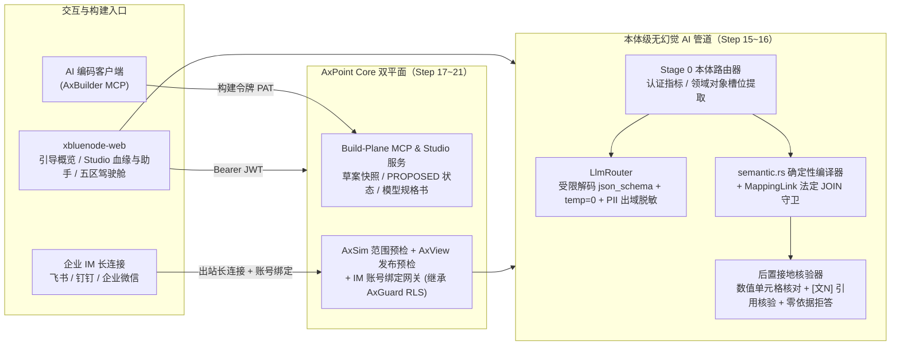
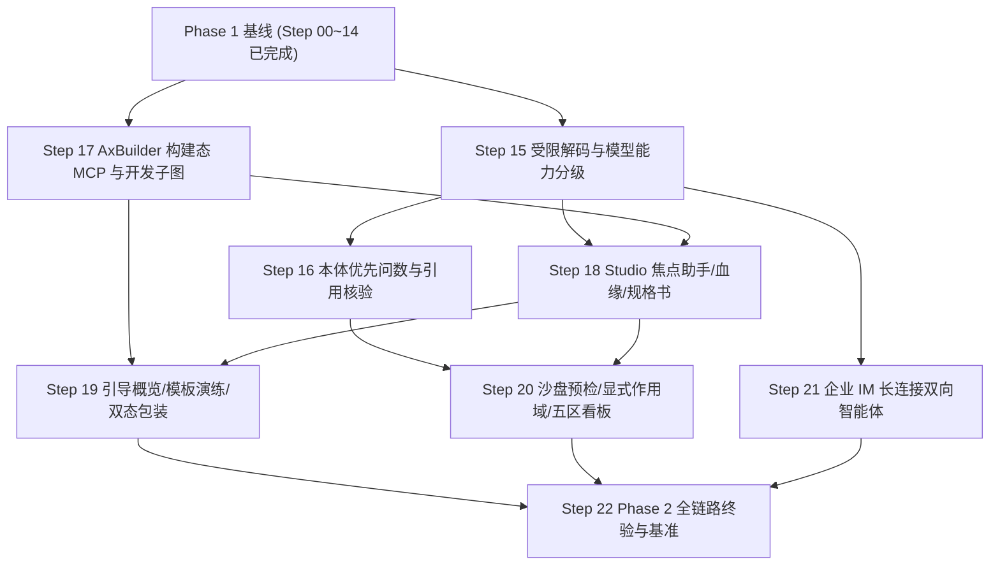

# xBlueNode / AxPoint Phase 2 实施总蓝图：本体级无幻觉 AI 与全链路构建易用性（Step 15～22）

本文件是 `plans/v2-ux-and-grounded-ai/` 的**唯一总入口**，承接已完成归档的第一阶段基线（[Step 00～14](../completed/v1-foundation-step00-14/00-MASTER-INDEX.md)，对应迁移 `0001`～`0014`、能力项 `C01`～`C59`）。本蓝图围绕**本体级无幻觉 AI（兼容云端 API 与本地 7B～32B 模型）**与**构建态 MCP 协同及工作室端到端易用性**两大主线，按可并行依赖层（L12～L16）定义 Step 15～22 的契约、数据模型、接口、前端交互与可执行门禁。

常驻工程约束、三级门禁与多团队/多代理并发规约见：
- [IRON_RULES.md](../../IRON_RULES.md)
- [QUALITY_GATES_AND_VERIFICATION.md](../../docs/QUALITY_GATES_AND_VERIFICATION.md)
- [MULTI_AGENT_TEAM_WORKFLOW.md](../../docs/MULTI_AGENT_TEAM_WORKFLOW.md)
- [A1-CONVENTIONS-ENUMS-ROUTES.md](../../docs/standards/A1-CONVENTIONS-ENUMS-ROUTES.md)

---

## 1. Phase 2 核心演进目标

### 1.1 专项一：本体级无幻觉 AI 闭环（`grounded-ai/`，Step 15～16）
1. **模型层受限解码与能力分级（Step 15）**：在 `axpoint-llm` 为云端 API 与本地推理引擎（Ollama / vLLM / SGLang）建立显式结构化解码能力描述（`NONE | JSON_OBJECT | JSON_SCHEMA`），透传动态枚举约束的 `response_format: json_schema`，对数值/SQL/槽位提取强制锁定 `temperature = 0.0` 与确定性 `seed`，并支持用户级个人默认模型覆盖只读系统模型。
2. **本体优先问数编译、连接路径锁死与引用核验（Step 16）**：在 `axpoint-analytics` 增加第 0 阶段「本体与认证指标优先路由器」——命中 `MetricDef` 或已发布领域对象时仅提取强类型意图槽位，交由 `semantic.rs` 确定性编译执行，彻底绕过手写裸 SQL；多表关联 SQL 强制校验 `MappingLinkSpec` 法定连接边（拦截虚构跨表 `JOIN`）；知识检索问答（`DOC / HYBRID`）强制校验 `[文N]` 角标未越界且零召回时确定性拒答；内置 50 例对抗回归基准（拦截率 100%）。

### 1.2 专项二：构建态协同、可视化血缘与全链路易用性（`builder-and-ux/`，Step 17～22）
1. **`AxBuilder` 构建态 MCP 与开发子图沙盒（Step 17）**：将 `/api/mcp` 从纯运行态消费升级为「运行态 + 构建态双平面」，向外部 AI 编码客户端暴露 9 个受细粒度权限（`STUDIO_EDIT` / `FLOW_EDIT` / `VIEW_EDIT`）管控的构建工具（环境预检、工作区拉取、模型校验、草案推送、模板克隆、流程与看板草案同步、开发子图试灌与清空），每次工具调用自动回传前端页面深链，并在前端提供主流客户端配置片段一键生成。
2. **`xBlueStudio` 焦点感知助手、单节点横向血缘与全景规格书（Step 18）**：在建模画布右栏提供常驻上下文感知 AI 助手（区分「只诊断不修改」与「写入草案并自动生成快照回退点」）；为节点、属性与规则增加 `PROPOSED / CONFIRMED` 成熟度状态流；双击节点切入左→右全链路数据血缘画布（`数据集列 → 映射转换 → 节点属性/指标 → 聚合/派生公式 → 告警/端点/驾驶舱`）；支持一键生成结构化「模型全景规格书（含推荐验收问数集）」并对接出品引擎导出。
3. **引导式冷启动、演练子图模板试用与一键应用包装（Step 19）**：在系统概览页提供实时计算完成度的 5 步构建引导条；将行业模板只读预览前置于工作台并开放「一键克隆至独立演练子图」（免 `OPS_ADMIN` 权限，安全试用不污染主图）；在 `xBlueStudio` 发布后直接内联「打包领域智能体（含暴露 MCP）」与「生成孪生驾驶舱」双出口。
4. **沙盘范围预检、会话级显式作用域与驾驶舱语义分区（Step 20）**：`AxSim` 克隆前执行静态范围健康度预检（因果边覆盖率、跨边聚合闭合度、孤立节点占比）；`AxQuery` 输入栏增加 `@` 与胶囊式会话作用域挂载器（限定数据集、文档前缀、业务子图、已发布技能）；`xBlueView` 提供五区语义驾驶舱骨架模板（`CONTROL / SCENE / KPI / INSIGHT / DECISION`）与发布前数据源健康自检；`xBlueGraph` 增加 Schema 自动补全图模式筛选栏。
5. **企业 IM 出站长连接双向智能体（Step 21）**：在 `AxAgent` 建立飞书、钉钉、企业微信出站长连接网关（内网环境免开公网入站回调端口，基于 PostgreSQL 租约实现 `< 45s` 单主故障接管），支持提问人首次私聊完成平台账号绑定，全量继承本人 `AxGuard` 行列权限与 PII 脱敏策略。
6. **Phase 2 全链路端到端验收与双轨基准（Step 22）**：串联「模板克隆演练 → 侧栏 AI 微调与血缘核对 → 构建态 MCP 同步 → 范围预检推演 → 五区驾驶舱发布 → 云/端双轨零幻觉问数」完整旅程的 Playwright E2E 与 `all.sh` 总验收。

---

## 2. 目标演进架构图



---

## 3. 步骤总表与文件索引（Step 15～22）

| Step | 名称 | 方案文件 | 迁移文件 | 涉及 Crate / 包 | 前置 Step | 负责分队 |
| :--- | :--- | :--- | :--- | :--- | :--- | :--- |
| **15** | 受限解码、模型能力分级与个人模型覆盖 | [01-STEP15](./grounded-ai/01-STEP15-CONSTRAINED-DECODING-AND-LLM-CAPS.md) | `0015_llm_structured_grounding.sql` | `axpoint-domain`、`axpoint-llm`、`axpoint-db`、`axpoint-server`、web | 14 | `squad-domain-agent` + `squad-web` |
| **16** | 本体优先问数路由、法定 JOIN 守卫与引用核验 | [02-STEP16](./grounded-ai/02-STEP16-ONTOLOGY-GROUNDED-ASK-AND-CITATION-GUARD.md) | `0016_grounded_ask_eval.sql` | `axpoint-domain`、`axpoint-analytics`、`axpoint-db`、`axpoint-server`、web | 15 | `squad-analytics-guard` + `squad-web` |
| **17** | `AxBuilder` 构建态 MCP、构建令牌与开发子图沙盒 | [03-STEP17](./builder-and-ux/03-STEP17-AXBUILDER-MCP-AND-DEV-SUBGRAPH.md) | `0017_axbuilder_scopes.sql` | `axpoint-domain`、`axpoint-agent`、`axpoint-db`、`axpoint-server`、web | 14 | `squad-domain-agent` + `squad-web` |
| **18** | `xBlueStudio` 焦点感知助手、单节点血缘与模型规格书 | [04-STEP18](./builder-and-ux/04-STEP18-STUDIO-COPILOT-LINEAGE-AND-SPEC-DOC.md) | `0018_studio_proposal_status.sql` | `axpoint-domain`、`axpoint-llm`、`axpoint-db`、`axpoint-server`、web | 15、17 | `squad-domain-agent` + `squad-web` |
| **19** | 5 步构建引导、演练子图模板试用与 Studio 双态包装 | [05-STEP19](./builder-and-ux/05-STEP19-ONBOARDING-TEMPLATE-HUB-AND-APP-PACKAGING.md) | 无（复用 `0014` / `0017`） | `axpoint-domain`、`axpoint-db`、`axpoint-server`、web | 17、18 | `squad-domain-agent` + `squad-web` |
| **20** | `AxSim` 范围预检、`AxQuery` 显式作用域与五区驾驶舱 | [06-STEP20](./builder-and-ux/06-STEP20-SIM-PREFLIGHT-SCOPED-QUERY-AND-VIEW-ZONES.md) | 无（复用 `0005` / `0010` / `0011`） | `axpoint-domain`、`axpoint-analytics`、`axpoint-server`、web | 16、18 | `squad-analytics-guard` + `squad-domain-agent` + `squad-web` |
| **21** | `AxAgent` 企业 IM 出站长连接双向机器人与权限绑定 | [07-STEP21](./builder-and-ux/07-STEP21-IM-BIDIRECTIONAL-AGENT-CONNECTORS.md) | `0019_im_bot_bindings.sql` | `axpoint-domain`、`axpoint-agent`、`axpoint-security`、`axpoint-db`、`axpoint-server`、web | 15 | `squad-domain-agent` + `squad-analytics-guard` + `squad-web` |
| **22** | Phase 2 端到端全旅程验收、无幻觉红队基准与总门禁 | [08-STEP22](./builder-and-ux/08-STEP22-V2-E2E-BENCHMARKS-AND-ACCEPTANCE.md) | 无 | `scripts/gate`、`xbluenode-web/e2e`、`tests/cassettes` | 16、19、20、21 | `squad-qa` + `orchestrator` |

---

## 4. 依赖拓扑与可并行层级（L12～L16）



同一依赖层内的 Step 互不阻塞，可由不同分队在独立 `git worktree` 中并发推进（契约 PR 按迁移编号 `0015 → 0016 → 0017 → 0018 → 0019` 顺序先行合入）：

| 依赖层 | 并行 Step | 契约迁移顺序 | 并行执行分队分配 |
| :--- | :--- | :--- | :--- |
| **L12** | Step 15、Step 17 | `0015` → `0017` | `squad-domain-agent`（拆 2 个子代理分别负责 `axpoint-llm` 与 `axpoint-agent::mcp_server`）+ `squad-web` |
| **L13** | Step 16、Step 18、Step 21 | `0016` → `0018` → `0019` | `squad-analytics-guard`（Step 16）；`squad-domain-agent`（Step 18 & Step 21）；`squad-web`（三页面组件互不重叠） |
| **L14** | Step 19、Step 20 | 无新迁移 | `squad-domain-agent`（Step 19 & Step 20 预检）；`squad-analytics-guard`（Step 20 作用域）；`squad-web` |
| **L15** | Step 22 | 无新迁移 | `squad-qa` + `orchestrator`（全量回归、基准评测与归档） |

---

## 5. 计划新增能力追踪映射（`C60`～`C75`，随各 Step 契约 PR 追加至 `A7`）

> 说明：`docs/standards/A7-REQUIREMENTS-TRACEABILITY.md` 由 `scripts/check_traceability.py` 实时核验已存在门禁脚本；以下 `C60`～`C75` 条目在对应 Step 的契约 PR 提交 `scripts/gate/stepNN.sh` 时同步写入 `A7`。

| 编号 | 所属域 | 能力项 | 负责 Step | 目标门禁断言（`stepNN.sh`） |
| :--- | :--- | :--- | :--- | :--- |
| `C60` | D 智能 | 云端与本地小模型 `json_schema` 受限解码及确定性零温采样 | 15 | `step15` `"schema-guided-ok"`、`"temp-zero-enforced"` |
| `C61` | G 系统 | 系统级只读模型与用户个人默认模型分级覆盖 | 15 | `step15` `"user-default-provider"`、`"system-provider-readonly"` |
| `C62` | D 智能 | 本体与认证指标优先问数路由（零裸 SQL 确定性语义编译） | 16 | `step16` `"ontology-metric-route"`、`"slot-compile-exact"` |
| `C63` | D 智能 | 多表问数本体外键路径守卫（拦截无映射依据的自由 `JOIN`） | 16 | `step16` `"ungrounded-join-rejected"`、`"mapped-join-ok"` |
| `C64` | D 智能 | 知识问答段落引用角标核验与零召回确定性拒答 | 16 | `step16` `"phantom-citation-stripped"`、`"empty-recall-abstain"` |
| `C65` | D 智能 | 云/端双轨 50 例反幻觉对抗基准 100% 拦截 | 16 / 22 | `step16` `"hallucination-eval-100"` |
| `C66` | C 构建 | `AxBuilder` 构建态 MCP 工具集（拉取/校验/推送模型、流程与看板草案并回传深链） | 17 | `step17` `"mcp-axbuilder-preflight"`、`"mcp-push-draft"`、`"mcp-deeplink"` |
| `C67` | C 构建 | 细粒度构建令牌预设与隔离开发子图试灌及一键清空 | 17 | `step17` `"builder-token-no-prod"`、`"dev-subgraph-reset"` |
| `C68` | B 设计 | `xBlueStudio` 焦点感知常驻 AI 助手与草案快照一键回退 | 18 | `step18` `"copilot-readonly-diag"`、`"copilot-mutate-rollback"` |
| `C69` | B 设计 | 模型要素 `PROPOSED / CONFIRMED` 成熟度状态流与完备度通过项计数 | 18 | `step18` `"proposal-confirm-flow"`、`"pass-count-metrics"` |
| `C70` | B 设计 | 单节点左→右全链路数据血缘管道图与自动生成模型全景规格书 | 18 | `step18` `"node-lineage-graph"`、`"subgraph-spec-doc"` |
| `C71` | G 系统 | 系统概览 5 步实时构建向导与免运维权限演练子图模板试用 | 19 | `step19` `"onboarding-progress"`、`"trial-template-clone"` |
| `C72` | C 构建 | `xBlueStudio` 一键双态应用包装（领域智能体 + 孪生驾驶舱） | 19 | `step19` `"studio-pack-agent"`、`"studio-pack-dashboard"` |
| `C73` | E 推演 | `AxSim` 沙盘克隆前静态范围完整度预检（传导覆盖率与聚合闭合度） | 20 | `step20` `"sim-preflight-warn"`、`"sim-preflight-closed"` |
| `C74` | D / F | `AxQuery` 会话级显式作用域挂载与 `xBlueView` 五区骨架及发布前自检 | 20 | `step20` `"scoped-ask-isolated"`、`"view-zone-preset"`、`"view-publish-preflight"` |
| `C75` | D 智能 | `AxAgent` 飞书/钉钉/企微出站长连接双向机器人与提问人账号权限绑定 | 21 | `step21` `"im-bind-token"`、`"im-rls-inherited"`、`"im-leader-failover"` |

---

## 6. 计划新增枚举与权限增量预览（随各 Step 契约 PR 同步至 `A1`）

| 枚举名 | 新增或定义取值 | 所属 Step | 用途 |
| :--- | :--- | :--- | :--- |
| `StructuredOutputMode` | `NONE` `JSON_OBJECT` `JSON_SCHEMA` | 15 | `ax_llm_providers.structured_mode` 受限解码能力标识 |
| `GroundingMode` | `SEMANTIC_METRIC` `DOMAIN_OBJECT` `GUARDED_SQL` `GROUNDED_DOC` `ABSTAINED` `CLARIFICATION` | 16 | `an_ask_turns.grounding_mode` 问数与问答接地路径审计 |
| `DesignMaturity` | `PROPOSED` `CONFIRMED` | 18 | `NodeTypeSpec` / `PropertySpec` / `EdgeTypeSpec` / 规则成熟度状态 |
| `CopilotActionMode` | `DIAGNOSE_ONLY` `PATCH_DRAFT` | 18 | `xBlueStudio` 焦点感知助手交互模式 |
| `CockpitZoneLayout` | `FREE_GRID` `STANDARD_FIVE_ZONE` | 20 | `xv_dashboards` 画布预设布局模式（`CONTROL/SCENE/KPI/INSIGHT/DECISION`） |
| `ImPlatform` | `FEISHU` `DINGTALK` `WECOM` | 21 | `ax_im_connectors.platform` 企业 IM 双向接入通道 |
| `ImIdentityPolicy` | `REQUIRE_USER_BIND` `CREATOR_DELEGATED` | 21 | IM 提问权限继承策略（推荐强制个人账号绑定） |
| `AuditAction`（追加） | `BUILDER_MCP_MUTATE` `STUDIO_SNAPSHOT_RESTORE` `TRIAL_TEMPLATE_CLONE` `IM_ACCOUNT_BIND` | 17～21 | `sec_audit_logs.action` 审计链扩展动作 |

---

## 7. 统一执行与门禁命令

每个 Step 执行完毕后须同时满足单步门禁与全栈守卫：

```bash
# 1. 全套静态守卫
bash scripts/naming-guard.sh
python3 scripts/lint-guard.py
python3 scripts/web-guard.py
python3 scripts/python-guard.py
python3 scripts/hallucination-guard.py
python3 scripts/docs-and-plans-guard.py
python3 scripts/check_routes.py
python3 scripts/check_traceability.py

# 2. 当前 Step 门禁（例如 Step 16）
bash scripts/gate/step16.sh

# 3. Phase 1 + Phase 2 累计回归
bash scripts/gate/all.sh
```
