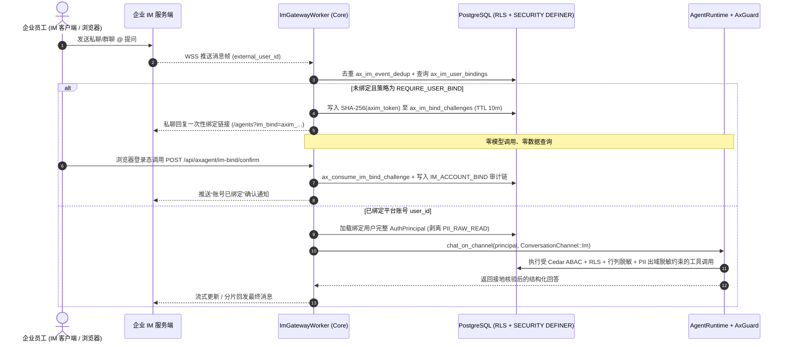

# 07 · Step 21：AxAgent 企业 IM 出站长连接双向机器人与权限绑定

在 [Step 08](../../completed/v1-foundation-step00-14/07-STEP07-08-AXFLOW-ORCHESTRATION-RULES-ALERTS.md) 中，`axpoint-flow::notify` 已实现面向飞书、钉钉、企业微信的单向告警推送；但企业在隔离内网部署平台时通常不具备公网固定 IP 或入站 Webhook 反向代理端口。本步在 `axpoint-agent` 构建**零入站端口的出站长连接（WebSocket / Stream）双向智能体网关**，基于 PostgreSQL 行锁租约实现无状态多副本单主接管（故障切换耗时 `< 45s`），并通过一次性私聊绑定挑战码将外部 IM 身份映射至平台 `sec_users`，使每一次 IM 对话均以提问人本人的 `AuthPrincipal` 驱动 `AgentRuntime`，全量继承 `AxGuard` Cedar ABAC、PostgreSQL RLS、行列脱敏与 PII 出域拦截策略。

总览索引与工程约束见 [00-V2-MASTER-INDEX.md](../00-V2-MASTER-INDEX.md)、[IRON_RULES.md](../../../IRON_RULES.md) 与 [A1-CONVENTIONS-ENUMS-ROUTES.md](../../../docs/standards/A1-CONVENTIONS-ENUMS-ROUTES.md)。

---

## 21.0 目标、前置与契约

- **目标**：
  1. 幂等数据库迁移 `0019_im_bot_bindings.sql`（连接器注册表、外部账号绑定表、一次性绑定挑战码表、入站事件去重表、全表租户 RLS 与 `SECURITY DEFINER` 跨租户租约/挑战核销函数）；
  2. `axpoint-agent::im_gateway` 出站长连接常驻工作器（覆盖 `FEISHU`、`DINGTALK`、`WECOM` 三通道协议适配、30s 租约心跳、`< 45s` 故障切换、`watch::Receiver<bool>` 优雅停机、入站幂等去重、流式状态卡片节流更新与超长 Markdown 安全分片）；
  3. 提问人身份绑定闭环（未绑定拦截下发 10 分钟有效私聊挑战深链 → Web 登录态 `POST /api/axagent/im-bind/confirm` 原子核销并写入 `IM_ACCOUNT_BIND` 审计链 → 后续消息以绑定用户的 `AuthPrincipal` 调用 `AgentRuntime`）；
  4. `AxAgentPage.tsx` 新增 `IM 连接` 标签页与 `ImConnectorPanel.tsx` 管理界面，配套零外部依赖 WebSocket 回环测试桩与 `scripts/gate/step21.sh`。
- **前置**：[Step 15](../grounded-ai/01-STEP15-CONSTRAINED-DECODING-AND-LLM-CAPS.md)（受限解码与模型路由）及 [Step 09](../../completed/v1-foundation-step00-14/08-STEP09-AXAGENT-PUBLISHING-MCP-AGENTS.md)、[Step 13](../../completed/v1-foundation-step00-14/11-STEP13-AXGUARD-SECURITY-GOVERNANCE.md) 基线通过。
- **关联能力追踪**：
  - `C75`：`step21` `"im-bind-token"`、`"im-rls-inherited"`、`"im-leader-failover"`
- **契约清单**：
  - 数据库迁移：`deploy/migrations/0019_im_bot_bindings.sql`（登记至 [A2](../../../docs/standards/A2-DATABASE-MIGRATIONS-INDEX.md)）
  - 领域模型与枚举：`axpoint-domain::enums::{ImPlatform, ImIdentityPolicy, ImConnectorStatus}`、`ConversationChannel::Im`、`AuditAction::ImAccountBind`、`axpoint-domain::im::*`
  - 端口接口：`axpoint-domain::ports::{ImGatewayRepository, PrincipalHydrationPort}`
  - 网关实现：`axpoint-agent::im_gateway`
  - 接口契约：`/api/axagent/im-connectors/*` 与 `/api/axagent/im-bind/*`（登记至 [API_CONTRACT.md](../../../docs/API_CONTRACT.md) 与 [A4](../../../docs/standards/A4-API-CONTRACT-INDEX.md)）
  - 前端模块：`xbluenode-web/src/lib/api/axagent.ts`、`src/components/axagent/ImConnectorPanel.tsx`、`src/pages/AxAgentPage.tsx`

### 文件变更清单

| 动作 | 路径 | 内容 |
| :--- | :--- | :--- |
| 新建 | `deploy/migrations/0019_im_bot_bindings.sql` | 连接器、身份绑定、挑战码、事件去重、RLS 与 `SECURITY DEFINER` 函数（§21.1） |
| 修改 | `axpoint-core/crates/axpoint-domain/src/enums.rs` | 新增 `ImPlatform`、`ImIdentityPolicy`、`ImConnectorStatus`；扩展 `ConversationChannel::Im`、`AuditAction::ImAccountBind` |
| 新建 | `axpoint-core/crates/axpoint-domain/src/im.rs`；修改 `src/{lib.rs, ports.rs}` | IM 连接器契约、绑定记录、入站/出站帧模型与 `ImGatewayRepository` 端口 |
| 新建 | `axpoint-core/crates/axpoint-db/src/im_repo.rs`；修改 `src/lib.rs` | PostgreSQL 存储实现、租约认领/续期/释放与原子绑定挑战核销 |
| 新建 | `axpoint-core/crates/axpoint-agent/src/im_gateway/{mod.rs, supervisor.rs, protocol.rs, feishu_ws.rs, dingtalk_stream.rs, wecom_bot.rs, chunker.rs}` | 出站长连接监管器、三平台协议帧状态机、流式节流与分片器（§21.2） |
| 修改 | `axpoint-core/crates/axpoint-agent/src/{lib.rs, runtime.rs}` | 支持 `ConversationChannel::Im` 会话复用与 `WAITING_APPROVAL` 异步回推 |
| 修改 | `axpoint-core/crates/axpoint-server/src/{background.rs, state.rs, routes/axagent.rs}` | 启动 `ImGatewaySupervisor` 后台任务（接入 `watch::Receiver<bool>`），挂载 IM 路由 |
| 修改 | `xbluenode-web/src/lib/api/axagent.ts`、`src/pages/AxAgentPage.tsx` | IM 连接器与绑定 API 客户端、`IM 连接` 页签与 `?im_bind=` 确认入口 |
| 新建 | `xbluenode-web/src/components/axagent/ImConnectorPanel.tsx` | 连接器配置、状态监控、已绑定账号列表与绑定确认弹窗（§21.4） |
| 新建 | `scripts/gate/tools/mock_im_hub.py`、`scripts/gate/step21.sh` | 确定性 RFC-6455 WebSocket 回环测试服务与 Step 21 门禁脚本（§21.5） |

---

## 21.1 数据库迁移 `deploy/migrations/0019_im_bot_bindings.sql`

严格遵守幂等迁移铁律（`CREATE TABLE IF NOT EXISTS`、`ADD COLUMN IF NOT EXISTS`、`CREATE INDEX IF NOT EXISTS`、租户表统一启用 `ax_enable_tenant_rls`、跨租户后台函数最小权限授予 `axpoint_app`）：

```sql
-- 0019_im_bot_bindings.sql：企业 IM 出站长连接机器人、用户身份绑定、挑战码与分布式租约

CREATE TABLE IF NOT EXISTS ax_im_connectors (
    id                 UUID PRIMARY KEY DEFAULT gen_random_uuid(),
    tenant_id          TEXT NOT NULL,
    name               TEXT NOT NULL,
    platform           TEXT NOT NULL CHECK (platform IN ('FEISHU','DINGTALK','WECOM')),
    agent_id           UUID NOT NULL REFERENCES ax_agents(id) ON DELETE CASCADE,
    credential_id      UUID NOT NULL REFERENCES ds_credentials(id) ON DELETE RESTRICT,
    config             JSONB NOT NULL DEFAULT '{}'::jsonb, -- 非秘密参数：endpoint_override, allow_private_network, bot_code 等
    identity_policy    TEXT NOT NULL DEFAULT 'REQUIRE_USER_BIND'
                           CHECK (identity_policy IN ('REQUIRE_USER_BIND','CREATOR_DELEGATED')),
    delegated_user_id  UUID REFERENCES sec_users(id) ON DELETE RESTRICT,
    enabled            BOOLEAN NOT NULL DEFAULT TRUE,
    leader_holder      TEXT,
    lease_until        TIMESTAMPTZ,
    status             TEXT NOT NULL DEFAULT 'DISCONNECTED'
                           CHECK (status IN ('DISCONNECTED','CONNECTING','CONNECTED','DEGRADED','ERROR')),
    last_error         TEXT NOT NULL DEFAULT '',
    last_heartbeat_at  TIMESTAMPTZ,
    created_by         UUID REFERENCES sec_users(id) ON DELETE SET NULL,
    created_at         TIMESTAMPTZ NOT NULL DEFAULT NOW(),
    updated_at         TIMESTAMPTZ NOT NULL DEFAULT NOW(),
    UNIQUE (tenant_id, name),
    CHECK (identity_policy <> 'CREATOR_DELEGATED' OR delegated_user_id IS NOT NULL)
);
CREATE INDEX IF NOT EXISTS idx_ax_im_connectors_lease
    ON ax_im_connectors (enabled, lease_until);

CREATE TABLE IF NOT EXISTS ax_im_user_bindings (
    id                    UUID PRIMARY KEY DEFAULT gen_random_uuid(),
    tenant_id             TEXT NOT NULL,
    platform              TEXT NOT NULL CHECK (platform IN ('FEISHU','DINGTALK','WECOM')),
    external_user_id      TEXT NOT NULL,
    external_display_name TEXT NOT NULL DEFAULT '',
    user_id               UUID NOT NULL REFERENCES sec_users(id) ON DELETE CASCADE,
    bound_at              TIMESTAMPTZ NOT NULL DEFAULT NOW(),
    UNIQUE (tenant_id, platform, external_user_id)
);
CREATE INDEX IF NOT EXISTS idx_ax_im_user_bindings_user
    ON ax_im_user_bindings (tenant_id, user_id);

CREATE TABLE IF NOT EXISTS ax_im_bind_challenges (
    token_hash            TEXT PRIMARY KEY,                -- SHA-256 hex(raw_token)
    tenant_id             TEXT NOT NULL,
    connector_id          UUID NOT NULL REFERENCES ax_im_connectors(id) ON DELETE CASCADE,
    platform              TEXT NOT NULL CHECK (platform IN ('FEISHU','DINGTALK','WECOM')),
    external_user_id      TEXT NOT NULL,
    external_display_name TEXT NOT NULL DEFAULT '',
    expires_at            TIMESTAMPTZ NOT NULL,
    consumed_at           TIMESTAMPTZ,
    consumed_by           UUID REFERENCES sec_users(id) ON DELETE SET NULL,
    created_at            TIMESTAMPTZ NOT NULL DEFAULT NOW()
);
CREATE INDEX IF NOT EXISTS idx_ax_im_bind_challenges_exp
    ON ax_im_bind_challenges (tenant_id, expires_at);

CREATE TABLE IF NOT EXISTS ax_im_event_dedup (
    tenant_id    TEXT NOT NULL,
    connector_id UUID NOT NULL REFERENCES ax_im_connectors(id) ON DELETE CASCADE,
    event_id     TEXT NOT NULL,
    received_at  TIMESTAMPTZ NOT NULL DEFAULT NOW(),
    PRIMARY KEY (connector_id, event_id)
);
CREATE INDEX IF NOT EXISTS idx_ax_im_event_dedup_time
    ON ax_im_event_dedup (tenant_id, received_at);

-- 扩展 ax_conversations 支持 IM 通道与外部会话线程续接
ALTER TABLE ax_conversations DROP CONSTRAINT IF EXISTS ax_conversations_channel_check;
ALTER TABLE ax_conversations ADD CONSTRAINT ax_conversations_channel_check
    CHECK (channel IN ('WORKBENCH','EMBED','API','FLOW','MCP','IM'));
ALTER TABLE ax_conversations ADD COLUMN IF NOT EXISTS im_connector_id UUID REFERENCES ax_im_connectors(id) ON DELETE SET NULL;
ALTER TABLE ax_conversations ADD COLUMN IF NOT EXISTS external_chat_id TEXT;
CREATE INDEX IF NOT EXISTS idx_ax_conversations_im_thread
    ON ax_conversations (tenant_id, im_connector_id, external_chat_id, user_id, updated_at DESC)
    WHERE channel = 'IM';

-- 扩展保留策略目标枚举支持清理过期 IM 事件去重表与挑战码
ALTER TABLE ax_retention_policies DROP CONSTRAINT IF EXISTS ax_retention_policies_target_check;
ALTER TABLE ax_retention_policies ADD CONSTRAINT ax_retention_policies_target_check
    CHECK (target IN (
        'METRIC_SERIES','METRIC_ROLLUP_MINUTE','AUDIT','EXPORT_FILE','FLOW_STEP_LOG','JOB',
        'OUTBOX','LAKE_SNAPSHOT','MESSAGE','QUERY_HISTORY','CONVERSATION','IM_EVENT_DEDUP'
    ));
INSERT INTO ax_retention_policies (tenant_id, target, keep_days)
VALUES ('default', 'IM_EVENT_DEDUP', 7)
ON CONFLICT (tenant_id, target) DO NOTHING;

SELECT ax_enable_tenant_rls(t) FROM unnest(ARRAY[
    'ax_im_connectors',
    'ax_im_user_bindings',
    'ax_im_bind_challenges',
    'ax_im_event_dedup'
]::regclass[]) AS t;

-- 跨租户后台连接器租约认领与续期（单主防脑裂）
CREATE OR REPLACE FUNCTION ax_claim_im_connectors(
    p_holder TEXT,
    p_limit INT,
    p_lease_seconds INT
)
RETURNS SETOF ax_im_connectors
LANGUAGE sql
SECURITY DEFINER
SET search_path = public
AS $$
    UPDATE ax_im_connectors c
       SET leader_holder     = p_holder,
           lease_until       = NOW() + make_interval(secs => p_lease_seconds),
           last_heartbeat_at = NOW(),
           updated_at        = NOW()
     WHERE c.id IN (
           SELECT id
             FROM ax_im_connectors
            WHERE enabled = TRUE
              AND (leader_holder = p_holder
                   OR lease_until IS NULL
                   OR lease_until < NOW())
            ORDER BY CASE WHEN leader_holder = p_holder THEN 0 ELSE 1 END,
                     lease_until NULLS FIRST,
                     id
            FOR UPDATE SKIP LOCKED
            LIMIT p_limit
     )
    RETURNING c.*;
$$;

-- 优雅停机时主动归还本实例持有的全部 IM 租约
CREATE OR REPLACE FUNCTION ax_release_im_connectors(p_holder TEXT)
RETURNS INT
LANGUAGE sql
SECURITY DEFINER
SET search_path = public
AS $$
    WITH released AS (
        UPDATE ax_im_connectors
           SET leader_holder = NULL,
               lease_until   = NULL,
               status        = 'DISCONNECTED',
               updated_at    = NOW()
         WHERE leader_holder = p_holder
        RETURNING 1
    )
    SELECT count(*)::INT FROM released;
$$;

-- 原子校验并核销一次性 IM 绑定挑战码，同时写入或更新账号绑定表
CREATE OR REPLACE FUNCTION ax_consume_im_bind_challenge(
    p_token_hash TEXT,
    p_tenant_id  TEXT,
    p_user_id    UUID
)
RETURNS TABLE (
    connector_id          UUID,
    platform              TEXT,
    external_user_id      TEXT,
    external_display_name TEXT
)
LANGUAGE plpgsql
SECURITY DEFINER
SET search_path = public
AS $$
DECLARE
    v_row ax_im_bind_challenges%ROWTYPE;
BEGIN
    UPDATE ax_im_bind_challenges ch
       SET consumed_at = NOW(),
           consumed_by = p_user_id
     WHERE ch.token_hash  = p_token_hash
       AND ch.tenant_id   = p_tenant_id
       AND ch.consumed_at IS NULL
       AND ch.expires_at  > NOW()
    RETURNING * INTO v_row;

    IF NOT FOUND THEN
        RETURN;
    END IF;

    INSERT INTO ax_im_user_bindings (
        tenant_id, platform, external_user_id, external_display_name, user_id, bound_at
    )
    VALUES (
        v_row.tenant_id, v_row.platform, v_row.external_user_id,
        v_row.external_display_name, p_user_id, NOW()
    )
    ON CONFLICT (tenant_id, platform, external_user_id)
    DO UPDATE SET
        user_id               = EXCLUDED.user_id,
        external_display_name = EXCLUDED.external_display_name,
        bound_at              = NOW();

    RETURN QUERY
    SELECT v_row.connector_id, v_row.platform, v_row.external_user_id, v_row.external_display_name;
END;
$$;

REVOKE ALL ON FUNCTION ax_claim_im_connectors(TEXT, INT, INT) FROM PUBLIC;
REVOKE ALL ON FUNCTION ax_release_im_connectors(TEXT) FROM PUBLIC;
REVOKE ALL ON FUNCTION ax_consume_im_bind_challenge(TEXT, TEXT, UUID) FROM PUBLIC;
GRANT EXECUTE ON FUNCTION ax_claim_im_connectors(TEXT, INT, INT) TO axpoint_app;
GRANT EXECUTE ON FUNCTION ax_release_im_connectors(TEXT) TO axpoint_app;
GRANT EXECUTE ON FUNCTION ax_consume_im_bind_challenge(TEXT, TEXT, UUID) TO axpoint_app;
```

### 凭证密文结构（`ds_credentials`）

`ax_im_connectors.credential_id` 统一复用 `Keyring` AES-256-GCM 密封存储（`AAD = tenant_id || ':' || credential_id`），不新增任何明文密钥列：
- `FEISHU`：`{"app_id": "cli_...", "app_secret": "..."}`
- `DINGTALK`：`{"client_id": "ding...", "client_secret": "..."}`
- `WECOM`：`{"bot_id": "aib...", "secret": "..."}`

---

## 21.2 出站长连接多副本网关架构（`axpoint-agent::im_gateway`）

### 21.2.1 三通道出站握手机制（零入站端口）

所有外部连接均由 Core 节点作为客户端主动向外发起 HTTPS 票据交换与 WSS 长连接，部署侧防火墙只需放行出站 `443`（私有化网关或测试回环通过 `OutboundUrlGuardPort` + `config.allow_private_network` 受控放行）：

| 平台 (`ImPlatform`) | 适配器模块 | 出站票据获取端点 | 长连接帧协议与心跳确认 |
| :--- | :--- | :--- | :--- |
| `FEISHU` | `feishu_ws.rs` | `POST /callback/ws/endpoint`（携带 `AppID` / `AppSecret` 换取动态 WSS URL 与 `PingInterval`） | 二进制/JSON 帧封装（测试回环兼容标准 JSON 信封），收到 `im.message.receive_v1` 必须在 `3s` 内回发 `200` ACK 帧，业务处理异步投递至会话队列 |
| `DINGTALK` | `dingtalk_stream.rs` | `POST /v1.0/gateway/connections/open`（换取 `endpoint` 与一次性 `ticket`） | `WSS ?ticket=...` JSON Stream 帧；处理 `SYSTEM/ping` 即刻回显 `pong`，收到 `CALLBACK` 机器人消息回发 `{"code":200,"headers":{"messageId":...}}` |
| `WECOM` | `wecom_bot.rs` | `WSS` 智能机器人长连接通道（发送 `aibot_subscribe` 携带 `bot_id` 与签名/密钥完成鉴权） | JSON 帧双向流；定期发送 `ping` 心跳帧，收到 `aibot_msg_callback` 校重后驱动智能体并通过 `aibot_respond_msg` 流式更新回答 |

若连接器 `config.endpoint_override` 非空（例如集团内部私有化 IM 网关地址或 CI 测试桩 `ws://127.0.0.1:<port>/ws`），适配器优先向 `OutboundUrlGuardPort` 请求地址安全核验（未显式开启 `allow_private_network` 时拒绝访问 RFC1918 / Loopback 地址，杜绝 SSRF）。

### 21.2.2 30 秒分布式租约、`< 45s` 故障切换与优雅停机

在 Kubernetes 多副本（`replicas >= 2`）形态下，同一企业 IM 机器人若被过多实例同时挂载会触发平台连接数挤占或重复回复。`ImGatewaySupervisor` 采用**单连接器单主租约（Single-Leader Lease）**模型：

1. **核心时间常数**：
   - `IM_LEASE_DURATION_SECS: i32 = 30`（单次租约有效期 30 秒）
   - `IM_HEARTBEAT_INTERVAL: Duration = Duration::from_secs(10)`（持有者每 10 秒批量续租并上报 `CONNECTED / DEGRADED` 状态）
   - `IM_SUPERVISOR_SCAN_INTERVAL: Duration = Duration::from_secs(5)`（各 Core 副本每 5 秒调用 `ax_claim_im_connectors(holder_id, max_slots, 30)` 认领无主或租约过期连接器）
2. **故障接管上界推导**：
   设原持有副本在最近一次心跳刚完成瞬间发生硬断电或 `SIGKILL`，租约剩余最长 $T_{\text{lease}} = 30\text{s}$；存活副本至多等待 $T_{\text{scan}} = 5\text{s}$ 扫描发现 `lease_until < NOW()` 并抢占锁，再经 $T_{\text{dial}} \le 3\text{s}$ 完成票据交换与 WebSocket 重连：
   $$
   T_{\text{failover\_max}} = T_{\text{lease}} + T_{\text{scan}} + T_{\text{dial}} = 30\text{s} + 5\text{s} + 3\text{s} = 38\text{s} < 45\text{s}
   $$
   若原副本为滚动发布正常退出（收到 `SIGTERM`），`watch::Receiver<bool>` 立即触发 `ax_release_im_connectors(holder_id)` 清空 `lease_until`，存活副本在 $\le 5\text{s}$ 内平滑接管。
3. **脑裂防护（Fencing）与 Rust 并发铁律**：
   - 严禁使用无退出条件的死循环（遵守 `clippy::infinite_loop = "deny"`）；所有监听循环统一采用 `while !*shutdown_rx.borrow()` 配合 `tokio::select!` 监听 `shutdown_rx.changed()`。
   - 每次向 IM 通道发送业务回复前，工作器校验内存原子世代号与最近一次数据库续租结果；一旦续租因租约被他人抢占而未返回当前 `connector_id`，立即取消当前连接的 `CancellationToken` 并丢弃未发出的回复，确保同一事件绝不双发。

### 21.2.3 入站幂等去重、流式进展更新与安全分片

1. **事件级幂等去重**：收到入站消息后，先在当前租户 RLS 上下文执行 `INSERT INTO ax_im_event_dedup (tenant_id, connector_id, event_id) VALUES ($1, $2, $3) ON CONFLICT DO NOTHING`；受影响行数为 `0` 时直接忽略重投帧。
2. **流式进展卡片节流（`chunker.rs`）**：
   - 订阅 `AgentRuntime` 运行期发出的 `AgentEvent`（`ToolStarted`、`ToolFinished`、`WaitingApproval`、`Completed`）；
   - 按 `>= 800ms` 最小时间间隔合并更新进度提示（`检索知识库…`、`执行受控问数…`、`等待人工审批…`），避免触发企业 IM 接口限流。
3. **Markdown 边界感知分片**：
   - 当最终回复超过单条消息安全阈值（`3_600` UTF-8 字节）时，`split_markdown_chunks` 严格在双换行段落或完整代码块围栏（```` ``` ````）外部切分，绝不截断表格行或 `[文N]` 角标。
4. **人工审批异步闭环**：若工具命中 `approval_required_tools` 使会话进入 `WAITING_APPROVAL`，网关立即在当前 IM 会话回发审批卡片摘要与工作台深链（`/flow?approval_id=<id>`）；当审批人在 Web 端批准后，`OutboxTopic::ApprovalDecided` 唤醒 `AgentRuntime` 完成剩余推理，并由网关主动回推最终结论。

---

## 21.3 提问人身份绑定与全链路 `AxGuard` 权限继承



### 安全边界硬约束

1. **`REQUIRE_USER_BIND`（默认推荐策略）**：
   - 未绑定外部账号在群聊被 `@` 或私聊提问时，一律不进入 `LlmRouter` 或任何工具，仅生成 32 字节密码学随机挑战码 `axim_<base64url>`（数据库只存 `SHA-256` 十六进制摘要，`expires_at = NOW() + INTERVAL '10 minutes'`，单次核销即失效）。
   - 已绑定用户提问时，通过 `PrincipalHydrationPort` 从 `sec_users`、`sec_user_roles`、`sec_departments`、`sec_user_attributes` 实时水合该员工当前的 `AuthPrincipal`：
     - 若员工在 `sec_users` 中已被禁用或锁定，立即拒绝执行并提示账号不可用；
     - **强制脱敏护栏**：无论该员工在 Web 端是否拥有 `PII_RAW_READ` 权限，IM 通道水合出的 `AuthPrincipal` 一律移除 `Permission::PiiRawRead`，确保手机号、身份证、银行卡等敏感原值绝不经第三方 IM 云服务器明文传输；
     - 该员工所属部门的 `sec_row_policies`（例如华西区仅见 `dept_id = 'west'`）、`sec_column_policies`、数据集密级上限以及 Step 16 本体问数守卫与 Web 端 `AxAgent` **100% 同构生效**。
2. **`CREATOR_DELEGATED`（受限公共播报机器人策略）**：
   - 仅当管理员显式选择该策略并指定 `delegated_user_id` 时可用；
   - 运行时权限被硬截断为 `delegated_principal.permissions ∩ {DATA_READ, AGENT_RUN}`，禁止触发任何写操作工作流（`FLOW_RUN`）或推演下发（`SIM_APPLY`），且可访问资产密级上限锁定为 `INTERNAL`。

---

## 21.4 路由与前端 `ImConnectorPanel`

### 21.4.1 接口清单（挂载于 `/api/axagent`）

| 方法与路径 | 权限要求 | 功能说明 |
| :--- | :--- | :--- |
| `GET /api/axagent/im-connectors` | `DATA_READ` 或 `AGENT_EDIT` | 列出当前租户 IM 连接器、实时在线状态、持有节点标识与最近心跳时间 |
| `POST /api/axagent/im-connectors` | `AGENT_EDIT` | 新建连接器（密钥写入 `ds_credentials` 密封存储） |
| `PATCH /api/axagent/im-connectors/{id}` | `AGENT_EDIT` | 更新名称、绑定智能体、启停开关、密钥轮换或身份策略 |
| `DELETE /api/axagent/im-connectors/{id}` | `AGENT_EDIT` | 删除连接器并通知持有工作器断开连接 |
| `POST /api/axagent/im-connectors/{id}/test` | `AGENT_EDIT` | 执行一次出站票据鉴权连通性探测并返回往返耗时 `latency_ms` |
| `GET /api/axagent/im-bindings` | `DATA_READ`（普通用户仅见本人，`AGENT_EDIT` 可见全租户） | 查询已绑定的外部 IM 账号映射记录 |
| `DELETE /api/axagent/im-bindings/{id}` | 本人或 `AGENT_EDIT` | 解除指定外部 IM 账号绑定并记录审计日志 |
| `GET /api/axagent/im-bind/preview?token=` | 已登录主体（任意角色） | 校验未过期挑战码并返回所属连接器名称、平台类型与外部昵称预览 |
| `POST /api/axagent/im-bind/confirm` | 已登录主体（任意角色） | 提交 `{"token": "axim_..."}` 原子完成当前登录账号与外部 IM 身份绑定 |

### 21.4.2 前端组件 `ImConnectorPanel.tsx`（集成于 `AxAgentPage.tsx`）

1. **导航页签扩展**：`AxAgentTabKey` 增加 `"im"`，页签文案为 `IM 连接`（英文 `IM`）。
2. **连接器卡片与状态监控**：
   - 展示连接器名称、平台徽标（`飞书` / `钉钉` / `企业微信`）、关联智能体、身份策略标签（`账号绑定` / `委托只读`）、实时状态徽标（`已连接` / `连接中…` / `未连接` / `异常`）与当前主节点租约持有标识；
   - 行内操作按钮精炼为：`测试`、`编辑`、`停用` / `启用`、`删除`。
3. **新建 / 编辑连接器弹窗**：
   - 字段标签仅用名词：`名称`、`平台`、`智能体`、`身份策略`、`应用凭证 ID`、`应用密钥`；
   - 占位符使用字面格式示例（如 `cli_a6b8c0d2e4f6`），全部下拉控件统一使用 `primitives.tsx` 中的 `Select`。
4. **挑战码绑定确认弹窗（`?im_bind=axim_...`）**：
   - 当用户通过私聊链接进入 `/agents?im_bind=axim_...` 时，自动调用 `previewImBindToken` 打开确认弹窗（标题：`账号绑定`），主体展示待绑定的 IM 平台、外部账号标识与绑定后将继承当前平台账号数据权限的说明，底部按钮为 `取消` / `确认绑定`。

---

## 21.5 验收门禁 `scripts/gate/step21.sh`

### 21.5.1 确定性本地回环测试服务（`scripts/gate/tools/mock_im_hub.py`）

为保证离线环境与 CI 容器零外部网络依赖即可端到端验证出站 WebSocket 建连、断线故障接管与双向消息收发，`scripts/gate/tools/mock_im_hub.py` 仅使用 Python `3.11+` 标准库（`asyncio`、`hashlib`、`base64`、`json`、`urllib.parse`）实现双端口测试桩：
- `POST /callback/ws/endpoint`：模拟飞书票据颁发接口，校验 `AppID` / `AppSecret` 后返回指向本机 `ws://127.0.0.1:<port>/ws` 的动态连接地址；
- `GET /ws`（RFC-6455 WebSocket 升级）：维护当前活跃 Core 工作器长连接，记录连接建立次数与持有者标识；
- 管理控制接口：`POST /test/inject`（向当前活跃 WebSocket 注入指定 `event_id`、`external_user_id`、`chat_id` 与 `text` 的入站消息帧）、`POST /test/drop-ws`（模拟网络闪断）、`GET /test/replies`（读取网关回推的全部消息帧）。

### 21.5.2 门禁脚本 `scripts/gate/step21.sh`

```bash
#!/usr/bin/env bash
# Step 21 门禁：企业 IM 出站长连接、一次性挑战码绑定、AxGuard 行级权限继承与 <45s 租约故障接管
set -euo pipefail
source "$(dirname "$0")/lib.sh"

# 1. Rust 单元与数据库集成测试
(cd "$ROOT/axpoint-core" && \
  cargo test -p axpoint-domain im --locked && \
  cargo test -p axpoint-db im_repo --locked && \
  cargo test -p axpoint-agent im_gateway --locked)

# 2. 迁移完整性与跨租户 RLS 零可见断言
expect_json "step21-migrations-clean" "$(api GET /api/axops/health/deep)" '.migrations.pending == 0'

# 启动本地确定性 IM WebSocket 回环桩
MOCK_IM_PORT="${MOCK_IM_PORT:-19821}"
python3 "$ROOT/scripts/gate/tools/mock_im_hub.py" --port "$MOCK_IM_PORT" >"$ROOT/.gate/mock_im_hub.log" 2>&1 &
MOCK_IM_PID=$!
trap 'kill "$MOCK_IM_PID" >/dev/null 2>&1 || true' EXIT
wait_until "mock-im-ready" 15 "curl -sf 'http://127.0.0.1:${MOCK_IM_PORT}/test/health'"

# 准备或复用具备数据问数工具的已发布智能体，以及受部门行级策略限制的西区分析员主体令牌
IM_AGENT_ID=$(api POST /api/axagent/agents '{
  "name": "im_gate_assistant_21",
  "description": "IM 双向联调智能体",
  "spec": {
    "system_prompt": "你是企业经营数据助手，必须调用工具查询真实数据并严格按结果作答。",
    "tools": [{"kind": "BUILTIN", "name": "ask_analytics"}, {"kind": "BUILTIN", "name": "query_sql"}],
    "max_steps": 4
  }
}' | jq -r .id)
api POST "/api/axagent/agents/$IM_AGENT_ID/publish" '{}' >/dev/null

CONN=$(api POST /api/axagent/im-connectors "{
  \"name\": \"feishu_gate_21\",
  \"platform\": \"FEISHU\",
  \"agent_id\": \"$IM_AGENT_ID\",
  \"identity_policy\": \"REQUIRE_USER_BIND\",
  \"secret\": {\"app_id\": \"cli_gate21\", \"app_secret\": \"sec_gate21\"},
  \"config\": {
    \"endpoint_override\": \"http://127.0.0.1:${MOCK_IM_PORT}\",
    \"allow_private_network\": true
  }
}")
CONN_ID=$(printf '%s' "$CONN" | jq -r .id)

# 验证跨租户零可见
expect_eq "im-rls-tenant-isolation" "$(sql_app other "SELECT count(*) FROM ax_im_connectors")" "0"

# 等待 Core 后台 ImGatewaySupervisor 认领租约并建立出站长连接
wait_until "im-ws-connected" 25 \
  "api GET /api/axagent/im-connectors | jq -e '.items[] | select(.id==\"$CONN_ID\") | .status == \"CONNECTED\" and (.leader_holder != null)'"

# 3. C75（一）：未绑定账号提问仅返回一次性绑定挑战码，绑定确认后写入审计且禁止重放
curl -sf -X POST "http://127.0.0.1:${MOCK_IM_PORT}/test/inject" \
  -H "Content-Type: application/json" \
  -d '{"event_id":"evt_bind_01","external_user_id":"ou_west_user_01","external_display_name":"王西区","chat_id":"oc_dm_01","text":"查询各区域销售额"}' >/dev/null

wait_until "im-challenge-emitted" 15 \
  "curl -sf 'http://127.0.0.1:${MOCK_IM_PORT}/test/replies' | jq -e '(.items | length) >= 1'"

CHALLENGE_REPLY=$(curl -sf "http://127.0.0.1:${MOCK_IM_PORT}/test/replies" | jq -r '.items[-1].text')
BIND_TOKEN=$(printf '%s' "$CHALLENGE_REPLY" | grep -Eo 'axim_[A-Za-z0-9_-]+' | head -n1)
[[ -n "$BIND_TOKEN" ]] || _fail "im-bind-token" "missing axim_ token in reply: $CHALLENGE_REPLY"

# 使用受部门行级策略约束的业务用户令牌（来自 Step 13 种子 WEST_USER_TOKEN，缺省回退新签受限用户会话）完成绑定
BIND_BEARER="${WEST_USER_TOKEN:-$AXPOINT_DEV_TOKEN}"
CONFIRM_RESP=$(curl -sS -X POST "$CORE_BASE_URL/api/axagent/im-bind/confirm" \
  -H "Authorization: Bearer $BIND_BEARER" \
  -H "Content-Type: application/json" \
  -d "{\"token\": \"$BIND_TOKEN\"}")

# 重放已消费挑战码必须返回 400
expect_code "im-bind-replay-rejected" 400 POST /api/axagent/im-bind/confirm "{\"token\": \"$BIND_TOKEN\"}" "$BIND_BEARER"
expect_eq "im-bind-audit" "$(sql_app default "SELECT count(*) > 0 FROM sec_audit_logs WHERE action='IM_ACCOUNT_BIND'")" "t"
expect_json "im-bind-token" "$CONFIRM_RESP" '.platform == "FEISHU" and .external_user_id == "ou_west_user_01"'

# 4. C75（二）：绑定后提问全量继承本人 AxGuard 行级权限与 PII 脱敏（且事件重投幂等）
BEFORE_REPLIES=$(curl -sf "http://127.0.0.1:${MOCK_IM_PORT}/test/replies" | jq '.items | length')
curl -sf -X POST "http://127.0.0.1:${MOCK_IM_PORT}/test/inject" \
  -H "Content-Type: application/json" \
  -d '{"event_id":"evt_ask_rls_01","external_user_id":"ou_west_user_01","external_display_name":"王西区","chat_id":"oc_dm_01","text":"查询我可见的部门订单明细"}' >/dev/null
# 重复注入相同 event_id，验证去重不触发二次回复
curl -sf -X POST "http://127.0.0.1:${MOCK_IM_PORT}/test/inject" \
  -H "Content-Type: application/json" \
  -d '{"event_id":"evt_ask_rls_01","external_user_id":"ou_west_user_01","external_display_name":"王西区","chat_id":"oc_dm_01","text":"查询我可见的部门订单明细"}' >/dev/null

wait_until "im-agent-replied" 30 \
  "[[ \$(curl -sf 'http://127.0.0.1:${MOCK_IM_PORT}/test/replies' | jq '.items | length') -gt $BEFORE_REPLIES ]]"

# 核验生成的 IM 会话归属于绑定用户本人，且未泄露跨部门受保护记录或未脱敏手机号
BOUND_UID=$(sql_app default "SELECT user_id FROM ax_im_user_bindings WHERE platform='FEISHU' AND external_user_id='ou_west_user_01'")
IM_CONV_CHECK=$(sql_app default "SELECT count(*) FROM ax_conversations WHERE channel='IM' AND im_connector_id='$CONN_ID' AND user_id='$BOUND_UID'")
LAST_IM_TEXT=$(curl -sf "http://127.0.0.1:${MOCK_IM_PORT}/test/replies" | jq -c '.items[-1]')
expect_eq "im-conv-bound-principal" "$IM_CONV_CHECK" "1"
expect_json "im-rls-inherited" "$LAST_IM_TEXT" '
  (.text | length) > 0
  and ((.text | test("13[0-9]{9}")) | not)
'

# 5. C75（三）：模拟原持有副本失联（lease_until 过期 + WebSocket 断开），验证 < 45s 自动抢占接管
sql_owner "UPDATE ax_im_connectors SET leader_holder = 'crashed-replica-0', lease_until = NOW() - INTERVAL '2 seconds', status = 'ERROR' WHERE id = '$CONN_ID'" >/dev/null
curl -sf -X POST "http://127.0.0.1:${MOCK_IM_PORT}/test/drop-ws" >/dev/null

T_START=$(date +%s)
wait_until "im-failover-reclaimed" 40 \
  "api GET /api/axagent/im-connectors | jq -e '.items[] | select(.id==\"$CONN_ID\") | .status == \"CONNECTED\" and .leader_holder != \"crashed-replica-0\" and (.leader_holder != null)'"
T_ELAPSED=$(( $(date +%s) - T_START ))
expect_json "im-leader-failover" "{\"elapsed_s\": $T_ELAPSED}" '.elapsed_s < 45'

gate_pass step21
```

**通过标准**：`scripts/gate/step21.sh` 末行输出 `GATE step21 PASS`；连接器工作器通过 `python3 scripts/lint-guard.py`（零 `infinite_loop`、零 `unwrap`、接入优雅停机信号），前端 `ImConnectorPanel` 通过 `python3 scripts/web-guard.py` 校验。
