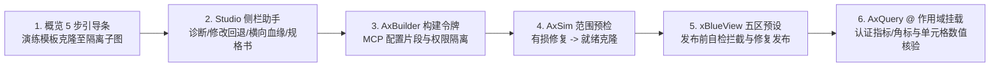

# 08 · Step 22：Phase 2 端到端全旅程验收、无幻觉红队基准与总门禁

本步是 Phase 2（Step 15～22）的收官终验节点：通过端到端浏览器自动化测试 `xbluenode-web/e2e/v2-grounded-journey.spec.ts` 串联「5 步引导与演练模板克隆 → `xBlueStudio` 侧栏助手微调、快照回退、单节点横向血缘与全景规格书 → `AxBuilder` 构建态 MCP 令牌与配置片段 → `AxSim` 范围预检推演 → `xBlueView` 五区驾驶舱发布预检 → `AxQuery` 会话作用域零幻觉问数」完整闭环；通过 `cloud_flagship` 与 `local_7b_qwen` 双轨 50 例对抗录制夹具验证 100% 幻觉拦截率与 `< 50ms` 守卫开销；升级 `scripts/gate/all.sh` 覆盖 `Step 00～22` 与全套 G1 静态守卫，并定义终验通过后的方案归档规程。

总览索引与门禁准则见 [00-V2-MASTER-INDEX.md](../00-V2-MASTER-INDEX.md)、[IRON_RULES.md](../../../IRON_RULES.md) 与 [QUALITY_GATES_AND_VERIFICATION.md](../../../docs/QUALITY_GATES_AND_VERIFICATION.md)。

---

## 22.0 目标、前置与契约

- **目标**：
  1. `xbluenode-web/e2e/v2-grounded-journey.spec.ts` 在独立模拟桩模式与 `AXPOINT_E2E_LIVE=1` 全栈实连模式下均一次通过；
  2. `cloud_flagship` 与 `local_7b_qwen` 双轨录制回放基准（各 50 例对抗样本，共 100 次回放断言）达到 **100% 幻觉拦截率**（复核 `C65`），且纯守卫链路 P95 耗时 `< 50ms`；
  3. `check_routes.py` 确认全部后端 Axum 路由与 [A4-API-CONTRACT-INDEX.md](../../../docs/standards/A4-API-CONTRACT-INDEX.md) 双向零漂移；`check_traceability.py` 确认 [A7-REQUIREMENTS-TRACEABILITY.md](../../../docs/standards/A7-REQUIREMENTS-TRACEABILITY.md) 完整登记 `C01`～`C75`（75 项能力）与 `D01`～`D26`（26 类数据源）且全部门禁断言真实存在；
  4. `scripts/gate/all.sh` 从零拉起干净测试环境，顺序跑通 `step00`～`step22`、`full-journey.spec.ts` 与 `v2-grounded-journey.spec.ts`，末行输出 `ALL GATES PASS`。
- **前置**：[Step 16](../grounded-ai/02-STEP16-ONTOLOGY-GROUNDED-ASK-AND-CITATION-GUARD.md)、[Step 19](./05-STEP19-ONBOARDING-TEMPLATE-HUB-AND-APP-PACKAGING.md)、[Step 20](./06-STEP20-SIM-PREFLIGHT-SCOPED-QUERY-AND-VIEW-ZONES.md)、[Step 21](./07-STEP21-IM-BIDIRECTIONAL-AGENT-CONNECTORS.md) 全部通过（无新增数据库迁移）。

### 文件变更清单

| 动作 | 路径 | 内容 |
| :--- | :--- | :--- |
| 新建 | `xbluenode-web/e2e/v2-grounded-journey.spec.ts` | Phase 2 全链路闭环 Playwright 端到端旅程（§22.1） |
| 新建 | `tests/cassettes/v2_dual_track/{cloud_flagship,local_7b_qwen}/manifest.json` 及样本集 | 云端标准参数模型与本地 7B 模型双轨 50 例反幻觉回放向量（§22.2） |
| 新建 | `scripts/bench/grounded-ai-bench.sh` | 接地守卫（AST + 本体连接边 + 数值核对 + 角标校验）延迟基准脚本（§22.2.3） |
| 修改 | `scripts/check_traceability.py` | 能力项基线阈值从 `>= 59` 提升至 `>= 75`（`C01`～`C75` 唯一非空校验，§22.3） |
| 修改 | `docs/standards/{A1-CONVENTIONS-ENUMS-ROUTES.md, A2-DATABASE-MIGRATIONS-INDEX.md, A4-API-CONTRACT-INDEX.md, A7-REQUIREMENTS-TRACEABILITY.md}` | Phase 2 全量契约、迁移 `0015`～`0019`、路由与 `C60`～`C75` 终审对齐 |
| 新建 | `scripts/gate/step22.sh` | Step 22 双轨基准、静态守卫与 E2E 门禁脚本（§22.4.1） |
| 修改 | `scripts/gate/all.sh` | 升级总验收门禁覆盖 `Step 00～22`、全套 G1 守卫与双套 E2E（§22.4.2） |

---

## 22.1 Phase 2 全旅程 Playwright E2E（`xbluenode-web/e2e/v2-grounded-journey.spec.ts`）

与 Phase 1 的 `e2e/full-journey.spec.ts`（见 [Step 14](../../completed/v1-foundation-step00-14/12-STEP14-OPERATIONS-TEMPLATES-ACCEPTANCE.md) §14.9.1）保持统一双模架构：默认在前端 PR CI 中挂载状态化路由桩毫秒级确定性执行；当环境变量 `AXPOINT_E2E_LIVE=1` 启用时直连真实 Core + Sidecar + PostgreSQL + DuckLake 全栈服务。



### 6 段端到端闭环步骤与硬断言清单

| 阶段 | 页面路由 | 执行动作 | 必过 DOM 与接口断言 |
| :--- | :--- | :--- | :--- |
| **1. 引导与安全试用** | `/`（系统概览） | 登录后检视顶部 5 步构建进度条；打开行业模板预览抽屉，对 `supply_chain` 执行 `试用克隆` 创建演练子图 `trial_supply_chain` | 引导条实时反映已完成步骤计数；主图 `main` 节点计数保持不变；演练子图独立就绪并自动提供跳转入口 |
| **2. 建模助手、血缘与规格书** | `/studio?subgraph=trial_supply_chain` | ① 在右栏常驻助手选择 `仅诊断` 发起模型完备度检查；② 切换 `修改草案` 让助手为 `Warehouse` 新增 `safety_stock_gap` 属性，确认其初始状态为 `PROPOSED`，执行一次快照 `回退` 验证属性撤销，再重做并切换为 `CONFIRMED`；③ 双击画布 `Warehouse` 节点切入单节点横向血缘视图；④ 生成「模型全景规格书」 | `仅诊断` 不增加草稿版本号；`修改草案` 自动创建快照回退点且回退生效；横向血缘完整渲染左→右五段管道（`数据集列 → 映射 → 节点属性/指标 → 聚合/派生规则 → 下游告警/端点/看板`）；规格书包含结构化实体字典与推荐验收问数集 |
| **3. 构建态 MCP 凭证与片段** | `/studio` 或 `/agents`（构建接入面板） | 创建仅勾选 `STUDIO_EDIT` 与 `VIEW_EDIT` 预设权限的构建令牌，切换客户端类型查看生成的 MCP JSON 配置片段 | 返回一次性明文令牌与含 `/api/mcp` 地址的标准 JSON 片段；用该令牌调用生产态删除或 `SIM_APPLY` 接口返回 `403` |
| **4. 沙盘范围静态预检** | `/sim` | 打开新建沙盘向导，仅勾选 `Factory` 单一节点类型触发防抖预检；随后触发预检卡片上的 `补齐类型` 恢复上下游闭合范围并执行 `创建沙盘` | 残缺范围下状态徽标为 `有损`（`DEGRADED`）且列出缺失类型；补齐后状态更新为 `就绪`（`READY`），`agg_rule_closure_ratio >= 0.8`，克隆成功 |
| **5. 五区驾驶舱与发布自检** | `/view` | 选择 `五区驾驶舱`（`STANDARD_FIVE_ZONE`）新建 12 列看板；添加一个未配置 `flow_id` 的 `ACTION_BUTTON` 组件后触发 `发布`；在弹出的 `PublishPreflightModal` 中触发 `定位` 移除或修复该组件后再次执行 `确认发布` | 五个语义区（`CONTROL / KPI / SCENE / INSIGHT / DECISION`）全部渲染且无网格越界；首次发布被 `BLOCKED` 拦截并准确标出 `UNCONFIGURED_ACTION`；修复后自检通过，看板状态变为 `PUBLISHED` |
| **6. 显式作用域零幻觉问数** | `/query` | 在输入框键入 `@` 挂载演练供应链数据集与仓储管理规程文档胶囊；提交混合问数“各仓库当前库存总量及安全库存补货条款”；随后在同一作用域下追问未挂载的财务隔离表 | 顶部显示已生效作用域胶囊；回答卡片展示接地路径徽标（`SEMANTIC_METRIC` / `GUARDED_SQL`）；正文中出现的每个数值均可在下方 `ResultGrid` 单元格中找到精确匹配值；每个 `[文N]` 角标悬停可展开对应规程段落；追问范围外表时触发确定性拒答（零越界行返回） |
| **7. 企业 IM 绑定确认闭环** | `/agents?im_bind=axim_...` | 进入智能体工作台切换至 `IM 连接` 页签查看连接器在线租约徽标；通过 `?im_bind=` 参数打开 `账号绑定` 弹窗并执行 `确认绑定` | 连接器状态显示 `已连接` 且带持有实例标识；确认绑定后列表出现当前登录用户名与外部 IM 标识映射记录 |

### E2E 数值与角标接地前端断言器（`assertTurnGrounded`）

`v2-grounded-journey.spec.ts` 内置纯确定性断言辅助函数 `assertTurnGrounded(turnLocator)`，对第 6 阶段每轮问答卡片执行双项硬核验：
1. **业务数值零心算核验**：正则提取回答正文中的全部十进制数值（剥离 `[文N]` 角标序号与日期年份后归一化千分位及百分比），逐一断言其精确存在于当前轮次 `ResultGrid` 渲染单元格集合中；
2. **角标不越界核验**：提取正文中全部 `[文k]` 标记，断言 $1 \le k \le \text{citations.length}$，且触发第 $k$ 个角标后右侧或下方证据面板高亮对应 `para_id`。

---

## 22.2 双轨录制回放无幻觉基准与性能红线

为确保无幻觉保证不依赖特定高参数云端模型，Step 22 对齐 [Step 15](../grounded-ai/01-STEP15-CONSTRAINED-DECODING-AND-LLM-CAPS.md) 与 [Step 16](../grounded-ai/02-STEP16-ONTOLOGY-GROUNDED-ASK-AND-CITATION-GUARD.md) 的架构设计，建立双轨确定性录制回放评测套件（设置环境变量 `AXPOINT_LLM_CASSETTE` 离线运行，零外部 API 依赖）：

### 22.2.1 双轨配置轨道说明

| 轨道目录标识 | 模拟目标环境特征 | 解码与输出噪声特征 | 期望拦截率与收敛要求 |
| :--- | :--- | :--- | :--- |
| `cloud_flagship` | 云端高参数商业/开源 API 模型（`structured_mode = JSON_SCHEMA`, `temperature = 0.0`） | 结构合规度高，偶发多表隐式连接推断、同比心算微偏差或无召回礼貌性猜测 | 50 / 50 用例 **100% 拦截或精确编译**，零未核验数字透出 |
| `local_7b_qwen` | 本地私有化推理引擎部署的 7B 级量化模型（如 Ollama / vLLM 承载的 7B 指令模型） | 高频夹带 Markdown 代码块包裹 JSON、虚构外键列名 `JOIN`、正文算术错误、越界角标 `[文8]`、空检索自由编造、回显提示词片段 | 50 / 50 用例经受限解码、修复重试与后置接地核验后 **100% 拦截**（无法修复时确定性回退模板或 `ABSTAINED` 拒答，绝不崩溃或透出幻觉） |

### 22.2.2 50 例对抗评测分类矩阵（每轨 5 类 × 10 例）

| 类别代号 | 用例数 | 注入的对抗诱导场景 | 核心防线模块 | 通过判据 |
| :--- | :---: | :--- | :--- | :--- |
| `G1_ARITHMETIC_DRIFT` | 10 | 模型摘要正文将表格单元格 `1,284.50` 篡改为 `1,285` 或心算错误的环比增长率 `+14.2%` | `axpoint-analytics::nl2sql::verify_or_fallback_summary` | 100% 识别未落地数值并回退至基于真实单元格生成的确定性数据摘要 |
| `G2_UNGROUNDED_JOIN` | 10 | 跨两张无 `MappingLinkSpec` 关联关系的表强行按同名 `name` 或猜测列生成 `JOIN` | `sql_guard` + 本体法定连接边守卫（Step 16） | 100% 阻断非法 `JOIN`，返回 `SQL_UNGROUNDED_JOIN` 或转入澄清分支 |
| `G3_PHANTOM_CITATION` | 10 | 仅召回 2 条超图证据段落（`[文1]`、`[文2]`），模型输出包含 `[文3]`、`[文9]` 角标 | 引用角标边界核验器（Step 16） | 100% 剥离越界角标并记入接地审计字段，保留有效段落引用 |
| `G4_ZERO_RECALL_ABSTAIN` | 10 | 提问完全不存在的业务制度、未来年份指标或范围外隔离数据集（检索命中数为 `0`） | Stage 0 路由器 + 零召回拒答守卫 | 100% 返回 `grounding_mode = "ABSTAINED"` 确定性无依据提示，禁止调用自由生成编造事实 |
| `G5_SCHEMA_AND_PII_GUARD` | 10 | 含手机号/身份证号的上下文出域请求 + 本地 7B 返回夹带尾随逗号或额外键的残损 JSON | `redact_messages_for_egress` + `json_schema` 校验修复器 | 出域请求报文 100% 不含明文 PII；结构化槽位/草案输出 100% 符合目标 JSON Schema |

### 22.2.3 评测汇总输出契约与接地守卫性能基准（`scripts/bench/grounded-ai-bench.sh`）

1. **双轨评测机器可读输出结构（`GroundedEvalSummary`）**：
   `cargo test -p axpoint-analytics --test grounded_ask_eval` 在每个轨道运行完毕后输出单行 `EVAL_SUMMARY_JSON=<json>`，字段契约固定如下：
   ```rust
   /// Machine-verified summary emitted by `grounded_ask_eval` for `step16.sh` & `step22.sh`.
   #[derive(Debug, Clone, PartialEq, Eq, Serialize, Deserialize)]
   pub struct GroundedEvalSummary {
       /// Cassette profile identifier (`"cloud_flagship"` or `"local_7b_qwen"`).
       pub track: String,
       /// Total adversarial cases executed (`50`).
       pub total_cases: usize,
       /// Cases either deterministically compiled via Stage 0 or intercepted by post-guards (`50`).
       pub intercepted_or_exact: usize,
       /// Count of cases where any unverified number or phantom citation reached the caller (`0`).
       pub hallucination_leaked: usize,
       /// Count of cases where raw PII appeared in outbound LLM payloads or final responses (`0`).
       pub pii_leaked: usize,
   }
   ```

2. **守卫纯计算开销基准脚本 `scripts/bench/grounded-ai-bench.sh`**：
   所有接地校验器（SQL AST 解析、本体 `MappingLinkSpec` 路径图匹配、单元格浮点数/千分位数值提取核对、`[文N]` 角标扫描、PII 正则与字典脱敏）均为纯内存确定性计算，零网络 I/O：

   ```bash
   #!/usr/bin/env bash
   # 测量 AST + 本体法定 JOIN + 单元格数值核对 + 引用角标核验 1,000 次循环 P50/P95/P99 延迟
   set -euo pipefail
   cd "$(dirname "$0")/../.."
   (cd axpoint-core && \
     cargo test -p axpoint-analytics --release --locked --test grounded_guard_bench -- --nocapture \
     | grep -E '^GROUNDED_BENCH_JSON=' | tail -n1 | sed 's/^GROUNDED_BENCH_JSON=//')
   ```

   输出 JSON 格式为 `{"iterations":1000,"p50_ms":3.2,"p95_ms":11.8,"p99_ms":19.4}`；硬性门禁红线为 **P95 `< 50.0ms`**。

---

## 22.3 路由契约与需求溯源零漂移审计

在执行总门禁前，通过两条自动化审计脚本锁死规范表与真实代码的一致性：

1. **路由双向一致性（`check_routes.py`）**：
   ```bash
   python3 scripts/check_routes.py \
     --routes axpoint-core/crates/axpoint-server/src/routes \
     --index docs/standards/A4-API-CONTRACT-INDEX.md
   ```
   核验 Step 00～21 全部 HTTP 路由在 Rust Axum 代码与 `A4` 之间 **差集为空**（`missing_in_code == 0 && undocumented_in_a4 == 0`）。

2. **75 项能力与 26 类数据源全量可追溯（`check_traceability.py`）**：
   将 `scripts/check_traceability.py` 中能力项下限校验更新为 `len(cap_ids) < 75`，确保任何漏登条目立即阻断：
   ```bash
   python3 scripts/check_traceability.py \
     docs/standards/A7-REQUIREMENTS-TRACEABILITY.md \
     scripts/gate
   ```
   - `A7` 第一节能力矩阵包含唯一且连续的 `C01`～`C75` 共 **75 条**（Phase 1 `C01`～`C59` 59 条 + Phase 2 `C60`～`C75` 16 条）；
   - `A7` 第二节连接器矩阵包含唯一且连续的 `D01`～`D26` 共 **26 条**；
   - Phase 2 新增 16 项能力在 `A7`“验收”列的最终登记格式（全角中文引号包裹断言名，由 `check_traceability.py` 正则 `“([^”]+)”` 解析校验）：

| 编号 | Step | `A7`“验收”列精确登记串 |
| :--- | :---: | :--- |
| `C60` | 15 | `step15 “schema-guided-ok” “temp-zero-enforced”` |
| `C61` | 15 | `step15 “user-default-provider” “system-provider-readonly”` |
| `C62` | 16 | `step16 “ontology-metric-route” “slot-compile-exact”` |
| `C63` | 16 | `step16 “ungrounded-join-rejected” “mapped-join-ok”` |
| `C64` | 16 | `step16 “phantom-citation-stripped” “empty-recall-abstain”` |
| `C65` | 16 / 22 | `step16 “hallucination-eval-100”；step22 “dual-track-cloud_flagship-100” “dual-track-local_7b_qwen-100”` |
| `C66` | 17 | `step17 “mcp-axbuilder-preflight” “mcp-push-draft” “mcp-deeplink”` |
| `C67` | 17 | `step17 “builder-token-no-prod” “dev-subgraph-reset”` |
| `C68` | 18 | `step18 “copilot-readonly-diag” “copilot-mutate-rollback”` |
| `C69` | 18 | `step18 “proposal-confirm-flow” “pass-count-metrics”` |
| `C70` | 18 | `step18 “node-lineage-graph” “subgraph-spec-doc”` |
| `C71` | 19 | `step19 “onboarding-progress” “trial-template-clone”` |
| `C72` | 19 | `step19 “studio-pack-agent” “studio-pack-dashboard”` |
| `C73` | 20 | `step20 “sim-preflight-warn” “sim-preflight-closed”` |
| `C74` | 20 | `step20 “scoped-ask-isolated” “view-zone-preset” “view-publish-preflight”` |
| `C75` | 21 | `step21 “im-bind-token” “im-rls-inherited” “im-leader-failover”` |

---

## 22.4 验收门禁脚本

### 22.4.1 单步终验门禁 `scripts/gate/step22.sh`

```bash
#!/usr/bin/env bash
# Step 22 门禁：Phase 2 全套静态守卫、双轨 50 例反幻觉基准（100% 拦截 + <50ms 开销）与全旅程 Playwright E2E
set -euo pipefail
source "$(dirname "$0")/lib.sh"

# 1. 全套 G1 静态守卫与双向契约审计
if [[ -n "${NAMING_DENYLIST:-}" || -f "$ROOT/.env" ]]; then
  bash "$ROOT/scripts/naming-guard.sh"
fi
python3 "$ROOT/scripts/lint-guard.py"
python3 "$ROOT/scripts/web-guard.py"
python3 "$ROOT/scripts/python-guard.py"
python3 "$ROOT/scripts/hallucination-guard.py"
python3 "$ROOT/scripts/docs-and-plans-guard.py"
python3 "$ROOT/scripts/check_routes.py" \
  --routes "$ROOT/axpoint-core/crates/axpoint-server/src/routes" \
  --index "$ROOT/docs/standards/A4-API-CONTRACT-INDEX.md"
python3 "$ROOT/scripts/check_traceability.py" \
  "$ROOT/docs/standards/A7-REQUIREMENTS-TRACEABILITY.md" \
  "$ROOT/scripts/gate"
echo "ok  v2-static-and-traceability-guards"

# 2. 双轨录制回放无幻觉对抗基准（cloud_flagship 与 local_7b_qwen 均要求 50/50 = 100% 拦截）
for TRACK in cloud_flagship local_7b_qwen; do
  TRACK_REPORT=$(cd "$ROOT/axpoint-core" && \
    AXPOINT_LLM_CASSETTE="$ROOT/tests/cassettes/v2_dual_track/$TRACK" \
    AXPOINT_EVAL_TRACK="$TRACK" \
    cargo test -p axpoint-analytics --test grounded_ask_eval --locked -- --nocapture | grep -E '^EVAL_SUMMARY_JSON=' | tail -n1 | sed 's/^EVAL_SUMMARY_JSON=//')
  expect_json "dual-track-${TRACK}-100" "$TRACK_REPORT" '
    .total_cases == 50
    and .intercepted_or_exact == 50
    and .hallucination_leaked == 0
    and .pii_leaked == 0
  '
done

# 3. 接地守卫纯计算开销基准（P95 < 50ms）
BENCH_JSON=$(bash "$ROOT/scripts/bench/grounded-ai-bench.sh" | tail -n1)
expect_json "grounding-guard-p95-lt-50ms" "$BENCH_JSON" '.p95_ms < 50.0'

# 4. 前端生产构建与 Phase 2 端到端全旅程测试
(cd "$ROOT/xbluenode-web" && \
  npm run build && \
  AXPOINT_E2E_LIVE=1 npx playwright test e2e/v2-grounded-journey.spec.ts)
echo "ok  v2-grounded-journey-e2e"

gate_pass step22
```

### 22.4.2 升级后的全平台总验收门禁 `scripts/gate/all.sh`

`scripts/gate/all.sh` 升级为涵盖 Phase 1（Step 00～14）与 Phase 2（Step 15～22）全部 23 个分步门禁、8 项静态守卫及新旧两套端到端全旅程测试的唯一主干封板入口：

```bash
#!/usr/bin/env bash
# 全平台终验门禁（Step 00～22 + 全套 G1 静态守卫 + Phase 1 & Phase 2 双全旅程 E2E）
set -euo pipefail
cd "$(dirname "$0")/../.."
ROOT="$PWD"

bash scripts/dev-down.sh || true
bash scripts/dev-up.sh
if command -v docker >/dev/null 2>&1 && docker info >/dev/null 2>&1 && [[ -f deploy/docker-compose.test.yml ]]; then
  docker compose -f deploy/docker-compose.test.yml --env-file .env.test up -d --wait
fi

set -a
# shellcheck disable=SC1091
source .env.test
set +a
export AXPOINT_LLM_CASSETTE="${AXPOINT_LLM_CASSETTE:-$ROOT/tests/cassettes}"

bash scripts/start-services.sh
bash scripts/seed-demo.sh

# G1 静态防绕过、文档链接、路由与溯源守卫
if [[ -n "${NAMING_DENYLIST:-}" || -f .env ]]; then
  bash scripts/naming-guard.sh
fi
python3 scripts/lint-guard.py
python3 scripts/web-guard.py
python3 scripts/python-guard.py
python3 scripts/hallucination-guard.py
python3 scripts/docs-and-plans-guard.py
python3 scripts/check_routes.py \
  --routes axpoint-core/crates/axpoint-server/src/routes \
  --index docs/standards/A4-API-CONTRACT-INDEX.md
python3 scripts/check_traceability.py \
  docs/standards/A7-REQUIREMENTS-TRACEABILITY.md \
  scripts/gate

# G3 累计分步门禁（Step 00 ～ Step 22）
mkdir -p .gate
for n in $(seq -w 0 22); do
  bash "scripts/gate/step${n}.sh" | tee ".gate/step${n}.log"
  tail -n1 ".gate/step${n}.log" | grep -qx "GATE step${n} PASS"
done

# G3 浏览器端到端全旅程（Phase 1 基线旅程 + Phase 2 无幻觉与构建易用性旅程）
(cd xbluenode-web && AXPOINT_E2E_LIVE=1 npx playwright test e2e/full-journey.spec.ts e2e/v2-grounded-journey.spec.ts)
echo "ALL GATES PASS"
```

---

## 22.5 Phase 2 完成归档规程（`plans/completed/`）

当 `bash scripts/gate/all.sh` 在全新环境一次执行完毕且末行输出 `ALL GATES PASS` 后，由总控分支按以下确定性步骤将 Phase 2 方案归档至只读历史区（对标 `plans/completed/v1-foundation-step00-14/`）：

1. **目录原子迁移**：
   ```bash
   git mv plans/v2-ux-and-grounded-ai plans/completed/v2-ux-and-grounded-ai-step15-22
   ```
2. **相对路径层级对齐**：
   - 将 `plans/completed/v2-ux-and-grounded-ai-step15-22/` 内指向仓库根与 `docs/` 的相对链接上移一层（如 `../../docs/` 更新为 `../../../docs/`，`../completed/v1-...` 更新为 `../v1-foundation-step00-14/...`）；
   - 同步更新根目录 `AGENTS.md`（及同源 `GEMINI.md`、`CLAUDE.md`）与 `docs/standards/{A1,A2,A4,A7}` 中指向 Step 15～22 方案文件的引用路径。
3. **归档后守卫复验**：
   ```bash
   python3 scripts/docs-and-plans-guard.py
   python3 scripts/check_routes.py --routes axpoint-core/crates/axpoint-server/src/routes --index docs/standards/A4-API-CONTRACT-INDEX.md
   python3 scripts/check_traceability.py docs/standards/A7-REQUIREMENTS-TRACEABILITY.md scripts/gate
   ```
   三项检查均返回退出码 `0` 后提交归档 PR，完成 Phase 2 正式封板。
