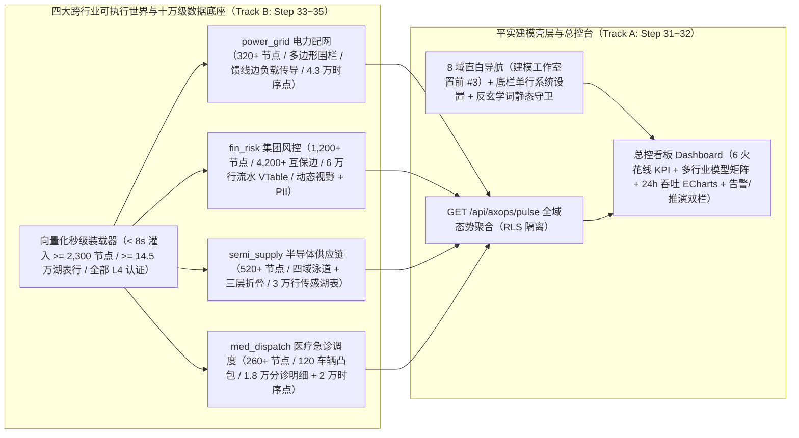
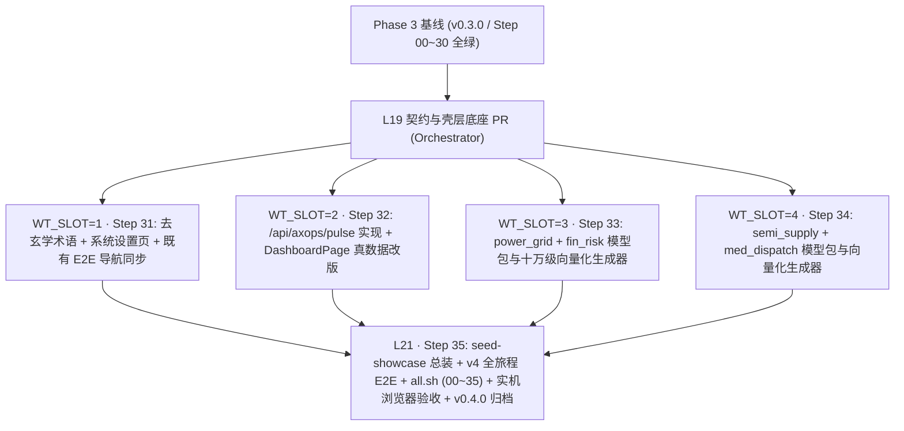

# xBlueNode / AxPoint Phase 4 实施总蓝图：平实建模语言、真数据总控台与四大行业十万级仿真世界（Step 31～35）

本文件是 `plans/v4-modeling-console-and-industry-worlds/` 的**唯一总入口**，承接已完成归档的三期基线：
- **Phase 1**（[Step 00～14](../completed/v1-foundation-step00-14/00-MASTER-INDEX.md)，迁移 `0001`～`0014`，能力项 `C01`～`C59`）
- **Phase 2**（[Step 15～22](../completed/v2-ux-and-grounded-ai-step15-22/00-V2-MASTER-INDEX.md)，迁移 `0015`～`0019`，能力项 `C60`～`C75`）
- **Phase 3**（[Step 23～30](../completed/v3-craft-and-world-runtime-step23-30/00-V3-MASTER-INDEX.md)，迁移 `0020`～`0024`，能力项 `C76`～`C92`，基线版本 `v0.3.0`）

本阶段聚焦三大核心产品工程目标——**专项一：去玄学术语、建模优先导航重排与真数据总控看板（`console-and-ia/`，Step 31～32）**与**专项二：四大跨行业可执行世界模型与十万级向量化仿真数据底座（`industry-worlds/`，Step 33～35）**。全阶段复用已有三容器私有化架构（PostgreSQL 16 + Rust `axpoint-core` + Python `axpoint-parser` Sidecar），**零新增外部中间件、零新增数据库迁移文件**（100% 驱动已有 `xb_*`、时序分区表、DuckLake、`xv_*`、`ax_sim_*` 与 `sec_row_policies` 表结构发挥工业级实效）。

常驻工程约束、三级门禁与多团队/多代理并发规约见：
- [IRON_RULES.md](../../IRON_RULES.md)
- [QUALITY_GATES_AND_VERIFICATION.md](../../docs/QUALITY_GATES_AND_VERIFICATION.md)
- [MULTI_AGENT_TEAM_WORKFLOW.md](../../docs/MULTI_AGENT_TEAM_WORKFLOW.md)
- [A1-CONVENTIONS-ENUMS-ROUTES.md](../../docs/standards/A1-CONVENTIONS-ENUMS-ROUTES.md)

---

## 1. Phase 4 核心演进目标

### 1.1 专项一：平实建模语言、导航重构与真数据总控看板（`console-and-ia/`，Step 31～32）

1. **去玄学术语与建模核心工作流导航重构（Step 31）**：
   - **界面与文档全面去玄学术语**：清除用户界面可见文案、徽章、权限名称、AI 向导默认标题及对外文档中的学术黑话（`本体 / Ontology`），统一使用直白准确的工程建模语言（`业务模型 / Business Model`、`建模工作室 / Modeling Studio`、`业务对象 / Domain Object`、`模型草案 / Model Draft`、`拓扑摘要 / Topology Summary`）；`⌘K` 搜索面板仅在隐藏索引词中保留别名兼容，并在 `scripts/web-guard.py` 增加反玄学词界面守卫；
   - **侧栏按建模闭环重排**：将主侧栏重排为 8 个直白工作区：`总控看板`（`/`）→ `数据与知识`（`/hub`）→ **`建模工作室`（`/studio`，提至第 3 位核心入口）** → `查询与制图`（`/analytics`）→ `推演沙盘`（`/sim`）→ `编排与告警`（`/flow`）→ `数字看板`（`/view`）→ `智能体与接口`（`/agents`）；
   - **消除底栏单元素折叠套娃**：移除侧栏底部重复的「系统治理 ⌄ → 系统治理」折叠夹，改为固定单行入口 **`系统设置`（`Settings`，主路由 `/settings`，无感兼容 `/governance`、`/guard`、`/ops`）**。
2. **全域运行脉冲接口与真数据总控看板改版（Step 32）**：
   - 在 `axpoint-server` 新增单次往返聚合接口 `GET /api/axops/pulse`（受 `AuthPrincipal` 与 PostgreSQL RLS 严格隔离），毫秒级返回当前租户的全域业务规模（子图数、对象类型数、业务节点数、关系边数、湖表数据集数与总行数、近 24h 时序指标写入点、常驻流数）、24h 分时吞吐序列、各业务子图健康矩阵（`L0`～`L4` 认证等级、节点/边体量、异常越界节点数、关联看板与沙盘深链）、活跃告警、待批动作与近期沙盘 `deadline_step` 预警；
   - 全面重写 `DashboardPage.tsx`（`总控看板`）：移除静态检索算法说明卡片，上线 **6 张带实时火花线的核心态势卡 + 多行业业务模型工作台矩阵 + 24h 时序吞吐与异常分布 ECharts 图表 + 实时告警/待批动作与沙盘红线预警双栏工作区**；冷启动 5 步向导条在租户已有业务节点与数据集时自动收起。

### 1.2 专项二：四大跨行业可执行模型与十万级向量化仿真数据（`industry-worlds/`，Step 33～35）

1. **电力配网调度与集团授信互保风控双行业世界（Step 33）**：
   - **`power_grid`（新型电力与配网调度，320+ 节点 / 540+ 边 / 43,200 时序点）**：构建发电场站、220kV/110kV 变电站（含真实经纬度与供电区多边形围栏 `geo_shape`）、10kV 台区配变、重点负荷用户（三甲医院/晶圆厂）、倒闸跳闸事件与供电分区汇总块；在输配电馈线边上挂载实时负载率与电流时序指标，配置 `V→E / E→V` 过载传导规则、`切非核心负荷 / 投储能放电` `ActionSpec`、主变跳闸 `deadline_step` 推演方案及五区配网看板；
   - **`fin_risk`（集团授信与担保链风控，1,200+ 节点 / 4,200+ 边 / 60,000 行对公流水湖表）**：构建集团母公司、关联法人、实际控制人（含手机号、身份证号、银行卡号三道强制 PII 脱敏列）、授信合同与行业敞口汇总；边涵盖 `控股`、`交叉互保`（携带担保额与违约传染规则）与 `大额资金划转`；60,000 行 DuckLake 流水直接驱动 `@visactor/react-vtable` 多维透视数据条与热力色阶；预置状态驱动动态行级视野策略（逾期率越界自动向风控部门开放整条互保链）与图算法社区识别看板。
2. **半导体全球多级供应链与城市急诊床位调度双行业世界（Step 34）**：
   - **`semi_supply`（半导体全球多级供应链，520+ 节点 / 1,300+ 边 / 30,000 行批次与传感湖表）**：覆盖 `采购域`（特种气体/硅片商）、`制造域`（晶圆厂与光刻/刻蚀机台 OEE/良率）、`物流域`（清关口岸与区域分拨仓）、`履约域`（车企大单）四大业务域复合泳道，内嵌晶圆批次动态事件与良率汇总立方三层折叠结构，配套航空加急包机与安全晶圆调拨 `ActionSpec` 及供应链看板；
   - **`med_dispatch`（城市急诊与医疗床位调度，260+ 节点 / 480+ 边 / 18,000 行分诊湖表 + 20,000 时序点）**：建模院区、急诊/重症临床科室、生命支持设备（ECMO/呼吸机）、120 急救车（多点空间分布支撑 `convex_hull` 覆盖包络与球面距离查询）、急诊分诊接诊事件与床位周转汇总，配套救护车改派与应急加床 `ActionSpec` 及急诊调度看板。
3. **十万级秒级向量化装载引擎、全栈 E2E 与 `v0.4.0` 验收归档（Step 35）**：
   - 交付幂等向量化装载器 `scripts/seed-showcase.sh` 与受 `OPS_ADMIN` 管控的 `POST /api/axops/demo/showcase/load`，采用 DuckDB 原生向量化表生成与 PostgreSQL `UNNEST` 批量写入，在 **`< 8s`** 内完成四大行业子图 **>= 2,300 业务节点、>= 6,500 关系边、>= 145,000 湖表明细行、>= 80,000 时序指标点**灌装，且全部 4 套行业子图通过 `/certify` 达成 **`L4_CERTIFIED`**（保持 `scripts/seed-demo.sh` 轻量快速，不拖慢单测门禁）；
   - 落地 `xbluenode-web/e2e/v4-modeling-and-worlds.spec.ts`、`scripts/gate/step35.sh`，将 [A7-REQUIREMENTS-TRACEABILITY.md](../../docs/standards/A7-REQUIREMENTS-TRACEABILITY.md) 能力追踪扩充至 **`C01`～`C98`（98 项）**，跑通 `bash scripts/gate/all.sh`（`Step 00～35` 全绿）与 Chrome DevTools 实机浏览器巡检后归档发布 `v0.4.0`。

---

## 2. 目标架构与数据流全景图

---

## 3. 步骤总表与文件索引（Step 31～35）

| Step | 名称 | 方案文件 | 迁移文件 | 涉及 Crate / 目录 | 前置 Step | 负责分队 |
| :--- | :--- | :--- | :--- | :--- | :--- | :--- |
| **31** | 平实建模语言规范、建模优先导航重排与单行系统设置重构 | [01-STEP31](./console-and-ia/01-STEP31-PLAIN-MODELING-TERMINOLOGY-AND-SHELL-REFORGE.md) | 无 | `docs/standards/A1`、`scripts/web-guard.py`、`xbluenode-web`、`README.md` | 30 | `orchestrator` + `squad-web` + `squad-qa` |
| **32** | 全域运行脉冲接口（`/api/axops/pulse`）与真数据总控看板改版 | [02-STEP32](./console-and-ia/02-STEP32-LIVE-OPERATIONAL-DASHBOARD-AND-PULSE-API.md) | 无 | `axpoint-domain`、`axpoint-db`、`axpoint-server`、`xbluenode-web` | 30 | `squad-domain-agent` + `squad-web` + `squad-qa` |
| **33** | 新型电力配网调度（`power_grid`）与集团授信互保风控（`fin_risk`）行业世界 | [03-STEP33](./industry-worlds/03-STEP33-POWER-GRID-AND-FIN-RISK-WORLDS.md) | 无 | `templates/packs/`、`axpoint-parser/scripts/`、`scripts/seed/showcase/` | 30 | `squad-domain-agent` + `squad-data` + `squad-qa` |
| **34** | 半导体全球供应链（`semi_supply`）与城市急诊床位调度（`med_dispatch`）行业世界 | [04-STEP34](./industry-worlds/04-STEP34-SEMI-SUPPLY-AND-MED-DISPATCH-WORLDS.md) | 无 | `templates/packs/`、`axpoint-parser/scripts/`、`scripts/seed/showcase/` | 30 | `squad-domain-agent` + `squad-data` + `squad-qa` |
| **35** | 十万级秒级向量化装载器、Phase 4 全旅程 E2E、实机巡检与 `v0.4.0` 归档 | [05-STEP35](./industry-worlds/05-STEP35-SHOWCASE-VECTOR-SEEDER-E2E-AND-ACCEPTANCE.md) | 无 | `axpoint-server/src/ops/`、`scripts/seed-showcase.sh`、`scripts/gate/`、`xbluenode-web/e2e` | 31、32、33、34 | `squad-domain-agent` + `squad-qa` + `orchestrator` |

---

## 4. 三层推进拓扑与四路 Worktree Subagent 并行排期（L19～L21）

按 [MULTI_AGENT_TEAM_WORKFLOW.md](../../docs/MULTI_AGENT_TEAM_WORKFLOW.md) 规范，**L20 四条轨道物理写入集合完全互不相交**，通过 4 个独立 `git worktree` 与 `.50` 远程测试机 4 套隔离槽位（`WT_SLOT=1..4`）并行编码与独立审查：

| 阶段层 | 分支 / Worktree | 槽位与数据库 | 派发角色（`check-write-scope.sh`） | 独占写入边界（`ALLOWED_PATHS`） | 独立验收官 |
| :--- | :--- | :--- | :--- | :--- | :--- |
| **L19（先行契约 PR）** | `feat/contract-v4-shell-and-pulse` | 主槽编译守卫 | `orchestrator` | `docs/API_CONTRACT.md`、`docs/standards/{A1,A4}`、`axpoint-core/crates/axpoint-domain/src/{ops.rs,ports.rs}`、`xbluenode-web/src/{App.tsx,modules/meta.ts,modules/registry.ts}`、`scripts/web-guard.py` | GitHub Actions 全绿 |
| **L20 并行轨 #1（Step 31）** | `wt-step31-plain-shell` `feat/web-step31-plain-modeling-copy` | `WT_SLOT=1` `xbluenode_wt1` (`:19995`) | `squad-web+squad-qa` | `xbluenode-web/src/{i18n/enums.ts,pages/GovernancePage.tsx,components/analytics/GroundingBadge.tsx,components/dashboard/TemplateHubModal.tsx,components/ui/CommandPalette.tsx,components/xbluestudio/AiDraftWizard.tsx,lib/api/axflow.ts}`、`xbluenode-web/e2e/*.spec.ts`、`scripts/gate/{step23.sh,step31.sh}` | `Step 31 Verifier & RedTeam Subagent` |
| **L20 并行轨 #2（Step 32）** | `wt-step32-live-dashboard` `feat/step32-pulse-and-dashboard` | `WT_SLOT=2` `xbluenode_wt2` (`:29995`) | `squad-domain-agent+squad-web+squad-qa` | `axpoint-core/crates/axpoint-db/src/ops_repo/`、`axpoint-core/crates/axpoint-server/src/routes/axops.rs`、`axpoint-core/crates/axpoint-server/tests/step32_pulse_api.rs`、`xbluenode-web/src/{lib/api/axops.ts,pages/DashboardPage.tsx,components/dashboard/PulseCharts.tsx,components/dashboard/SubgraphMatrixGrid.tsx}`、`xbluenode-web/e2e/step32-live-dashboard.spec.ts`、`scripts/gate/step32.sh` | `Step 32 Verifier & RedTeam Subagent` |
| **L20 并行轨 #3（Step 33）** | `wt-step33-grid-fin-worlds` `feat/step33-power-grid-and-fin-risk` | `WT_SLOT=3` `xbluenode_wt3` (`:39995`) | `squad-data+squad-domain-agent+squad-qa` | `templates/packs/{power_grid,fin_risk}/`、`axpoint-parser/scripts/gen_worlds_grid_fin.py`、`scripts/seed/showcase/{power_grid.sh,fin_risk.sh}`、`scripts/gate/step33.sh` | `Step 33 Verifier & RedTeam Subagent` |
| **L20 并行轨 #4（Step 34）** | `wt-step34-semi-med-worlds` `feat/step34-semi-supply-and-med-dispatch` | `WT_SLOT=4` `xbluenode_wt4` (`:49995`) | `squad-data+squad-domain-agent+squad-qa` | `templates/packs/{semi_supply,med_dispatch}/`、`axpoint-parser/scripts/gen_worlds_semi_med.py`、`scripts/seed/showcase/{semi_supply.sh,med_dispatch.sh}`、`scripts/gate/step34.sh` | `Step 34 Verifier & RedTeam Subagent` |
| **L21（总装终验与归档）** | `wt-step35-showcase-e2e` `feat/step35-showcase-and-acceptance` | 主门禁槽 `xbluenode` (`:9995`) | `squad-domain-agent+squad-qa` + `orchestrator` | `axpoint-core/crates/axpoint-server/src/ops/`、`scripts/seed-showcase.sh`、`xbluenode-web/e2e/v4-modeling-and-worlds.spec.ts`、`scripts/gate/{step35.sh,all.sh}`、`docs/standards/A7-REQUIREMENTS-TRACEABILITY.md`、`scripts/check_traceability.py` | `Step 35 Verifier & RedTeam` + 实机 Chrome DevTools |

> **写入锁精确预检**：L19 契约 PR 中，`orchestrator` 需同步更新 `scripts/check-write-scope.sh` 的 `squad-domain-agent` 测试白名单正则（将 `step2[5689]_[a-z0-9_]+\.rs` 扩充为 `step(2[5689]|3[1-5])_[a-z0-9_]+\.rs`），确保 L20 各分队集成测试文件合法落盘并自测通过。

---

## 5. 新增能力追踪映射（`C93`～`C98`，随各 Step 门禁脚本落盘同步写入 `A7`）

| 编号 | 所属域 | 能力项 | 负责 Step | 目标门禁断言（`stepNN.sh`） |
| :--- | :--- | :--- | :--- | :--- |
| `C93` | G 系统 | 全站平实业务建模语言（界面零玄学术语）、建模工作室置前导航与单行系统设置入口 | 31 | `step31` `"ui-zero-ontology-jargon"`、`"nav-modeling-promoted"`、`"settings-flat-entry"` |
| `C94` | F / G | 全域运行态势脉冲接口（`/api/axops/pulse`）与真数据多行业矩阵总控看板 | 32 | `step32` `"pulse-rls-isolated"`、`"dashboard-live-pulse"`、`"dashboard-subgraph-matrix"` |
| `C95` | B / E / F | 新型电力与配网调度世界模型（320+ 节点、多边形供电围栏、馈线边负载四路径传导、4 万+ 时序点与跳闸 `deadline_step` 沙盘） | 33 | `step33` `"power-grid-l4-certified"`、`"power-grid-feeder-deadline"` |
| `C96` | A / D / G | 集团授信与互保风控世界模型（1,200+ 节点、4,200+ 互保边、6 万行对公流水 VTable 透视、三道 PII 脱敏与逾期状态动态视野） | 33 | `step33` `"fin-risk-60k-lake-rows"`、`"fin-risk-pii-and-dynamic-rls"` |
| `C97` | B / C / F | 半导体全球供应链（四域复合泳道 + 三层折叠 + 3 万行批次传感）与城市急诊床位调度（120 车辆轨迹凸包 + 急诊看板）双行业世界 | 34 | `step34` `"semi-supply-l4-and-swimlanes"`、`"med-dispatch-convex-hull-and-l4"` |
| `C98` | G 质量 | 十万级多行业秒级向量化装载器（`< 8s`）、Phase 4 全旅程端到端验收与 98 项能力溯源总门禁 | 35 | `step35` `"showcase-145k-seeded-fast"`、`"v4-journey-pass"`、`"traceability-98-ok"` |

---

## 6. 标准 Subagent 并行派发规程与红队审查清单

### 6.1 `Author Subagent` 强约束指令（L20 四路通用）
1. **真实数据铁律**：严禁在前端页面、组件或看板中硬编码任何静态伪造业务数组；所有数字、趋势曲线、VTable 透视行、图谱拓扑与沙盘结果必须 100% 由后端 PostgreSQL / DuckLake / 时序分区表真实查询产出。
2. **命名与文案铁律**：100% 遵守自主命名词表（`naming-guard.sh` 零告警）；全部 UI 控件遵循 2～4 汉字 / 1～2 英文词极简动词规范（`clean-craft` `lint_copy.py` 零告警），禁止在用户可见文案出现 `本体` 或 `Ontology`。
3. **跨栈零绕过铁律**：Rust 零 `unsafe` / `#[allow]` / `unwrap` / `expect` / `as` / `[]` / `let _ =`；Python `mypy --strict` + `ruff` + 参数化 SQL；TypeScript `strict: true` 零 `any` / 零原生 `<select>`。
4. **资源共享铁律**：在 `.50` 远程主机 Worktree 中复用 `CARGO_TARGET_DIR=/home/xblue/workspace/xBlueNode/axpoint-core/target`，测试严格绑定各自 `WT_SLOT=1..4` 独立库与端口。

### 6.2 `Verifier & RedTeam Subagent` 独立验收清单
1. 运行 `bash scripts/check-write-scope.sh <role> origin/main...HEAD` 确认零越界修改；
2. 构造跨租户 `other` 令牌请求 `/api/axops/pulse` 与新增行业看板/子图，验证 100% 隔离（`0` 数据泄露或 `404`）；
3. 对 `fin_risk` 实控人敏感列执行无 `PII_RAW_READ` 权限的 SQL、问数与导出请求，验证手机号、身份证号、银行卡号掩码率 **100%**；
4. 对 `power_grid`、`fin_risk`、`semi_supply`、`med_dispatch` 四个子图逐一调用 `POST /api/xblue/subgraphs/{slug}/certify`，验证全部返回 `cert_level == "L4_CERTIFIED"` 且 `dead_knowledge_cnt == 0`；
5. 跑通对应 `bash scripts/gate/step3N.sh` 输出 `GATE step3N PASS`。
